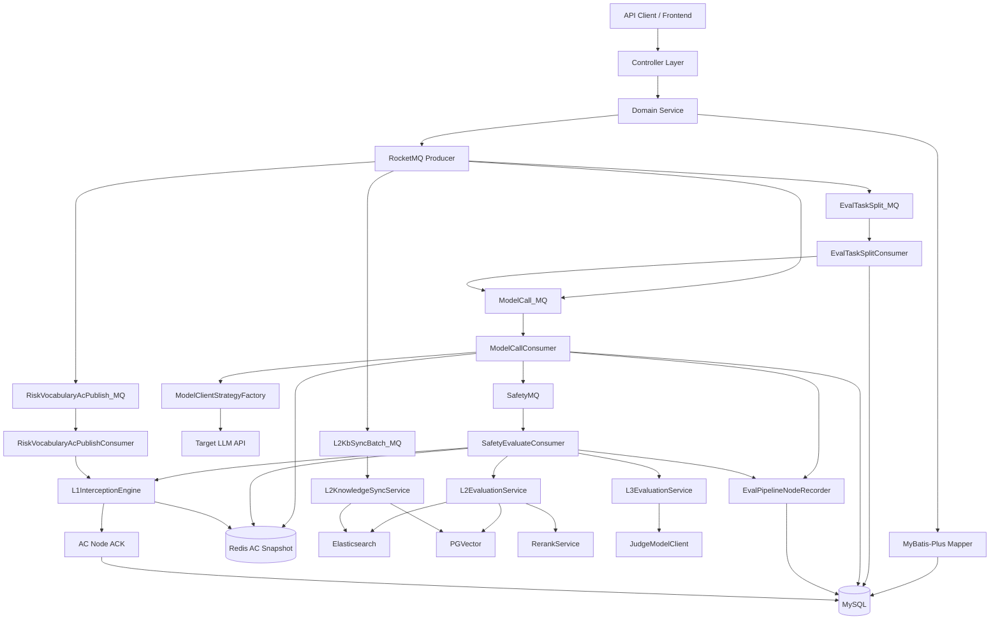
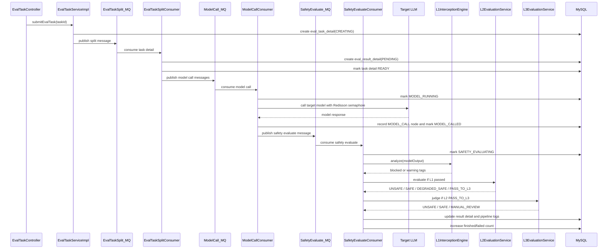

# AIGC Evaluate

`aigc-evaluate` 是一个大模型安全评测平台后端项目。项目用于管理被测模型、评测数据集、风险分类、L1 风险词库和 L2 攻击特征知识库，并通过 RocketMQ 异步执行评测任务。

当前评测主链路已经形成 `ModelCall_MQ -> SafetyEvaluate_MQ` 的两段式异步流水线：第一段只负责按模型并发限流调用被测大模型并落库输出，第二段读取已落库输出后依次经过 L1 AC 自动机字面量拦截、L2 ES + PGVector 双路召回判定、L3 Judge 模型裁决，最后写回样本结果、流水线节点日志和批次进度。

## 核心能力

| 能力 | 说明 |
| --- | --- |
| 模型资源管理 | 管理模型厂商、被测模型、Embedding 模型、API Key、Base URL，并支持模型连通性测试 |
| 数据集管理 | 管理评测数据集基础信息，查询数据集样本 |
| 风险分类管理 | 管理风险大类、风险小类、风险场景和 L3 判定规则 |
| L1 风险词库 | 管理风险关键词，并通过 Redis manifest/shard 快照、节点心跳和 ACK 协调发布 AC 自动机版本 |
| L2 攻击特征知识库 | 管理攻击特征和风险小类判定规则，支持异步同步到 Elasticsearch 和 PGVector |
| 评测任务管理 | 支持任务分页、提交、停止、状态查询、批次查询、样本结果查询和流水线日志查询 |
| 异步任务执行 | 使用 RocketMQ 解耦任务拆分、模型调用、安全评测、知识库同步和 AC 快照发布 |
| 模型调用策略 | 通过 `ModelClientStrategy` 接入 OpenAI、DeepSeek、Qwen、Spark、GLM、GPT、Mock 等厂商策略 |
| L1 字面量拦截 | 使用 Aho-Corasick Double Array Trie 对模型输出进行高性能风险词判定 |
| L2 双路召回判定 | 使用 ES 字面召回、PGVector 语义召回、RRF 融合、Rerank 和阈值路由输出安全决策 |
| L3 Judge 裁决 | 对 L2 模糊区加载 `risk_detail_rule` 构造 Judge Prompt，并通过真实或降级 Judge Client 输出最终判定 |
| 流水线节点日志 | 记录 `MODEL_CALL`、`L1`、`L2`、`L3` 的输入快照、输出快照、结构化结果、耗时和状态 |
| 认证能力 | 使用 Sa-Token 提供登录和登出接口 |

## 技术栈

| 类型 | 技术 |
| --- | --- |
| 语言与运行时 | Java 21 |
| Web 框架 | Spring Boot 3.5.x |
| ORM | MyBatis-Plus |
| 主业务数据库 | MySQL |
| 向量存储 | PostgreSQL + PGVector，Spring AI VectorStore |
| 搜索引擎 | Elasticsearch |
| 缓存与分布式锁 | Redis、Redisson |
| 消息队列 | RocketMQ |
| 模型调用 | Spring AI、OpenAI、DeepSeek、ZhipuAI、DashScope 相关集成 |
| Rerank / Judge / Embedding | `infra-ai` 中的 RerankService、JudgeModelClient、EmbeddingService |
| 安全词匹配 | Aho-Corasick Double Array Trie、HanLP |
| 认证 | Sa-Token |
| 工具库 | Hutool、Lombok、Fastjson2、Jackson、Apache Commons、Guava |

## 项目结构

```text
aigc-evaluate/
  pom.xml                         Maven 父项目，声明 eval/framework/infra-ai 三个模块
  eval/                           Spring Boot 应用模块，承载评测平台业务
  framework/                      通用框架模块
  infra-ai/                       AI 基础能力模块
  doc/                            API 文档、产品设计摘要和初始化 SQL
```

### eval 模块

```text
eval/src/main/java/com/kant/llm/
  LLMEvalApplication.java         应用启动入口
  common/
    condition/                    app.l2 / app.l3 条件装配注解和 Condition
    constant/                     MQ Topic、Redis Key、ES 文档常量
    convention/                   EvalContext 等流水线上下文
    enums/                        任务、结果、节点、L2/L3、AC 快照等状态协议
    provider/                     数据库驱动的 Embedding 模型信息提供器
    splitter/                     文本切分工具
  eval/
    basesource/                   模型厂商、模型信息、Embedding 模型、Mock 输出
    dataset/                      数据集和样本
    risk/                         风险大类、小类、场景和判定规则
    knowledge/                    L1 词库、L2 攻击特征、知识同步、AC 快照引擎
    task/                         评测任务、执行批次、结果明细、任务查询
    pipeline/                     MQ、流水线节点日志、ES 适配、L2/L3 评测服务
    user/                         登录认证
    test/                         测试接口
```

### framework 模块

```text
framework/src/main/java/com/kant/framework/
  config/                         Web、Redis、数据库、RocketMQ、幂等自动配置
  convention/                     通用响应对象
  exception/                      业务异常和安全拦截异常
  mq/producer/                    RocketMQ 发送适配、事务回查注册
  distributedid/                  分布式 ID 支持
  idempotent/                     幂等注解和切面
  web/                            统一响应、全局异常、SSE 工具
```

### infra-ai 模块

```text
infra-ai/src/main/java/com/kant/ai/infra/
  client/                         被测模型调用统一抽象和厂商策略
  embedding/                      Embedding 模型注册、路由和策略
  rerank/                         Rerank 服务注册、路由和策略
  judge/                          Judge 模型调用抽象和策略
  config/                         AI、ES、PGVector、Rerank 自动配置
  vector/                         PGVector 配置属性
```

## 整体架构



## 评测任务流程



流程说明：

1. 提交任务后，系统为已有 `eval_task` 创建一次执行批次 `eval_task_detail`，状态为 `CREATING`。
2. 任务拆分消费者读取 `dataset_sample`，为每条样本生成 `eval_result_detail`，状态为 `PENDING`。
3. 批次进入 `READY` 后，系统逐条发送 `ModelCall_MQ` 模型调用消息。
4. `ModelCallConsumer` 使用结果明细锁和模型维度 Redisson 分布式信号量调用被测模型，记录 `MODEL_CALL` 节点，并把样本状态推进到 `MODEL_CALLED`。
5. 模型调用完成后投递 `SafetyEvaluate_MQ`，`SafetyEvaluateConsumer` 读取已落库模型输出并把样本置为 `SAFETY_EVALUATING`。
6. 模型输出进入 L1。高确定性风险词命中时直接阻断，未阻断时 warning 标签会传给 L2。
7. L2 构造查询文本，执行 ES + PGVector 双路召回、RRF 融合、Rerank 和风险小类聚合，输出 `UNSAFE`、`SAFE`、`DEGRADED_SAFE` 或 `PASS_TO_L3`。
8. L3 只处理 L2 模糊区，加载 `risk_detail_rule` 构造 Judge Prompt，并通过真实或降级 Judge Client 输出最终判定。
9. 系统写回样本结果、节点日志，并用 SQL 原子递增推进批次进度；所有样本完成后将批次置为 `COMPLETED` 或 `ERROR`。

## 知识库同步流程

### L1 风险词 AC 快照

1. 管理端通过 `/knowledge/vocabularies/keyword/version/publish` 提交 AC 快照发布。
2. `KnowledgeVocabularyKeywordServiceImpl` 按风险小类生成 Redis manifest 和 shard。
3. 系统通过 `RiskVocabularyAcPublish_MQ` 广播构建版本。
4. 各节点的 `L1InterceptionEngine` 加载快照到 prepared context 并写入 BUILD ACK。
5. `RiskVocabularyAcPublishCoordinator` 等待目标节点 ACK，切换 Redis latest 指针后广播激活版本。
6. 节点激活 prepared context，写入 ACTIVE ACK，并通过定时心跳上报当前版本。

### L2 攻击特征索引

1. 管理端通过 `/Knowledge/attack-feature/sync` 提交一键同步任务。
2. `L2KnowledgeSyncServiceImpl` 扫描待同步 `knowledge_attack_feature`，生成 `knowledge_sync_event`。
3. 系统通过 `L2KbSyncEvent_MQ` 异步消费单个同步事件。
4. 启用或重建特征时写入 Elasticsearch 和 PGVector；删除或禁用特征时从索引中删除。
5. 同步结果回写事件状态和特征的 ES/PG 同步状态，失败事件设置重试时间并依赖 MQ 重试。

## 主要接口入口

所有接口默认带上下文路径：

```text
/api/aigc-eval
```

| 模块 | Base Path | 说明 |
| --- | --- | --- |
| 认证 | `/auth` | 登录、登出 |
| 模型资源 | `/source` | 模型厂商、被测模型、Embedding 模型、连通性测试 |
| 数据集 | `/data-set` | 数据集 CRUD、样本列表和分页 |
| 评测任务 | `/eval-task` | 提交、停止、分页、状态、批次、结果、流水线日志 |
| 评测任务节点日志 | `/eval-task/pipeline-node/list` | 按样本结果明细查询 `MODEL_CALL/L1/L2/L3` 节点日志 |
| L1 风险词库 | `/knowledge/vocabularies` | 风险关键词管理、AC 快照发布 |
| L2 知识库 | `/Knowledge/attack-feature` | L2 判定规则、攻击特征、同步事件和一键同步 |
| 风险场景 | `/risk/scenarios` | 风险场景管理 |
| 风险分类 | `/risk/category` | 风险大类、风险小类管理 |
| 测试接口 | `/test` | 本地测试和调试入口 |

> 注意：`/Knowledge/attack-feature` 当前代码中 `Knowledge` 为大写，调用时需保持一致。

## 快速启动

### 构建项目

```bash
mvn clean package
```

只构建后端应用模块：

```bash
mvn clean package -pl eval
```

### 启动后端

```bash
mvn spring-boot:run -pl eval
```

默认服务地址：

```text
http://localhost:8800/api/aigc-eval
```

### 运行测试

```bash
mvn test -pl eval
```

运行单个测试类：

```bash
mvn test -pl eval -Dtest=ModelClientStrategyTest
```

运行单个测试方法：

```bash
mvn test -pl eval -Dtest=ModelClientStrategyTest#test
```

## 运行依赖

启动和完整执行评测链路前，需要确保以下外部服务可用：

- MySQL：保存模型、数据集、任务、批次、结果、风险分类、知识库和同步事件等业务数据。
- Redis：用于 Redisson 分布式锁、AC 自动机快照、节点版本指针和 Sa-Token 支持。
- RocketMQ：用于任务拆分、模型调用、安全评测、L2 知识库同步、AC 快照发布。
- Elasticsearch：用于 L2 攻击特征字面召回。
- PostgreSQL + PGVector：用于 L2 攻击特征语义召回。
- 外部被测模型 API：用于模型连通性测试和评测执行。
- Embedding / Rerank / Judge 模型能力：用于 PGVector 写入、L2 精排和 L3 裁决。

`eval/src/main/resources/application.yml` 中包含本地运行所需的示例连接配置。生产环境建议迁移到环境变量、独立 profile 或配置中心，避免把外部服务地址和密钥直接放在默认配置中。

## 关键配置

```yaml
app:
  l2:
    # empty: 空召回降级
    # mysql-mock: 使用 MySQL 本地 mock 召回
    # real: 使用 ES + PGVector 真实召回
    recall-mode: real
  l3:
    # default: 不调用真实 Judge，L2 模糊区降级为人工核验
    # real: 调用 infra-ai 的 JudgeModelClient
    judge-mode: real
```

## 当前实现状态

当前代码已经形成后端评测主链路和三层安全判定闭环，但仍有一些实现边界需要注意：

- `EvalTaskServiceImpl#createEvalTask` 当前只记录日志，尚未真正创建 `eval_task` 主记录；`submit` 依赖已有任务记录。
- `/eval-task/progress` 当前 Controller 方法体为空，建议使用 `/eval-task/status`、`/eval-task/detail/page`、`/eval-task/result/page` 查询状态与进度。
- L2/L3 已接入单样本执行链路，但实际能力受 `app.l2.recall-mode` 和 `app.l3.judge-mode` 控制，可按环境在真实模式和降级模式之间切换。
- L2 真实召回当前使用 PGVector，但部分模型字段和日志字段仍沿用 `milvusHits`、`milvusSimilarity` 命名，用于兼容现有 L2 RRF 结构。
- 当前仓库未包含可运行的前端模块，主要实现集中在 `eval` 后端模块。
- 默认配置中包含外部服务连接信息，生产环境应改用 profile、环境变量或配置中心管理。

## 更多文档

- `doc/产品设计摘要/后端核心架构设计.md`
- `doc/产品设计摘要/评测任务业务完整流程图.md`
- `doc/API文档/评测任务接口文档.md`
- `doc/API文档/L2知识库接口文档.md`
- `doc/sql/mysql/data_free_eval_dev.sql`
- `doc/sql/pg/init.sql`
- `doc/sql/es/create_knowledge_attack_feature_index.json`
