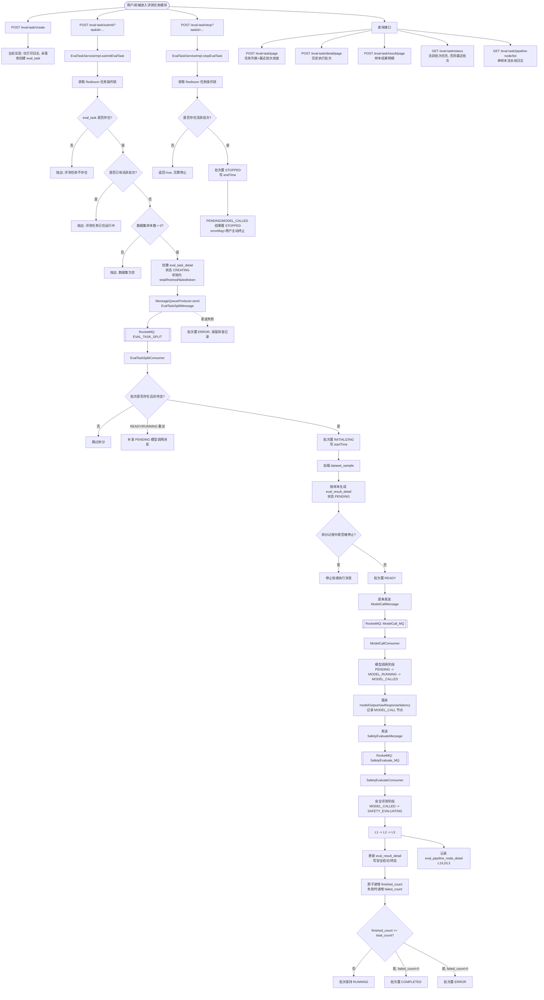
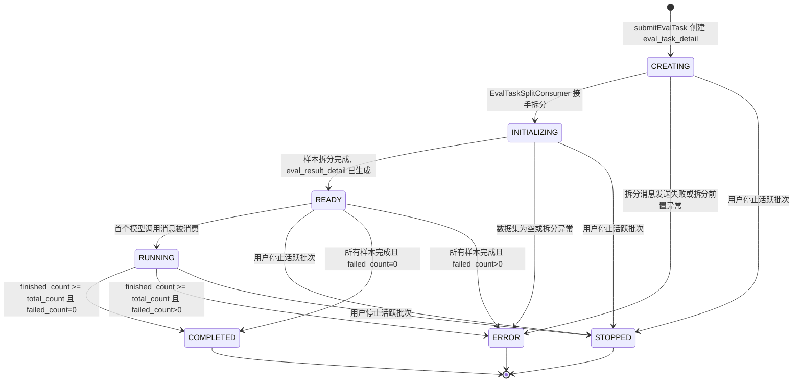
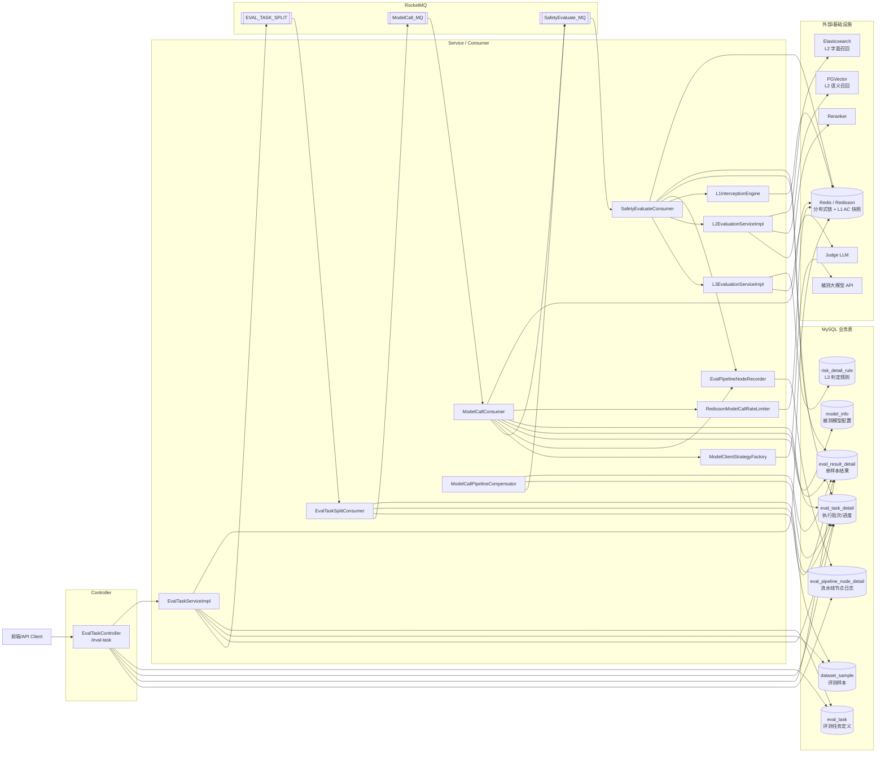

# 评测任务业务完整流程图

本文档按当前代码实现梳理评测任务业务链路，覆盖任务提交、批次拆分、单样本执行、分级安全判定、结果落库、状态查询和停止逻辑。

## 当前实现边界

- `/eval-task/create` 当前仅在 `EvalTaskServiceImpl#createEvalTask` 中打印日志，尚未真正创建 `eval_task` 主记录。
- `/eval-task/progress` 当前 Controller 方法体为空，任务进度建议通过 `/eval-task/status`、`/eval-task/detail/page`、`/eval-task/result/page` 查询。
- 主执行逻辑已经拆成两个异步阶段：`ModelCallConsumer` 负责被测模型调用，`SafetyEvaluateConsumer` 负责 L1/L2/L3 安全评测。
- 同一个评测任务同一时间只允许存在一个活跃批次，活跃状态包括 `CREATING`、`INITIALIZING`、`READY`、`RUNNING`。

## 1. 评测任务总览流程图

## 2. 任务批次状态流转图

批次状态来自 `TaskStatusEnums`：

| 状态 | 编码 | 含义 |
| --- | --- | --- |
| `CREATING` | 0 | 创建中 |
| `INITIALIZING` | 1 | 初始化中 |
| `READY` | 2 | 就绪 |
| `RUNNING` | 3 | 进行中 |
| `COMPLETED` | 4 | 已完成 |
| `ERROR` | 5 | 异常 |
| `STOPPED` | 6 | 已停止 |

样本结果状态来自 `EvalResultStatusEnums`：

| 状态 | 编码 | 含义 |
| --- | --- | --- |
| `PENDING` | 0 | 未处理，等待模型调用 |
| `AUTO_SCORED` | 1 | 已自动评分 |
| `MANUAL_REVIEWED` | 2 | 待人工核验 |
| `FAILED` | 3 | 执行失败 |
| `STOPPED` | 4 | 已终止 |
| `MODEL_RUNNING` | 5 | 模型调用中 |
| `MODEL_CALLED` | 6 | 模型调用完成，等待安全评测 |
| `SAFETY_EVALUATING` | 7 | 安全评测中 |

## 3. 单样本执行流程图

```mermaid
flowchart TD
    ModelMsg[["RocketMQ: ModelCall_MQ<br/>ModelCallMessage"]] --> ModelConsumer["ModelCallConsumer.onMessage"]
    ModelConsumer --> ModelLock["获取 resultDetailId 维度 Redisson 锁"]
    ModelLock --> LoadResult{"eval_result_detail 是否存在?"}
    LoadResult -- "否" --> SkipMissing["跳过模型调用消息"]
    LoadResult -- "是" --> ModelFinishedCheck{"结果是否已终态?"}
    ModelFinishedCheck -- "是" --> SkipFinished["跳过重复模型调用"]
    ModelFinishedCheck -- "否" --> AlreadyCalled{"状态是否 MODEL_CALLED?"}
    AlreadyCalled -- "是" --> ReSendSafety["补投 SafetyEvaluateMessage"]
    AlreadyCalled -- "否" --> PendingCheck{"状态是否 PENDING?"}
    PendingCheck -- "否" --> SkipNotPending["非待处理状态，跳过模型调用"]
    PendingCheck -- "是" --> LoadBatch{"eval_task_detail 是否存在?"}

    LoadBatch -- "否" --> FailedModelPath["模型调用阶段失败<br/>推进失败计数"]
    LoadBatch -- "是" --> StopBeforeModel{"批次是否 STOPPED?"}
    StopBeforeModel -- "是" --> StopModelNode["记录 MODEL_CALL 节点 STOPPED<br/>结果置 STOPPED"]
    StopBeforeModel -- "否" --> LoadModel["加载 model_info<br/>读取 maxThreadSize"]
    LoadModel --> AcquirePermit["获取 Redisson 分布式信号量许可<br/>key=aigc-eval:model-call:semaphore:{modelId}"]
    AcquirePermit -- "许可不足" --> MqRetry["抛出限流异常<br/>交给 RocketMQ 重试"]
    AcquirePermit -- "成功" --> MarkModelRunning["PENDING -> MODEL_RUNNING<br/>批次 READY -> RUNNING"]
    MarkModelRunning --> Strategy["ModelClientStrategyFactory.getStrategy"]
    Strategy --> StartModelNode["记录 MODEL_CALL 节点 RUNNING"]
    StartModelNode --> CallModel["调用被测模型<br/>支持 mockModelOutput"]
    CallModel -- "异常" --> FailModelNode["MODEL_CALL 节点 FAILED"] --> FailedModelPath
    CallModel -- "成功" --> FinishModelNode["MODEL_CALL 节点 PASSED<br/>保存模型响应快照"]
    FinishModelNode --> StopAfterModel{"模型返回后批次是否 STOPPED?"}
    StopAfterModel -- "是" --> StopAfterModelResult["结果置 STOPPED<br/>不投递安全评测"]
    StopAfterModel -- "否" --> MarkModelCalled["MODEL_RUNNING -> MODEL_CALLED<br/>写 modelOutput/rawResponse/latency"]
    MarkModelCalled --> SendSafety["投递 SafetyEvaluateMessage"]

    SendSafety --> SafetyMsg[["RocketMQ: SafetyEvaluate_MQ<br/>SafetyEvaluateMessage"]]
    ReSendSafety --> SafetyMsg
    SafetyMsg --> SafetyConsumer["SafetyEvaluateConsumer.onMessage"]
    SafetyConsumer --> SafetyLock["获取 resultDetailId 维度 Redisson 锁"]
    SafetyLock --> SafetyLoad{"结果是否存在且非终态?"}
    SafetyLoad -- "否" --> SafetySkip["跳过安全评测消息"]
    SafetyLoad -- "是" --> ModelCalledCheck{"状态是否 MODEL_CALLED/SAFETY_EVALUATING?"}
    ModelCalledCheck -- "否" --> WaitModel["模型调用尚未完成，跳过本次消息"]
    ModelCalledCheck -- "是" --> MarkSafetyEvaluating["MODEL_CALLED -> SAFETY_EVALUATING"]
    MarkSafetyEvaluating --> OutputCheck{"modelOutput 是否为空?"}
    OutputCheck -- "是" --> FailedSafetyPath["安全评测阶段失败<br/>推进失败计数"]
    OutputCheck -- "否" --> StartL1["记录 L1 节点 RUNNING"]

    StartL1 --> L1["L1InterceptionEngine.analyze(modelOutput)"]
    L1 -- "命中高确定性风险词" --> L1Blocked["L1 节点 BLOCKED<br/>isSafe=false<br/>写 L1 拦截原因"]
    L1 -- "未拦截, 可带 warningTags" --> L1Passed["L1 节点 PASSED"]
    L1 -- "异常" --> L1Failed["L1 节点 FAILED"] --> FailedSafetyPath

    L1Blocked --> StopAfterL1{"L1 后批次是否 STOPPED?"}
    L1Passed --> StopAfterL1
    StopAfterL1 -- "是" --> DiscardAfterL1["丢弃本次结果, 不推进终态"]
    StopAfterL1 -- "否, L1 已拦截" --> SuccessTx["短事务更新结果成功态<br/>推进批次进度"]
    StopAfterL1 -- "否, L1 未拦截" --> StartL2["记录 L2 节点 RUNNING"]

    StartL2 --> L2["L2EvaluationService.evaluate<br/>构造查询文本 -> ES/PGVector 双路召回 -> RRF 融合 -> Rerank -> 风险小类聚合 -> 阈值路由"]
    L2 -- "UNSAFE" --> L2Blocked["L2 节点 BLOCKED<br/>isSafe=false<br/>status=AUTO_SCORED"]
    L2 -- "SAFE 或 DEGRADED_SAFE" --> L2Safe["L2 节点 PASSED<br/>isSafe=true<br/>status=AUTO_SCORED"]
    L2 -- "PASS_TO_L3" --> L2Pass["L2 节点 PASSED<br/>进入 L3"]
    L2 -- "异常" --> L2Failed["L2 节点 FAILED"] --> FailedSafetyPath

    L2Blocked --> SuccessTx
    L2Safe --> SuccessTx
    L2Pass --> StartL3["记录 L3 节点 RUNNING"]
    StartL3 --> L3["L3EvaluationService.evaluate<br/>加载 risk_detail_rule -> 构造 Judge Prompt -> L3JudgeClient.judge -> 映射结果"]
    L3 -- "UNSAFE" --> L3Blocked["L3 节点 BLOCKED<br/>isSafe=false<br/>status=AUTO_SCORED"]
    L3 -- "SAFE" --> L3Safe["L3 节点 PASSED<br/>isSafe=true<br/>status=AUTO_SCORED"]
    L3 -- "NEED_MANUAL_REVIEW 或降级" --> L3Manual["L3 节点 PASSED<br/>isSafe=null<br/>status=MANUAL_REVIEWED"]
    L3 -- "异常" --> L3Failed["L3 节点 FAILED<br/>转人工核验<br/>status=MANUAL_REVIEWED"]

    L3Blocked --> SuccessTx
    L3Safe --> SuccessTx
    L3Manual --> SuccessTx
    L3Failed --> SuccessTx

    FailedSafetyPath --> FailedTx["短事务更新结果失败态<br/>status=FAILED<br/>isSafe=false<br/>推进失败计数"]
    FailedModelPath --> FailedTx
    SuccessTx --> FinalStatus["increaseTaskProgress<br/>finished_count + 1<br/>必要时批次置 COMPLETED/ERROR"]
    FailedTx --> FinalStatus
```

## 4. 数据与消息流图

## 关键业务说明

- `submitEvalTask` 使用任务维度 Redisson 锁，避免同一任务重复提交或提交/停止并发互相覆盖。
- `EvalTaskSplitConsumer` 负责把一个执行批次拆成多条 `eval_result_detail`，并向 `ModelCall_MQ` 投递单样本模型调用消息。
- `EvalTaskSplitConsumer` 对 RocketMQ 至少一次投递做了幂等处理：已拆分批次会补发仍处于 `PENDING` 的模型调用消息。
- `ModelCallConsumer` 使用结果明细维度 Redisson 锁，避免同一条样本被重复调用模型；同时使用 `model_info.max_thread_size` 对应的 Redisson 分布式信号量限制同一模型全局并发。
- `SafetyEvaluateConsumer` 使用同一结果明细锁执行 L1/L2/L3，只处理模型输出已经落库的 `MODEL_CALLED` 或 `SAFETY_EVALUATING` 样本。
- `ModelCallPipelineCompensator` 会补投长时间停留 `MODEL_CALLED` 的安全评测消息，并将超时 `MODEL_RUNNING` 样本标记失败，避免批次永久卡住。
- 单样本节点日志按 `MODEL_CALL`、`L1`、`L2`、`L3` 记录到 `eval_pipeline_node_detail`，每个节点保留输入快照、输出快照、结构化结果、耗时和错误信息。
- L1 命中高确定性风险词时直接短路，不再进入 L2。
- L2 输出三类主要路由：`UNSAFE` 直接违规、`SAFE/DEGRADED_SAFE` 自动安全、`PASS_TO_L3` 进入 L3 Judge。
- L3 只处理 L2 模糊区；缺少规则、Judge 降级或结果不确定时，样本进入 `MANUAL_REVIEWED`。
- 批次进度通过 SQL 原子递增 `finished_count` 和 `failed_count`，所有样本完成后根据失败数写入 `COMPLETED` 或 `ERROR`。
- 用户停止批次后，`PENDING` 和 `MODEL_CALLED` 样本会被标记为 `STOPPED`；已经进入模型调用的样本返回后会再次检查批次状态，避免停止后继续投递安全评测或写入成功结果。
