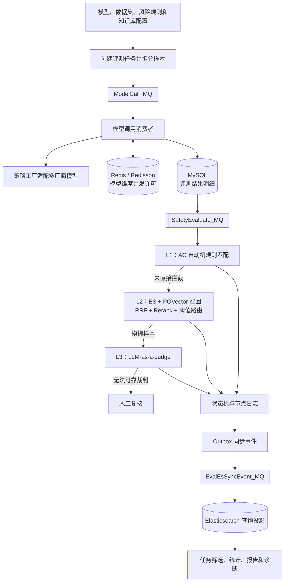
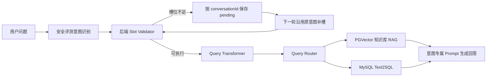

# 大模型安全评测平台：2 分钟项目介绍与架构讲法

> 用途：补齐周五计划中的“2 分钟项目介绍”和“项目架构讲法”。
>
> 面试定位：Java 高级后端工程师，重点突出复杂业务链路拆解、分布式工程能力和大模型应用落地，不把自己包装成模型算法工程师。
>
> 项目体量：日均 200+ 评测任务，评测结果与节点日志等明细数据日增 2000W+ 条。

## 一、2 分钟项目介绍

### 1. 标准主稿

我目前参与的是一个大模型安全评测平台，主要用于企业模型接入前的批量安全准入。平台日均处理 200+ 评测任务，评测结果和链路日志等明细数据日增 2000W+ 条。除了识别敏感、合规和攻击风险，平台还要保留判定证据，支持人工复核和误杀漏判排查。

任务创建后会拆成样本级明细，先进入模型调用 MQ。消费者通过策略工厂适配不同厂商模型，并用 Redisson 分布式信号量控制模型并发；输出落库后，再进入安全评测 MQ。两段链路隔离了外部模型的长耗时和安全判定，也便于独立扩容与失败重试。

判定采用 L1、L2、L3 三层链路。L1 用 AC 自动机快速匹配风险词；L2 通过 Elasticsearch 和 PGVector 召回风险特征，再经过 RRF、Rerank 和阈值路由进行判断；模糊样本进入 L3，由 LLM-as-a-Judge 结合目标风险规则裁判，无法可靠判断时转人工复核。

每个节点都会记录输入输出、结构化结果、耗时和异常。MySQL 作为事实数据源，通过 outbox 和 RocketMQ 把最新结果投影到 Elasticsearch，用于筛选、统计和诊断。

平台上还建设了安全评测助手 V1，通过意图识别、后端槽位校验和 conversationId 多轮补槽理解问题，再路由到 RAG 或 Text2SQL，完成链路诊断、规则溯源和风险资产查询。我主要负责异步评测链路、模型并发控制、L1/L2/L3 编排、节点日志与 ES 投影，以及助手的意图、槽位、检索路由和 Text2SQL。整体上，我负责的是 Java 后端和大模型应用工程化，不涉及基础模型训练。

### 2. 记忆提纲

不要逐字死背，记住下面六个锚点即可：

1. **背景**：模型接入前需要批量安全准入，结果必须可追踪、可复核。
2. **平台链路**：任务拆分 -> 模型调用 MQ -> 模型输出落库 -> 安全评测 MQ。
3. **三层判定**：L1 规则快筛，L2 检索与重排，L3 Judge 处理模糊样本。
4. **工程保障**：状态机、样本级幂等、模型维度并发控制、节点日志。
5. **评测助手**：意图识别 -> 槽位校验 -> 多轮补槽 -> RAG/Text2SQL。
6. **个人职责**：评测主链路、三层编排、可追溯与 ES 投影、助手 V1。

### 3. 30 秒压缩版

我参与的是一个大模型安全评测平台，主要用于企业模型接入前的批量安全准入。平台通过 RocketMQ 将模型调用和安全评测拆成两个阶段，评测侧采用 L1 AC 自动机、L2 ES 与 PGVector 检索重排、L3 LLM-as-a-Judge 的分层判定，并记录每个节点的输入输出和耗时。平台上还建设了安全评测助手，支持意图识别、槽位校验、多轮补槽、RAG 和 Text2SQL。我主要负责异步链路、并发与幂等、L1/L2/L3 编排、节点日志、ES 结果投影及助手核心流程。

## 二、项目架构讲法

### 1. 总体架构图



### 2. 架构总述

面试时先给结论：

> 这个项目我会分成五层来讲：资源与任务控制层、异步执行层、安全判定层、数据与可追溯层、智能评测助手层。主链路解决“如何稳定完成批量评测”，助手层解决“如何查询、解释和诊断评测结果”。

### 3. 第一层：资源与任务控制层

平台先管理模型资源、评测数据集、风险分类、风险规则和攻击特征知识库。用户创建任务时选择目标模型、数据集和风险范围，系统把批量任务拆成样本级评测明细。

样本级明细是整个链路的最小执行和追踪单元。后续模型输出、L1/L2/L3 结果、节点日志以及 ES 文档，都可以通过任务 ID、任务明细 ID 和评测结果明细 ID 关联起来。

平台日均有 200+ 评测任务，评测结果、节点日志等明细数据合计日增 2000W+ 条。这个规模具有明显的批处理和峰值特征，因此架构重点不是创建任务接口的 HTTP QPS，而是样本拆分速度、MQ 消费吞吐、模型并发配额、结果写入和积压恢复能力。

这一层面试时重点说明：平台不是直接在 HTTP 请求里循环调用模型，而是先把任务持久化，再交给异步链路执行。

### 4. 第二层：异步执行层

异步链路分为两个阶段：

1. **模型调用阶段**：样本进入 `ModelCall_MQ`，消费者根据模型配置从策略工厂取得对应客户端，完成多厂商模型调用。
2. **安全评测阶段**：模型输出持久化后进入 `SafetyEvaluate_MQ`，消费者执行 L1/L2/L3 判定并更新最终结果。

拆成两个 MQ 的原因不是形式上的解耦，而是两个阶段的资源模型不同：模型调用受外部厂商延迟、限流和网络波动影响；安全评测主要受规则匹配、检索、重排和 Judge 调用影响。拆开后可以分别设置消费并发、重试策略和扩容方式，也避免模型接口变慢时拖住整个判定链路。

模型并发控制使用 Redisson 的可过期分布式信号量。许可数量来自模型配置，控制的是同一个模型当前正在执行的请求数量；拿不到许可时让消息进入 MQ 重试。这里不要说成“Redis 令牌桶”，因为它解决的是在途并发数，而不是单位时间请求速率。

### 5. 第三层：L1/L2/L3 安全判定层

三层判定的设计目标是平衡速度、成本和准确性。

**L1 规则层**使用 AC 自动机一次扫描同时匹配大量风险词，适合处理确定性强、要求快速拦截的规则。高风险命中可以直接终止后续流程，较弱命中可以作为警告标签继续传给 L2。

**L2 检索判定层**把用户输入、模型输出和 L1 标签组合成检索查询，分别从 Elasticsearch 和 PGVector 召回风险攻击特征。两路结果通过 RRF 融合，再经过 Rerank 和阈值路由，输出安全、不安全、降级安全或进入 L3。L2 的价值是覆盖纯关键词无法识别的相似表达和变体攻击，同时比每条样本都调用 Judge 更可控。

**L3 语义裁判层**只处理 L2 无法稳定判定的模糊样本。系统先加载当前目标风险小类对应的规则，再约束 Judge 只围绕该风险类型输出结构化结论和证据。规则缺失、响应不合法或模型调用异常时不强行给结论，而是降级到人工复核。

三层之间的核心路由可以概括为：

```text
L1 明确高风险 -> 直接拦截
L1 未拦截 -> 进入 L2
L2 高置信安全/不安全 -> 输出结果
L2 低置信或语义模糊 -> 进入 L3
L3 无法可靠判断 -> 人工复核
```

### 6. 第四层：状态、幂等、可追溯与查询投影

链路以评测结果明细 ID 作为样本级执行标识，并同时使用分布式锁和数据库状态控制重复执行。消息重复投递时先检查当前状态：已经完成模型调用的样本不会再次请求外部模型，而是补投后续安全评测消息；已完成判定的样本不会重复计算。这样把 MQ 的至少一次投递转化为业务侧幂等。

每个阶段通过统一节点记录器保存开始、完成、失败、跳过或终止状态，并记录输入快照、输出快照、结构化结果、耗时和异常。排查误杀、漏判时，可以沿着 `MODEL_CALL -> L1 -> L2 -> L3` 还原当时使用的输入、命中规则、召回特征、阈值和最终路由原因。

数据侧以 MySQL 作为事实数据源，Elasticsearch 作为查询投影。面对日增 2000W+ 的评测结果和节点日志明细，平台使用 Sharding-JDBC 对核心增长表进行分库分表，单样本诊断尽量按评测结果明细 ID 定位，任务维度筛选和统计则由 ES 承担。业务状态变更时同步记录 outbox 事件，调度器把待同步或可重试事件发送到 RocketMQ；消费者根据事件 ID 回查 MySQL 最新数据并幂等写入 ES。失败时记录 `retry_count`、`next_retry_time` 和错误信息，后续继续补偿。

这里采用 outbox + MQ，而不是直接双写，是为了避免 MySQL 成功、ES 失败造成的不一致。当前场景也不优先引入 Canal 或 Flink CDC，因为这里同步的是有明确业务含义的评测结果投影，需要在业务事务内控制事件粒度；Canal/Flink CDC 更适合平台级数据同步、复杂清洗或实时数仓。

### 7. 第五层：安全评测助手



助手不是一个 Prompt 包办所有能力，而是把概率性理解和确定性执行拆开：

1. LLM 负责识别用户想做链路诊断、规则溯源、误杀漏判分析、合规问答、案例检索、风险资产查询还是报告辅助。
2. 后端 Slot Validator 根据意图重新校验必填槽位、业务边界和执行条件，不直接相信模型返回的 `needClarification`。
3. 信息不完整时，以 conversationId 保存 pending 状态；下一轮沿用原意图抽取缺失槽位，补齐后再执行。
4. Query Transformer 根据意图和槽位重写检索问题，Query Router 在知识库向量检索和 MySQL Text2SQL 之间选择执行路径。
5. Text2SQL 增加只读 SQL、表白名单、多语句拦截和默认 LIMIT，降低误执行和越权查询风险。

### 8. “你具体负责什么”的回答

> 我的职责主要分为平台链路和评测助手两部分。平台侧，我参与模型调用层抽象，负责模型调用与安全评测两段 MQ 流程、模型维度并发控制、样本状态与幂等处理，并参与 L1/L2/L3 的流程编排、节点日志和 MySQL 到 ES 的结果投影。助手侧，我负责安全评测意图体系、后端槽位校验、conversationId 多轮补槽、查询改写与路由，以及 Text2SQL 的安全限制。我的核心价值不是训练模型，而是把评测业务拆成稳定、可追踪、可扩展的 Java 后端和 LLM 应用链路。

### 9. 项目体量和部署补充讲法

面试官追问项目规模时，可以按下面的顺序回答：

1. **业务量**：日均 200 至 250 个批量评测任务，约 350 万至 450 万条评测样本。
2. **数据量**：每个样本平均产生结果明细和 3 至 5 条节点记录，合计日增 2000W+ 条明细数据。
3. **分库分表**：结果明细和节点日志每张逻辑表采用 4 库 x 16 表，各 64 张物理表；两张核心表合计 128 张。
4. **应用部署**：约 12 台应用节点，常态 24 至 28 个服务实例，高峰扩到 32 个左右。
5. **中间件**：MySQL 10 个节点、Redis 6 个节点、Elasticsearch 9 个节点、RocketMQ 6 个节点、PGVector 3 个节点。
6. **性能**：普通接口峰值约 300 至 500 QPS，P95 约 150 至 200ms、P99 约 400 至 500ms；异步评测峰值约 200 至 300 条样本/秒，单样本完整执行链路 P95 约 8 至 12 秒、P99 约 25 至 30 秒。

这组指标是按当前日任务量和日增数据量形成的推荐面试口径。回答 P95、P99 时必须说明统计的是普通接口、模型调用还是完整样本链路。

## 三、关键设计选择的简短回答

| 面试官问题 | 回答主线 |
| --- | --- |
| 为什么使用 MQ？ | 模型调用耗时长且不稳定，批量任务不适合阻塞 HTTP；MQ 用于削峰、异步执行、失败重试和独立扩容。 |
| 为什么拆成两个 MQ？ | 模型调用和安全判定的延迟来源、并发限制、失败原因不同，拆开后可以独立治理和隔离故障。 |
| 为什么用分布式信号量？ | 要限制同一模型的在途请求数；许可带租约可降低消费者异常退出造成的许可泄漏。 |
| 为什么需要 L1/L2/L3？ | L1 追求速度和确定性，L2 处理相似表达并平衡成本，L3 只裁判模糊样本，三层共同平衡时延、成本和准确率。 |
| 如何处理重复消费？ | 以结果明细 ID 加锁，并用数据库状态机判断是否已执行；重复消息只补齐未完成阶段。 |
| 为什么记录节点快照？ | 最终结论不足以解释误杀漏判，节点快照可以还原输入、规则命中、召回证据、阈值和路由原因。 |
| 为什么 MySQL 还要同步 ES？ | MySQL 保证事务和事实数据，ES 承担任务筛选、全文检索、统计聚合和诊断查询。 |
| 为什么用 outbox，不直接双写？ | outbox 与业务变更一起落库，再异步投影到 ES，失败可重试，避免两个存储之间出现不可补偿的不一致。 |
| 为什么暂不优先用 Canal/Flink CDC？ | 当前同步的是业务结果投影，需要明确事件语义和同步粒度；CDC 更适合通用数据同步、复杂计算和实时数仓。 |
| 为什么后端还要校验槽位？ | LLM 输出具有概率性，后端必须对必填参数、业务边界和执行条件做确定性兜底。 |
| RAG 和 Text2SQL 如何分工？ | 知识、规则解释和相似案例适合语义检索；风险资产、状态和时间范围等精确结构化查询适合 Text2SQL。 |

## 四、口径边界与简历校对提醒

1. **项目规模统一按同一数据口径讲**：日均 200+ 评测任务，评测结果、节点日志等明细数据日增 2000W+ 条。`2000W+` 指明细记录总量，不等于 2000W 个样本。
2. **L2 统一讲 PGVector**。最终 PDF 的技术栈写了 Milvus，但项目第 4 条写的是 PGVector，当前代码也是 PGVector。除非确实有 Milvus 版本或迁移经历，否则面试口径和下一版简历应统一。
3. **助手当前是两类检索执行器**：PGVector `VectorStoreDocumentRetriever` 和 MySQL `EvaSqlDatabaseContentRetriever`；ES 检索器仍是 TODO。可以说整个平台使用 MySQL、ES、向量库三类存储，但不要把助手描述成已经完整落地的“三源融合检索”。
4. **分库分表按真实架构展开**：重点准备分片键、库表数量、路由方式、扩容方案、跨分片查询和数据归档，不要只说“用了 Sharding-JDBC”。
5. **Skill Router 尚未独立落地**。当前是意图识别、槽位校验后进入统一 RAG 流程，面试时称“安全评测助手 V1”；Skill 化属于下一版演进方向。
6. **容量数据必须按指标类型区分**：HTTP QPS、异步样本吞吐、数据库写入 TPS、模型并发和端到端耗时不是同一个指标。P95、P99 必须说明统计的是哪个链路。
7. 最终 PDF 中有明显文字错误需要修正：`项目介上线绍` 应为 `项目介绍`，`实义现后端` 应为 `实现后端`，`语理解` 应为 `语义理解`。

## 五、练习方式

1. 先只看“六个锚点”，脱稿讲一遍，不追求逐字一致。
2. 录音并控制在 1 分 45 秒到 2 分 15 秒之间。
3. 第二遍刻意停顿在“两个 MQ”“L1/L2/L3”“助手 V1”“我负责什么”四个位置，让结构更清楚。
4. 让别人随机打断并追问，立即切换到第三部分的简短回答，不要从头重讲项目。
5. 最后用 30 秒压缩版收口，确保面试官时间不足时仍能讲出项目辨识度。
