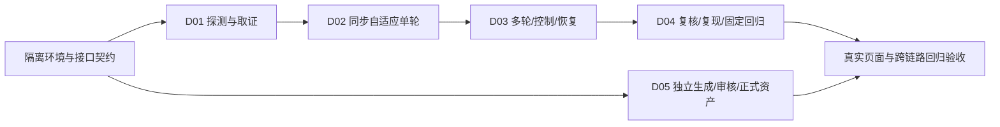

# D01～D05：测试与前端联调计划

日期：2026-10-01。当前工作范围：暂停D06、D07新增能力，先验证D01～D05现有实现并接入真实前端。保留产品方案中的后续需求，不将未实现能力包装成已验收功能。

## 1. 从哪里开始、到哪里结束

开始于冻结当前接口和测试环境。按共享探测、单轮红队、多轮运行、发现处理、样本生产五条纵向链路推进；每条先验证后端，再接对应页面，不一次性替换全部Mock。

结束条件是五条链路在隔离环境具有可追溯的接口、数据库和浏览器验收记录，关键异常行为正确，页面不依赖伪造结果。源码存在、单测通过、原型可演示均不等于整体验收通过。未支持的功能应禁用或明确展示限制。



本轮只进行不依赖外部服务的第一批机制测试和契约盘点，不应用SQL、不启动后台生成、不调用真实模型、不自动提交Git。

## 2. 第一步：准备可控环境

1. 确认测试后端地址、前端代理前缀、登录方式、测试actor和tenant；不把生产Token、凭据或真实敏感数据写入测试代码或文档。
2. 由环境负责人核对MySQL迁移记录，依次审阅D01～D05脚本及D04会话唯一约束变更。已存在表不能仅靠`CREATE IF NOT EXISTS`
   判断升级完成；早期D04升级脚本只用于符合条件的旧环境。
3. 准备一个明确获准调用的MODEL目标。先验证SINGLE_TURN；多轮另外核对厂商适配和`supportsMultiTurn`，不把能力查询当作探活。
4. D05使用独立生成配置，三个执行开关默认保持关闭；先完成种子和冻结计划控制面检查，再在明确获准环境按小额度启用生成、Worker和Scheduler。
5. 固定虚构机制样例和原规则引用，限定调用次数与运行期限。哨兵命中只验证机制，不作为漏洞或攻击效果证据。
6. 检查D03/D04后台接管可能读取的既有QUEUED/RUNNING记录。启动测试服务前确认测试库没有会被意外接管的生产任务。

## 3. 第二步：分层测试

| 层级               | 做什么                             | 不能证明什么                     |
|------------------|---------------------------------|----------------------------|
| 纯Java单测          | 输入、动作、预算、消息、证据和样本质量/时区不变量       | 真实SQL、租约竞争、HTTP认证或模型兼容     |
| Controller/DTO测试 | Result外壳、枚举、必填/长度、空值、错误映射和字段序列化 | Sa-Token真实过滤器、数据库事务及目标请求效果 |
| MySQL集成测试        | 幂等唯一键、版本冲突、抢占、租约失效、状态/账本原子写入    | 供应商远程请求严格恰好一次              |
| 授权目标联调           | 实际输入/响应、计量、消息重放、取消局限和未知结果       | 所有策略/风险类别已覆盖               |
| 浏览器验收            | 页面真实请求、操作状态、正文展示、事件补发和错误提示      | 正式语义Judge或完整权限系统已实现        |

不要直接运行现有全部`@SpringBootTest`测试：部分存量测试会依赖外部基础设施。先选择隔离测试类，再按环境显式启用集成测试。

### 第一批已加入的测试

源码位于`eval-agent/src/test/java/com/kant/agent/acceptance/`。没有Spring上下文和外部调用；D04读取端口使用Mockito内存替身，不用替身结论证明真实攻击效果。

| 测试类                            | 覆盖范围                                           | 用例数 |
|--------------------------------|------------------------------------------------|-----|
| AgentProbeContractTest         | 首尾空白、单轮会话拒绝、输入长度、能力集合冻结                        | 4   |
| AgentBudgetLedgerTest          | 调用额度、已知/未知结算、Token预留、超限记账、恢复和溢出                | 7   |
| AgentAttackActionValidatorTest | 固定策略、父探测和观察归属、重复输入、不可伪造停止原因                    | 5   |
| AgentSessionContractTest       | 原消息和助手空回复、序号、检查点引用与计数                          | 4   |
| AgentFindingVerifierTest       | 单轮完整性、正文篡改、缺失执行、身份隔离、完整/截断多轮轨迹                 | 6   |
| AgentProductionWorkflowTest    | PASS/REVISE/REJECT、拒答、规范去重、有界改写、UTC槽位、DST和日期范围 | 10  |

隔离测试命令（在后端仓库根目录运行；`-o`只使用已有依赖缓存）：

```powershell
mvn.cmd -o -pl eval-agent -am '-Dtest=Agent*Test' '-Dsurefire.failIfNoSpecifiedTests=false' test
node --test eval-agent/prototype-tests/red-team-prototype.test.cjs
```

2026-10-01已运行：第一条命令36项通过、0失败、0错误、0跳过；第二条原型测试19项通过。必要编译涉及framework、infra-ai、eval-agent，不启动服务。原型测试验证文档HTML/Mock契约，不验证现有Vue应用或后端API。

同日另外加入`eval/src/test/java/com/kant/llm/eval/agent/acceptance/AgentProbeHttpContractTest.java`：8项D01
HTTP契约测试全部通过。使用真实Controller、DTO校验、应用服务及项目异常处理器，端口使用替身、认证主体使用固定测试Provider，不启动Spring
Boot应用；验证服务端身份传递，不代表Sa-Token登录或数据库权限已验收。

```powershell
mvn.cmd -o -pl eval -am '-Dtest=Agent*Test' '-Dsurefire.failIfNoSpecifiedTests=false' test
```

该命令已成功完成eval及相关依赖模块的必要编译，重跑36项隔离测试并运行8项HTTP测试，总计44项Java测试通过。未执行其他存量集成测试或真实请求。HTTP测试确认：业务外壳成功可以同时返回UNKNOWN；DTO必填校验走项目通用客户端错误，而不是全部映射成A050001；无法解析的枚举返回HTTP400，不能假定所有错误都有Result外壳。

`AgentSessionContractTest`和账本恢复单测并不验证D03实际Worker恢复；审核发布、固定回归资格、并发去重与调度接管等D04/D05数据库行为仍待集成测试。

## 4. 第三步：逐阶段后端与页面验收

| 顺序  | 后端必验行为                                                   | 前端对应入口                  | 本步完成条件                                |
|-----|----------------------------------------------------------|-------------------------|---------------------------------------|
| D01 | 能力查询；单次受理；同键同参数复用；同键不同参数冲突；状态和证据归属；未知与取消意图               | 目标选择、探测结果、证据查看器         | executionId可追溯，正文正确且不执行HTML；未知不显示安全   |
| D02 | 创建不调用目标；单次主动启动；反馈影响动作；预算/重复输入/停止；动作、尝试和SUSPECTED         | 自动红队创建、任务详情、运行轨迹        | taskId/runId分开；禁止启动自动重试；无多轮暂停按钮       |
| D03 | 实际历史消息重放；QUEUED异步受理；租约竞争；暂停/恢复/停止；幂等键/版本；事件补发；崩溃后不重发未知操作 | 多轮运行详情、控制工具条、事件面板       | 断线不重启运行；恢复保持原会话/快照/预算/期限；BLOCKED不可继续  |
| D04 | 原发生保留；归并/拆分；证据/人工复核；候选审核；独立复现；完整固定回归；负责人修复确认/复发重开        | 风险发现、复核详情、回归候选、验证运行     | COMPLETED不等于修复；未知/缺步骤不能确认修复；原疑似事实不被覆盖 |
| D05 | 不调用被测目标；生成/质检/改写/去重；并发审核发布；精确正式集合；时区/漏触发/原槽位补跑；迟到事实记账    | 样本工厂、种子库、批次详情、候选审核、正式资产 | 生产/质量/准入状态独立；批准与发布同事务；未知不重发；未审核不入正式库  |

D05正式资产对旧标准评测流水线的适配仍未完成。若将“正式用例集进入旧流水线”纳入本次验收，需要单列D05缺口，不伪装成已接入，也不因D06暂缓而忽略它。

P0异常用例包括：跨actor取证、同键冲突、旧版本命令、双启动竞争、租约丢失、结果UNKNOWN、证据篡改、预算超额、无完整回归却确认修复、候选审核并发、同一每日槽位重复触发。先处理会导致重复付费、证据污染或错误安全结论的问题。

## 5. 当前真实前端差异

核对位置：`D:/llmProject/aigc-evaluate/front/aigc-evaluate-front/front`。本轮只读，未修改该目录；它不在当前后端会话可写根目录内。

现有`src/api/service/security-agent.ts`全部直接返回Mock，不会因为切换基础请求地址就自动调用真实接口。当前Vue页面可以作为布局基础，但不能直接沿用全部模拟业务字段。

| 现有前端假设                                                 | 当前后端事实                                      | 联调处理                                           |
|--------------------------------------------------------|---------------------------------------------|------------------------------------------------|
| targetModel字符串、riskCategories多选、attackModel/judgeModel | targetModelId、单riskId、规则Agent；没有任意攻击/判定模型配置 | 用真实DTO，禁用未支持配置；不编造自动规划/正式Judge                 |
| maxRounds/maxSamples/maxModelCalls扁平额度                 | budgetPolicy十字段，D02和D03模式不同                 | 表单逐字段解释；maxCost为空；不把动作数当调用数                    |
| 创建后按taskId启动、暂停、读取监控                                   | 创建返回taskId，启动返回runId；D02同步，D03异步            | 单独保存运行引用，按runId查询和控制；D02只使用stop                |
| CREATED/JUDGING/CANCELLED等统一状态                         | READY、QUEUED、PAUSING、BLOCKED、STOPPED等不同维度   | 为Task/Run/Probe/Finding/Candidate分别建类型，不丢失未知状态 |
| SAFE/RISK/confidence、成功率和覆盖率                           | 首版字面疑似信号，无正式语义Judge统计                       | 展示SUSPECTED及限制；缺失指标显示未提供，不补Mock或零值             |
| 候选approve→publish→enable分开                             | D05通过APPROVE审核并原子发布正式资产；D04也有独立审核契约         | 使用对应reviews请求和真实回执，不保留虚假的发布/启用操作               |
| 定时一次scheduledAt和语义相似度阈值                                | D05有界每日ProductionSchedule、规范精确去重            | 表单改为时区/分钟时刻/日期范围/漏触发政策；不声明语义去重                 |
| 通用任务分页、总览、模型画像、经验统计                                    | 当前红队没有通用任务分页/运行列表与对应总览接口                    | 列为D01～D05接入缺口或先保留明确Mock演示区，不能拼接伪造真实记录          |

现有`src/api/request.ts`可复用认证和大整数保护，但还需处理两点：

- D02启动同步可能超过当前30秒等待时间。超时显示“结果待核对”，不能自动再POST或更换键；单纯增大超时并不能获得启动幂等保证。
- 业务错误拦截器当前将code丢进普通Error.message。版本/幂等冲突需要保留结构化code，不能靠中文字符串猜错误类型。

## 6. 前端实施边界与组件职责

继续使用现有Vue3、TypeScript和组件体系，不为联调另造第二套产品页面。按Vue最佳实践分开服务端DTO、显示模型、状态副作用和纯展示组件。

| 层 / 组件                                                   | 单一职责 / 数据流                                                 |
|----------------------------------------------------------|------------------------------------------------------------|
| API与DTO（probe/redteam/finding/validation/sample-factory） | 精确声明后端Result.data和枚举；真实服务不静默回落Mock                         |
| TaskCreateWizard                                         | props接收能力/模式限制，emit提交经过解释的配置；不自由修改风险/判定能力                  |
| 运行状态composable                                           | 保存taskId/runId；读详情、轮询、命令版本及事件游标；切换运行/卸载时取消请求与关闭连接          |
| TaskMonitorBoard                                         | props接收真实运行/动作/预算，只展示；emit用户操作意图，不自行重启任务                   |
| 证据查看器                                                    | props为executionId+evidenceRef；按受控API单独加载正文，使用转义文本，不用v-html |
| 发现/审核/样本详情组件                                             | props读取各自资源版本；emit复核/审核意图；明确当前结论与原发生的不同                    |

SSE使用带登录认证的传输方式，不能假设原生EventSource支持自定义Token请求头。先读control-state，再按游标订阅、去重并刷新详情；版本冲突重新读取，不修改原命令内容后偷偷重试。

分页按各接口实际契约接入。D05使用游标Page，不能硬映射成旧current/size分页后声称具备真实total。轮询错误只停止或提示，不产生新的目标执行。

## 7. 本次进度和下一次入口

- 已完成：前端位置与Mock契约盘点、36项Java隔离测试、8项D01 HTTP契约测试、19项文档原型测试，eval及相关依赖模块必要编译。
- 待完成：其余Controller/DTO与D01完整执行查询序列化、真实认证、数据库与真实目标集成测试；当前Vue应用API改造与浏览器验收。
- 当前没有测试服务地址、已应用迁移记录和获准目标清单；不推断本地配置就是隔离授权环境。
- 修改现有前端前，需要将该前端目录加入会话可写工作区或取得对应文件操作批准。本轮不绕过工作区权限写入前端。

下一次优先补齐D01执行查询和错误分支的HTTP测试，进入目标/证据页面及隔离数据库联调，再推进D02。数据库迁移与真实调用须依据确认的测试环境执行。每条链路都记录命令、断言、关键引用与真实限制，不以一次成功点击代替异常/并发验收。

接入细节见[D01](D01-共享探测执行与证据接入说明.md)、[D02](D02-反馈驱动自动红队接入说明.md)、[D03](D03-多轮会话与运行恢复接入说明.md)、[D04](D04-发现复现与固定回归接入说明.md)、[D05](D05-独立样本工厂与定时生产接入说明.md)。
