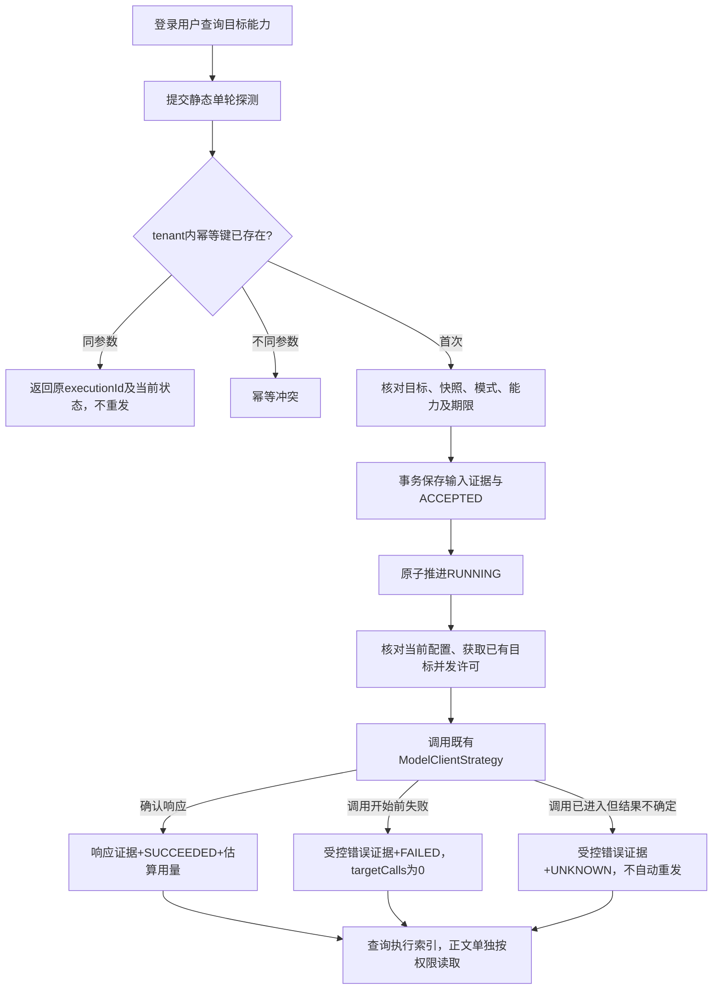

# D01：共享探测执行与证据接入说明

补充日期：2026-10-01。业务基线仍为《红队自动化评测智能体-产品与开发方案》。本文对照当前源码说明D01的入口、字段及后续扩展边界，不表示新增业务实现或通过验收。

首版接入说明补充时只修改文档，未运行测试、Maven、编译、SQL、服务或真实模型调用。2026-10-01后续进入D01～D05测试工作，已通过第一批隔离/HTTP契约测试并完成必要编译；仍未执行SQL、启动服务或调用真实模型。结果见[D01～D05测试与前端联调计划](D01-D05-测试与前端联调计划.md)
，不等于D01集成验收通过。

## 1. D01做什么、从哪里开始和结束

D01负责“一次受控输入如何调用目标、保存物理执行事实、查询状态并读取证据”，不是另一个样本评测流水线，也不是自动红队Agent。

开始于当前登录用户选择一个允许测试的模型目标，检查能力并提交一次探测；结束于形成可查询的执行状态、输入/响应/受控错误证据和用量。D01不解释目标内容是否违规，不确认风险，不做发现复现或修复回归。

| 名称                  | 含义                                    |
|---------------------|---------------------------------------|
| `probeId`           | 调用方提供的逻辑探测标识，不是独立的幂等键                 |
| `executionId`       | 服务端生成的物理执行记录ID，后续查询/取证使用它             |
| `idempotencyKey`    | tenant内探测提交键；同键同业务参数复用原执行，不再次进入本层目标调用 |
| `targetSnapshotRef` | 实际受理时固定的目标配置引用，不是模型权重内容哈希             |
| `evidenceRef`       | 某项原文证据引用，不是安全判定                       |

当前源码的共享适配器已供D02、D03和D04调用，但D01公开HTTP提交请求没有会话字段，仍以`STATIC_SINGLE_TURN`
接入。D03内部使用同一端口的多轮分支，不应据此将D01公开接口写成支持多轮。

## 2. 执行流程和模块分工



| 模块 / 类或端口                                                             | 职责                                      |
|-----------------------------------------------------------------------|-----------------------------------------|
| eval-agent / `TargetCapabilityPort`、`TargetSnapshot`                  | 目标配置、状态、能力和限制契约                         |
| eval-agent / `ProbeExecutionPort`、`ProbeCommand`、`TargetObservation`  | 提交、查询、取消意图及执行观察契约                       |
| eval-agent / `EvidenceReadPort`、`EvidenceReference`、`EvidenceContent` | 证据索引与受限原文分离                             |
| eval-agent / `BudgetPolicy`、`UsageRecord`                             | 预算/用量字段契约；D01公开接口没有运行预算控制面              |
| eval-agent / `AssessmentPort`                                         | 保留判定边界的契约，D01没有正式Judge接入接口              |
| eval / `ProbeApplicationService`                                      | 登录身份、请求到领域命令转换，不直接读取凭据                  |
| eval / `ModelTargetCapabilityAdapter`、`ModelTargetSnapshotFactory`    | 读取model_info并生成不含明文凭据的配置快照              |
| eval / `ModelProbeExecutionAdapter`                                   | 幂等、能力检查、复用目标客户端与已有限流器、记录执行结果            |
| eval / `AgentProbeRecordService`                                      | 短事务保存输入、执行状态、响应/受控错误与账目                 |
| eval / `DatabaseEvidenceReadAdapter`                                  | 按tenant、actor、execution和evidenceRef隔离读取 |
| eval / `ProbeDigestService`、`SensitiveErrorSanitizer`                 | 请求指纹、原文摘要、受控错误处理                        |
| eval / `AgentTargetController`、`AgentProbeController`                 | 下列HTTP入口                                |

输入/响应不是写入旧批量评测明细表。D01新增`agent_probe_execution`和`agent_evidence`，复用已有模型客户端及
`ModelCallRateLimiter`，不整体重写newpipeline。

## 3. 接入前提、迁移与认证

1. 人工确认现有Spring Boot服务、MySQL数据源、Sa-Token登录和模型客户端所需的基础设施可用。
2. 审阅D01迁移草案：`doc/sql/mysql/20260929_create_agent_probe_d01.sql`，它只新增探测及证据表。本次未执行；
   `CREATE IF NOT EXISTS`不会升级已存在表。
3. 选择已登记、未删除且启用的`model_info.id`。模型地址/凭据由已有配置服务读取，不由本请求传入；能力查询不发起目标探活。
4. 当前仓库已叠加D03、D04、D05，不是可只安装D01表的独立发行版。部署当前整体服务还应按实际已应用迁移记录审阅D02及后续迁移，不能把本文当成完整环境安装清单。
5. 先读目标能力，再提交一次允许测试的静态探测。POST是同步目标调用，会产生目标请求与费用，本文示例并未实际执行。

当前身份来自`SaTokenProbePrincipalProvider`：actor为Sa-Token登录ID，tenant为`agent.probe.default-tenant-id`，默认`default`
。身份不由请求指定。该配置只表示当前业务空间，不等于完整多租户系统。

`authorizationRef`
目前是非空授权引用，未实现完整审批/到期/撤销核验；activity/task/run/attempt在裸D01接口中也是上层关联引用，不自动创建这些业务对象。当前目标配置读取本身没有完整tenant/角色授权适配，必须只选择业务允许测试的目标，不能声称已实现细粒度目标权限。

D01/D02时间落库采用`ZoneId.systemDefault()`转换到无时区`DATETIME(3)`，API时间使用Instant；部署实例应保持一致的JVM/数据库驱动时间配置。不能把D05的显式UTC
`DATETIME(6)`约定套到这些早期表上。

## 4. 接口目录

以下为Controller路径，实际服务前缀/网关路径/认证头沿用现有工程，本文不假定端口或Token请求头名称。

| 方法与路径                                                    | 功能 / data类型                             |
|----------------------------------------------------------|-----------------------------------------|
| GET `/agent/targets/models/{modelId}/capabilities`       | 查询当前配置快照和能力，TargetCapabilitiesResponse  |
| POST `/agent/probes`                                     | 同步受理并尝试执行一次静态探测，ProbeSubmissionResponse |
| GET `/agent/probes/{executionId}`                        | 查询物理执行、证据索引、用量，ProbeExecutionResponse   |
| GET `/agent/probes/{executionId}/evidence/{evidenceRef}` | 读取所属原始证据，EvidenceContentResponse        |
| POST `/agent/probes/{executionId}/cancellation`          | 无请求体，记录取消意图，ProbeCancellationResponse   |

没有公开探测列表分页、按幂等键GET查询、会话创建或独立判定接口。没拿到executionId时可用原键和完整原参数重放POST，它只复用已受理记录；不能更换键、输入或截止时间当作“网络重试”。

## 5. 提交示例与每个请求字段

先查询已批准模型的能力，将下面`targetModelId`替换为真实可用ID。示例业务引用仅展示形状，不代表已经存在一份获批准的活动；不要使用D04验证运行保留的
`vrun_`命名空间伪造上层记录。

```json
{
  "idempotencyKey":"d01-demo-probe-001",
  "probeId":"probe-demo-001",
  "activityId":"activity-demo-001",
  "taskId":"task-demo-001",
  "runId":"run-demo-001",
  "attemptId":"attempt-demo-001",
  "authorizationRef":"approved-isolated-check-001",
  "targetModelId":1,
  "expectedTargetSnapshotRef":null,
  "riskId":"contract-mechanism-check",
  "ruleSetVersion":"rules-demo-v1",
  "executionMode":"STATIC_SINGLE_TURN",
  "input":"这是授权的虚构场景，仅返回字符串 DEMO_REPLY_OK，不访问真实系统或数据。",
  "requiredCapabilities":["SINGLE_TURN"],
  "deadlineAt":null
}
```

| 字段                        | 含义 / 约束                                                          |
|---------------------------|------------------------------------------------------------------|
| idempotencyKey            | 必填、最多128字符，tenant内唯一提交键；另一个actor使用同键也不会创建新执行                     |
| probeId                   | 必填、最多64字符，逻辑探测关联ID；同probeId但不同键不能被认为自动去重                         |
| activityId                | 必填、最多64字符，上层评测活动引用                                               |
| taskId                    | 必填、最多64字符，上层任务引用，D01不创建任务                                        |
| runId                     | 必填、最多64字符，上层运行引用，D01不创建红队运行                                      |
| attemptId                 | 必填、最多64字符，当前攻击尝试/业务单元引用                                          |
| authorizationRef          | 必填、最多128字符，运行授权引用；当前仅传递，不核验真实批准                                  |
| targetModelId             | 必填正整数，现有model_info主键，不是模型名称或快照字符串                                |
| expectedTargetSnapshotRef | 可空、最多160字符；不为空时填能力查询返回的精确引用，变化则拒绝首次受理                            |
| riskId                    | 必填、最多128字符，风险/场景标签，不产生风险判定                                       |
| ruleSetVersion            | 必填、最多128字符，后续判定应使用的规则引用；D01不执行规则集                                |
| executionMode             | 必填，D01公开提交使用STATIC_SINGLE_TURN；不接受ADAPTIVE_SINGLE_TURN作为一次物理探测模式 |
| input                     | 必填、最多100000字符，实际目标输入，保留首尾空格和换行，长度不是Token数                        |
| requiredCapabilities      | 可空/空数组为无额外要求；服务器仍要求SINGLE_TURN，只能要求目标已声明的能力                      |
| deadlineAt                | 可空Instant，建议ISO-8601带Z或偏移；表示最晚开始意图，不保证立即中断已发请求                   |

`expectedTargetSnapshotRef`
为空时首次受理采集当前快照，后续同键复用原记录。当前配置版本取model_info.version，否则取updateTime，否则为unversioned；D03多轮能力声明影响引用。配置/权重变更必须有可靠版本管理，本实现不是权重哈希验证。

## 6. 返回JSON字段字典

### 6.1 统一Result外壳

| 字段        | 含义                                       |
|-----------|------------------------------------------|
| code      | `"0"`表示HTTP业务接口调用成功，不是目标安全或执行一定SUCCEEDED |
| message   | 可空接口提示/错误说明                              |
| data      | 下述业务对象，失败时可能为空                           |
| requestId | 项目追踪引用，当前Controller未单独赋值，可空              |
| success   | 项目isSuccess()可能序列化为此值，仅反映code是否为0        |

### 6.2 目标能力TargetCapabilitiesResponse

| 字段                    | 含义                                                        |
|-----------------------|-----------------------------------------------------------|
| targetSnapshotRef     | 当前可比较配置引用，首次受理时可用作前置条件                                    |
| targetType            | 当前MODEL；其他目标类型不在D01实现范围                                   |
| targetId              | 模型资源ID字符串，不是模型名称                                          |
| displayName           | 目标展示名                                                     |
| modelName             | 配置实际模型名称                                                  |
| targetVersion         | 配置版本标签，不是模型权重版本保证                                         |
| status                | AVAILABLE配置启用、DISABLED配置停用；UNAVAILABLE为契约状态，读取不存在资源通常直接报错 |
| environment           | 配置environment标签，未配置为UNSPECIFIED，不验证隔离环境真实性                |
| identityRef           | model-credential:<id>内部凭据引用，不包含明文凭据，不证明测试身份已绑定            |
| supportedCapabilities | 已声明能力数组，决定能否请求相应执行模式                                      |
| capturedAt            | 快照采集Instant，不是模型调用时间                                      |
| limitations           | 当前适配限制，前端应展示，不是成功探活证据                                     |

当前默认能力为SINGLE_TURN。D03增加明确supportsMultiTurn配置与厂商适配后可声明MULTI_TURN，详见D03说明。RESET、BRANCH、TOOL_TRACE、RETRIEVAL_TRACE、IDEMPOTENT_EXECUTION、EXECUTION_STATUS_QUERY、TEST_IDENTITY是契约枚举，当前不是全部已实现能力。尤其不能把凭据引用当作TEST_IDENTITY。

### 6.3 提交ProbeSubmissionResponse

| 字段            | 含义                                                |
|---------------|---------------------------------------------------|
| probeId       | 请求逻辑探测ID                                          |
| executionId   | 服务端物理执行ID，后续GET/取消/取证用它                           |
| status        | 返回时执行状态；首次同步完成常为SUCCEEDED/FAILED/UNKNOWN，重放可仍在处理中 |
| newlyAccepted | true本次首次建记录，false复用原记录；不代表首次一定成功                  |
| acceptedAt    | 第一次受理时间，幂等重放不会新建受理时间                              |

### 6.4 执行ProbeExecutionResponse

| 字段                                         | 含义                                                            |
|--------------------------------------------|---------------------------------------------------------------|
| tenantId / actorId                         | 服务端执行归属业务空间/登录主体，只读                                           |
| activityId / taskId / runId / attemptId    | 原请求上层关联引用；含义同第5节                                              |
| probeId / executionId                      | 逻辑探测/物理记录，不能混作URL查询ID                                         |
| idempotencyKey                             | 首次受理提交键，不是新一轮调用指令                                             |
| traceId                                    | 首次执行技术追踪ID，重试新trace不改变业务幂等指纹                                  |
| authorizationRef                           | 原执行传递的授权引用                                                    |
| status                                     | 第7节物理执行状态，不是风险确认状态                                            |
| targetType / targetId                      | 原被测资源MODEL/ID字符串                                              |
| targetSnapshotRef                          | 本次实际受理固定快照，不随当前模型配置修改                                         |
| riskId / ruleSetVersion                    | 原请求风险标签/规则引用，不等于判定已执行                                         |
| executionMode                              | 原物理交互模式，裸D01为STATIC_SINGLE_TURN                               |
| requiredCapabilities                       | 原额外能力要求，按名称排序；不是目标完整能力数组                                      |
| sessionRef                                 | 裸D01为null；D03内部多轮执行才有平台会话引用                                   |
| deadlineAt                                 | 原可空截止意图                                                       |
| inputEvidence                              | 原输入证据索引，内部字段见下一表                                              |
| responseEvidence                           | 可空响应证据索引，SUCCEEDED应存在                                         |
| errorEvidence                              | 可空受控错误证据索引；不是第三方异常栈或明文凭据                                      |
| toolTraceEvidence / retrievalTraceEvidence | 预留轨迹索引数组，当前普通MODEL调用为空                                        |
| evidenceCompleteness                       | COMPLETE本适配文本输入/响应齐全；PARTIAL缺少完整响应等；MISSING为契约状态，不证明应用级工具证据完整 |
| latencyMs                                  | 可空毫秒耗时，采用客户端elapsed或本层计时，不等于精确供应商推理时间                         |
| usage                                      | 本层计量对象，字段见6.6节                                                |
| errorCode / errorMessage                   | 可空稳定执行错误码/受控摘要，不与Result.code混用                                |
| cancellationRequested                      | 是否曾记录取消意图，最终SUCCEEDED也可为true                                  |
| acceptedAt / startedAt / finishedAt        | 首次受理、本层开始处理、结果状态结束时间，可空不代表未产生费用                               |

### 6.5 证据索引EvidenceReferenceResponse与正文

| 字段                                | 含义                                                           |
|-----------------------------------|--------------------------------------------------------------|
| evidenceRef                       | 唯一证据引用                                                       |
| type                              | 当前常见PROBE_INPUT、TARGET_RESPONSE、TARGET_ERROR，其他枚举不表示已支持工具/检索 |
| ownerType                         | 当前PROBE_EXECUTION                                            |
| ownerRef                          | 所属executionId，读取时必须匹配当前URL执行                                 |
| mediaType                         | 当前text/plain; charset=UTF-8，不能据内容将其当HTML执行                   |
| contentHash                       | 原始正文SHA-256摘要，保存的索引，不是风险结论                                   |
| dataClass                         | 当前RESTRICTED访问分级，不表示数据库字段自动加密                                |
| createdAt                         | 证据创建时间                                                       |
| EvidenceContentResponse.reference | 上述完整证据索引对象                                                   |
| EvidenceContentResponse.content   | 原始输入/响应或脱敏受控错误正文，纯文本展示                                       |

正文接口当前核对身份和归属，不能将它描述为执行了D04整套证据完整性复核。D02动作只引用证据；原始目标内容不作为前端脚本或平台指令执行。

### 6.6 UsageResponse与取消回执

| 字段                                 | 含义                                                          |
|------------------------------------|-------------------------------------------------------------|
| usage.targetCalls                  | 本层进入目标客户端调用的计数；成功/UNKNOWN通常1，调用前失败0；未统一核验客户端内部物理重试次数        |
| usage.agentCalls                   | 此共享执行层Agent模型调用数，当前0，不包括D02规则decide次数                       |
| usage.inputTokens / outputTokens   | 可空输入/输出计量，当前按文本估算；UNKNOWN输出可能为空，不能当0                        |
| usage.cost / currency              | 当前无统一价格计量，通常null，不等于零费用                                     |
| usage.measurement                  | ACTUAL实报、ESTIMATED估算、UNAVAILABLE无法取得；当前成功/UNKNOWN为ESTIMATED |
| cancellation.probeId / executionId | 被取消意图关联的原逻辑/物理记录                                            |
| cancellation.status                | 当前事实状态，不保证变成CANCELLED                                       |
| cancellation.cancellationRequested | 是否确实已记录取消意图，已终态才请求时可仍false                                  |
| cancellation.requestedAt           | 可空第一次意图时间，重复请求不表示新一次供应商取消                                   |

## 7. 状态、幂等、取消和错误处理

| 状态                     | 当前含义                               |
|------------------------|------------------------------------|
| ACCEPTED               | 输入和执行意图已持久化，尚未推进处理                 |
| RUNNING                | 本层已开始处理，可能还在准备或等并发许可，不证明供应商已收到     |
| SUCCEEDED              | 已确认文本响应并保存证据；拒答文本也是执行成功，不是风险命中     |
| FAILED                 | 当前适配中明确在进入客户端调用前失败，不当作目标安全结果       |
| UNKNOWN                | 进入客户端后异常或没有可确认响应，可能已经执行/计费，不能盲目重发  |
| CANCELLATION_REQUESTED | 保存了取消意图，仍可能有确认响应或未知结果              |
| CANCELLED              | 明确尚未进入本层处理、满足状态条件时取消；不是远程取消接口的成功保证 |

- 幂等唯一范围是tenant+key，指纹包含actor、全部业务引用、目标、预期快照、风险/规则、模式/会话、输入摘要、能力、原期限，不含每次变化的traceId。更换actor或任一业务参数不能复用原键。
- 同键复用既有记录优先于当前快照/期限检查；原记录不会因为现在已过期或目标已改配置而被重新发送。
- 调用方网络超时与服务端保存UNKNOWN不同；没收到HTTP返回不代表目标未调用。查询原execution或用完整原参数同键重放，禁止换键补发。
- 同步请求进程中断后可能遗留ACCEPTED/RUNNING。裸D01没有后台自动恢复/最终状态核对入口，不能只因幂等重放成功就认定恢复完成。
- 取消是意图，RUNNING阶段或等待许可的请求不能保证立即停止；最后以查询的执行事实为准。
- `deadlineAt`在首次受理及执行准备时检查；静态单轮等并发许可后没有完整硬期限围栏，也没有统一中断客户端能力，不能把它展示成严格请求完成超时。
- D01本层不因UNKNOWN主动重发，但既有供应商客户端的内部重试尚未统一约束/计量，不声称跨供应商严格“恰好一次”。

接口错误与执行错误分开：

下面列出D01业务错误。DTO的@NotBlank/@Size等校验沿用项目GlobalExceptionHandler，返回通用客户端错误码，不一定为A050001；无法解析的枚举/JSON走HTTP400，不能假定每次失败都有Result外壳。2026-10-01已用独立MockMvc测试核对这两个分支，未运行真实服务或目标调用。

| Result.code       | 含义                     |
|-------------------|------------------------|
| A050001           | 参数/模式组合/期限不合法          |
| A050002           | tenant内同键不同业务参数        |
| A050003           | 请求能力或模式不受支持            |
| A050004 / A050005 | 执行/证据不存在或当前身份无权访问      |
| A050006           | 模型配置不存在、不可用或无法解析       |
| A050007           | 目标快照前置条件不匹配            |
| B050001 / B050002 | 事实保存失败/状态并发冲突，应先核对既有记录 |

已受理执行内的`errorCode`另有`DEADLINE_EXPIRED_BEFORE_CALL`、`TARGET_CONFIGURATION_CHANGED`、`TARGET_PREPARATION_FAILED`、
`TARGET_CALL_RESULT_UNKNOWN`等。Result.code为0时也可能data.status=FAILED/UNKNOWN，前端必须分开判断。

## 8. 人工接入观察顺序与D02衔接

以下只是后续联调检查清单，本轮没有实际调用：

1. 登录后查询允许目标，核对AVAILABLE、SINGLE_TURN和限制；缺失模型/停用目标/额外工具能力不能静默降级。
2. 提交虚构、无副作用输入，保存executionId，再查询执行。接口成功和目标响应内容分别查看。
3. 从inputEvidence/responseEvidence取引用读取原文，核对ownerRef、原文和SHA-256索引；不把证据正文写进普通日志。
4. 同一主体完整原参数同键重放，确认executionId相同、newlyAccepted=false；变更输入但同键应冲突。
5. 在获授权环境确认失败、未知与取消的展示口径；不通过真实危险操作验证机制。

D01的代码契约已供D02开发使用，但验收仍须核对受控调用、幂等、真实证据、计量局限及存量标准评测兼容。D02负责围绕这些执行事实做反馈循环，不将D01接口另包装成一套平行单样本业务。

下一份：[D02反馈驱动自动红队接入说明](D02-反馈驱动自动红队接入说明.md)
。线性多轮与恢复见[D03接入说明](D03-多轮会话与运行恢复接入说明.md)。
