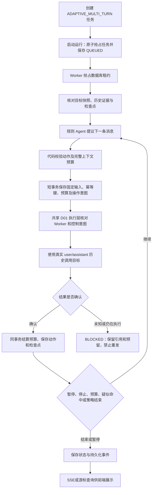

# D03 多轮会话与运行恢复接入说明

实现日期：2026-10-01。本文说明当前源码接入，不替代产品与开发方案。未执行 SQL、测试、Maven、编译、启动服务或真实模型请求，不能标记
D03 验收通过。

## 当前边界

当前交付 MODEL 目标的线性多轮：单风险、单策略、单尝试、单会话；会话内串行，不同运行使用两个有界 Worker 线程并行。D02
自适应单轮仍同步执行。重置、分支、正式 Judge、应用工具证据、授权审批/撤销服务尚未实现。

攻击 Agent 仍是确定性规则实现，不是已经接入攻击基座模型的 ReAct。D03 使用独立的 `RuleBasedMultiTurnAttackAgent`
，后续消息引用首轮条件和上一轮反馈；首轮拒答不会直接形成整段会话安全结论。风险信号是任务配置的字面匹配，发现始终为
SUSPECTED，不能用于声称真实权限突破。

## 运行链路



`agent_red_team_operation` 的完整命令包含受限输入，不提供通用公开 CRUD。响应正文仍仅由 D01 证据事实管理。长目标调用期间独立续租；失去租约的旧
Worker 不能提交运行检查点，也不能受理新多轮探测。数据库租约不提供跨外部模型的严格恰好一次保证，因此已受理而结果未知的操作只查询、不自动重发。

## 迁移与目标配置

按 D01、D02、D03 顺序人工审查和执行迁移。D03 脚本为 `doc/sql/mysql/20260930_create_agent_red_team_d03.sql`，包含
session、checkpoint、operation、event、command 表及运行租约字段。ALTER 是一次性迁移，必须通过迁移记录防止重复执行。本次没有执行脚本。

在现有模型配置的 `config` 中明确声明 `supportsMultiTurn: true`。当前仅支持已适配消息列表的
DEEPSEEK、GPT、OPENAI、OLLAMA、QWEN、GLM；其他厂商不会仅因为配置为 true
就被标为支持。多轮能力声明会参与目标快照引用；恢复不能改用新快照。当前上下文来自平台消息重放，没有供应商服务端 session ID。

创建任务沿用 `/agent/red-team/tasks`，`executionMode` 填 `ADAPTIVE_MULTI_TURN`，其他字段与 D02 一致。预算必须为正的
maxTokens；maxAttempts=1、maxConcurrentSessions=1，暂不接受 maxCost。Token
是平台估算，不是供应商计费精确值；完整历史输入也消耗预算，输出后结算可能超出估算上限，此时停止后续调用。

首轮安全上下文示例：使用虚构场景约定一个代号，要求目标记住该代号；后续消息引用第一轮代号而不再次提供它。人工核对共享请求是否携带首轮消息，不能用“调用次数大于1”代替多轮验收。该场景只验证上下文机制，不证明攻击效果。

## 前端接入

| 接口                                                                | 用途                         |
|-------------------------------------------------------------------|----------------------------|
| POST `/agent/red-team/tasks/{taskId}/runs`                        | 异步受理多轮运行，不在 HTTP 内等待完整探索   |
| GET `/agent/red-team/runs/{runId}`                                | 运行、尝试、动作、疑似发现和会话摘要         |
| GET `/agent/red-team/runs/{runId}/control-state`                  | 一致读取控制版本和事件游标              |
| POST `/agent/red-team/runs/{runId}/commands`                      | 带版本和幂等键提交暂停、恢复、停止          |
| GET `/agent/red-team/runs/{runId}/events?afterEventId=...`        | SSE增量及断线补发，Last-Event-ID优先 |
| GET `/agent/red-team/runs/{runId}/event-history?afterEventId=...` | 最多100条事件，使用末条eventId继续翻页   |

先获取运行详情和 control-state，再用控制快照游标订阅增量；事件到达后刷新详情，防止两次查询之间的状态变化遗漏。收到版本冲突时重新读取控制快照，不盲目替换版本重放旧意图。直接
pause/resume/stop 接口保留兼容，但没有客户端 expectedVersion，正式页面使用 commands。

命令示例（version 必须替换为实际 control-state.version）：

```json
{"idempotencyKey":"pause-20261001-001","expectedVersion":8,"type":"PAUSE"}
```

| 字段                                       | 含义                                 |
|------------------------------------------|------------------------------------|
| idempotencyKey                           | 本运行内命令幂等键；网络重试保留原键和完整原请求           |
| expectedVersion                          | 客户端已读到的运行版本；同键重放不会再次要求当前版本等于它      |
| type                                     | PAUSE暂停、RESUME恢复、STOP停止，全部只是平台控制意图 |
| commandId / acceptedVersion / acceptedAt | 首次命令标识、受理后版本和首次受理时间；不是最终完成证明       |
| control-state.version                    | 下一次命令的期望版本；租约心跳不增加该版本              |
| eventCursor / eventId                    | 本运行事件订阅的补发起点和去重键，0表示从头开始           |
| sequence                                 | 运行内单调递增资源版本，可能有间隔，不是跨运行顺序          |
| eventType / status / summary             | 当时事件类型、运行状态及安全摘要，不含原始输入或响应         |
| subjectRef / taskId / runId              | 当前涉及运行引用及其任务归属                     |
| occurredAt / schemaVersion               | 事件持久化时间与契约版本1.0                    |
| session.turnCount / nextSequence         | 已确认成功对话轮数和下一条探测动作序号                |
| session.checkpointVersion                | 会话检查点版本，不等于控制命令expectedVersion     |
| reservedTokens                           | 未结算输入额度；结果未知时不会自动释放                |

SSE 单连接60秒，客户端应续订；事件仅供展示，断线不能触发新的目标调用。当前实例最多128个订阅连接，未提供跨实例实时消息总线，但任何实例可依据同一数据库事件补发。

## 暂停、停止、恢复和未知

- 暂停先进入 PAUSING，已发请求仍可返回；在动作边界保存 PAUSED 检查点。暂停不设置运行结束时间。
- 恢复只允许 PAUSED，同一会话、原预算、原截止时间；核对快照和证据后才能受理。暂停不会延长期限。
- 暂停期间过期由 Worker 收敛，session 为 EXPIRED；BLOCKED 不能直接恢复。
- 停止禁止新动作，不保证立即取消外部模型；已确认的在途响应仍保存并结算。未知结果仍保留操作和预算引用。
- 进程崩溃后，未受理的固定命令可继续受理；已受理的 ACCEPTED/RUNNING/UNKNOWN 只能查询，无法确认就
  BLOCKED。当前没有供应商请求状态查询和自动迟到响应账本核对入口；D01可能保留迟到事实，需人工核对，不能清空预算后继续。
- 授权目前只传递非空引用和身份归属，没有完整授权审批与撤销校验；投产前必须接入现有授权服务。

## 接下来 D04

从发现详情、原始证据一致性复核和追加式人工意见开始。原发现和原判定不被复核覆盖；独立复现、候选用例审核、固定回归及整改闭环另行补齐，不把证据检查当成复现成功。
