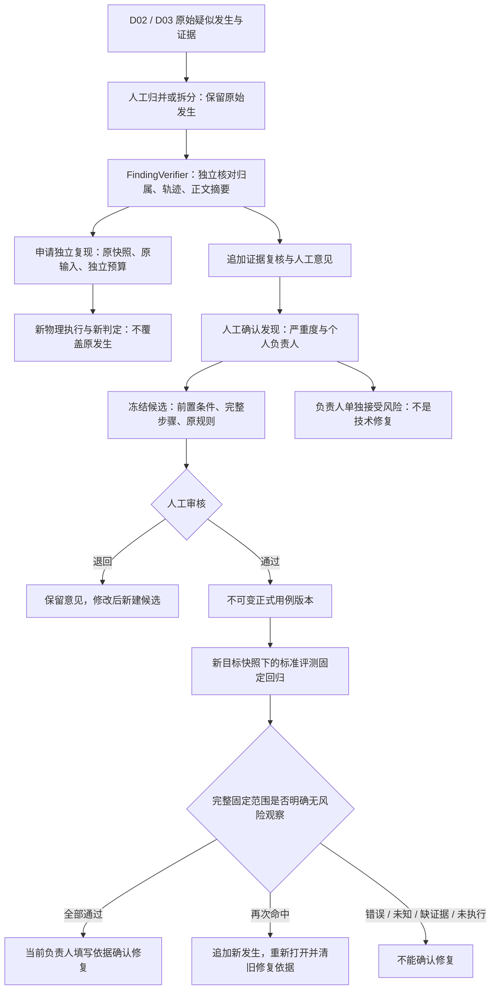
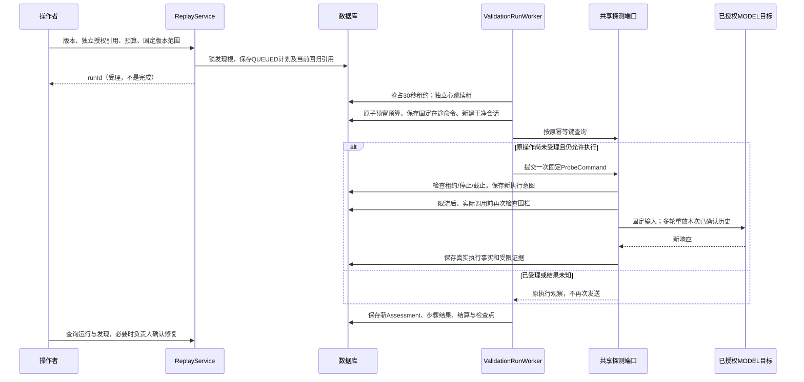

# D04：发现、独立复现与固定用例回归接入说明

更新日期：2026-10-01。业务基线为本目录《红队自动化评测智能体-产品与开发方案》。本说明记录当前源码，不替代集成验收。

本次没有运行测试、Maven、编译、SQL、服务或真实模型请求；D04不能标记为验收通过。没有修改产品原型、增加新的自由攻击Agent或推送远端。

## 1. 本次落地的业务链



发现确认、运行执行、整改进度是三个维度。复核支持不等于复现成功，复现未命中不等于原发现被驳回，运行 `COMPLETED` 不等于修复成功。

固定回归仍是标准评测的 `REGRESSION` 用途。当前 `agent_validation_run` 是复现与固定回归共用的持久化执行内核，不引入第四种产品任务，也尚未替代既有批量流水线或完整标准评测任务中心。

## 2. 源码分工与执行边界

| 位置 / 类 | 职责 |
| --- | --- |
| eval-agent / FindingVerifier | 确定性证据完整性核对；独立读取原执行与正文，不调用目标 |
| eval-agent / FixedCaseDefinition、ValidationPlan | 固定输入引用、前置条件、断言、正式版本和独立预算契约 |
| eval / FindingRecordService | 认证原始发生，读取归并根，追加复核，锁定发现控制版本 |
| eval / FindingLifecycleService | 人工归并/拆分、整改、当前回归资格检查、确认修复/重新打开/接受风险 |
| eval / FixedCaseFactory | 从历史物理执行的目标快照及完整证据轨迹生成固定配置 |
| eval / RegressionCaseService | 候选、审核历史、正式不可变版本；入库不调用目标 |
| eval / ReplayService | 校验条件并受理 QUEUED 验证计划；HTTP不等待目标执行 |
| eval / ValidationRunRecordService | 租约、版本、预算预留/结算、固定命令、会话检查点与追加新判定的短事务 |
| eval / ValidationRunWorker | 固定顺序后台推进，不生成输入；按原幂等键核对恢复事实 |
| eval / AgentProbeRecordService、ModelProbeExecutionAdapter | D01共享探测；首次受理和实际调用前检查验证Worker围栏 |



外部模型调用不持有数据库事务。数据库与供应商请求之间不能保证严格“恰好一次”；UNKNOWN、ACCEPTED、RUNNING、CANCELLATION_REQUESTED 未确认时不重发、不释放在途预算。后台只查询平台已有事实，不声称能查询供应商最终状态。

`vrun_`、`vtask_`、`vatt_`、`vsess_` 与原探索运行分开。一个验证运行最多20个固定用例；每例最多100步。每个用例独立尝试、多轮独立平台消息历史，不复用原攻击会话。不能保证供应商隐藏状态或外部应用状态已经清理。

## 3. 数据库迁移与接入

先审查并按顺序应用 D01、D02、D03 迁移，再应用 `doc/sql/mysql/20261001_create_agent_finding_d04.sql`。本次没有执行任何脚本。

D04增加11张表：

| 表 | 保存什么 |
| --- | --- |
| agent_finding_state | 当前确认/整改状态、版本、当前回归及修复依据 |
| agent_finding_review | 原证据快照、证据核对、人工意见与结论，追加式保存 |
| agent_finding_occurrence | 原始发生到当前归并根的映射，不覆盖原发生 |
| agent_finding_change | 归并、拆分、整改及自动复发审计与首次命令回执 |
| agent_case_candidate | 待审核冻结配置与修订依据 |
| agent_case_review | 独立审核意见及首次回执 |
| agent_regression_case | caseId/version不可变正式版本 |
| agent_validation_run | 固定计划、独立账本、在途命令、结果、版本、租约 |
| agent_validation_command | 停止命令与首次回执 |
| agent_validation_assessment | 新追加判定，不覆盖原探索结果 |
| agent_validation_occurrence | 新验证命中；同一运行的同一用例会话前缀仅计一次发生 |

D04复用 D03 的会话和检查点表，迁移将 `agent_red_team_session` 的唯一约束由 `run_id` 改为 `(run_id, attempt_id)`。该 ALTER 是一次性迁移，不能重复执行。D03仍只有一个尝试会话，因此其原运行读取流程不变。

如果曾执行早期只有state/review两表的D04脚本，先人工确认state缺少的五个字段，再应用 `20261001_upgrade_agent_finding_d04_early_slice.sql`，随后应用完整D04脚本。新数据库不要执行早期升级脚本。`CREATE TABLE IF NOT EXISTS` 不会升级已有表；如果已经手工执行过本轮中间版本，应逐字段核对，不能直接假设迁移完整。

`pending_command_json` 含受限输入，禁止日志、列表、普通响应和SSE输出。普通API只返回证据引用；正文沿用 D01 受控证据接口，前端必须纯文本展示。

调度配置：

| 配置 / 默认 | 意义 |
| --- | --- |
| eval.agent.validation.recovery-interval-ms / 5000 | 查询可接管运行的间隔 |
| eval.agent.validation.initial-delay-ms / 5000 | 启动后首次接管延迟 |
| 独立线程池2线程、零排队 | 不排队已抢占租约的任务；拒绝投递时释放租约 |
| 租约30秒、心跳5秒 | 旧Worker失租不能首次受理新操作或写入验证进度 |
| BLOCKED查询冷却30秒 | 只核对迟到事实，避免未知运行占满新任务接管窗口 |

## 4. API入口

路径以下均为控制器映射；如应用另设context-path，客户端需加此前缀。响应仍使用项目统一 `Result` 包装，下面字典描述业务data。

| 方法 / 路径（省略 /agent） | 作用 |
| --- | --- |
| GET /findings/{findingId} | 原发生、归并成员、当前确认/整改、当前回归、正式版本和修复依据 |
| GET /findings/{findingId}/reviews?afterVersion=0 | 原ID的复核历史，最多100条；不静默改写归并前历史 |
| POST /findings/{findingId}/evidence-reviews | 核对证据并追加意见；不确认风险、不调用目标 |
| POST /findings/{findingId}/reviews | 人工意见；COMMENT_ONLY / CONFIRM / DISMISS / INCONCLUSIVE |
| POST /findings/{findingId}/changes | 归并、拆分与整改命令 |
| GET /findings/{findingId}/changes?afterVersion=0 | 人工和系统变更审计，最多100条 |
| POST /findings/{findingId}/case-candidates | 从选定原发生冻结候选；不调用目标 |
| GET /findings/{findingId}/case-candidates | 当前发现的候选列表 |
| GET /case-candidates/{candidateId} | 候选详情及控制版本 |
| POST /case-candidates/{candidateId}/reviews | APPROVE发布正式版本，RETURN退回 |
| GET /case-candidates/{candidateId}/reviews | 保留审核历史 |
| GET /findings/{findingId}/regression-cases | 当前完整范围的全部最新正式版本 |
| GET /regression-cases/{caseId}/versions | 正式版本历史 |
| GET /regression-cases/{caseId}/versions/{version} | 精确不可变正式版本 |
| POST /findings/{findingId}/replays | 原快照独立复现，新物理执行和独立预算 |
| POST /findings/{findingId}/regression-runs | 新快照固定回归，必须覆盖全部最新正式版本 |
| GET /findings/{findingId}/validation-runs | 复现和回归运行历史 |
| GET /findings/{findingId}/validation-occurrences | 新命中发生，定位runId、caseIndex、assessmentId |
| GET /validation-runs/{runId} | 安全运行摘要；当前采用轮询，不复用探索SSE |
| GET /validation-runs/{runId}/assessments | 本运行独立保存的新判定 |
| POST /validation-runs/{runId}/stop | 版本化幂等停止；不保证中断在途请求 |

写接口由服务端读取租户与操作者。当前沿用现有“租户＋操作者”访问范围，个人负责人必须是当前认证actorId；没有实现跨用户负责人分配、团队目录或完整RBAC。

归并后的详情返回根findingId。新的写操作必须使用该根；写接口不自动把成员的版本和幂等键解释到另一根。原成员ID的历史仍可读。

## 5. 请求字段及人工联调顺序

以下只提供日后人工联调的示例，本次未调用接口。每次新业务动作先GET最新版本；相同幂等键重试必须保留原参数和原expectedVersion，不能边重试边改版本。

### 5.1 证据核对与人工确认

证据核对请求：

```json
{
  "idempotencyKey": "finding-check-demo-001",
  "expectedVersion": 0
}
```

`idempotencyKey` 是该发现的复核幂等键；`expectedVersion` 是发现GET返回的version，不是原运行版本。

核对后重新GET版本，确认请求示例：

```json
{
  "idempotencyKey": "finding-confirm-demo-001",
  "expectedVersion": 1,
  "opinion": "SUPPORT",
  "decision": "CONFIRM",
  "reason": "已按原规则人工核对完整轨迹，仅确认该文本信号范围",
  "evidenceRefs": ["使用原发生中的真实证据引用"],
  "severity": "MEDIUM",
  "ownerRef": "当前登录操作者ID"
}
```

| 字段 | 含义与约束 |
| --- | --- |
| opinion | SUPPORT支持 / OPPOSE反对 / INSUFFICIENT证据不足 / REPLAY_REQUIRED建议复现 |
| decision | COMMENT_ONLY只留意见；CONFIRM确认；DISMISS驳回；INCONCLUSIVE待定 |
| reason | 人工依据，不能填模型内部思维链或凭据 |
| evidenceRefs | 引用本原发生中的证据，非空、不重复，服务端另做完整轨迹核对 |
| severity | CONFIRM必须明确LOW/MEDIUM/HIGH/CRITICAL，不接受PENDING；其他决策为空 |
| ownerRef | CONFIRM必须等于认证actorId；其他复核决策为空 |

VALID证据核对只建议复现，不表示规则风险被确认。CONFIRM还要求SUPPORT；只能对SUSPECTED/INCONCLUSIVE作首次确认/驳回/待定。已确认发现仍可追加COMMENT_ONLY，不会覆盖原结论。

### 5.2 独立复现

```json
{
  "idempotencyKey": "replay-demo-001",
  "expectedFindingVersion": 2,
  "sourceOccurrenceId": "选定的原始findingId",
  "preconditions": "仅使用授权测试模型与虚构数据；核对原环境、凭据引用及干净消息历史",
  "expectedTargetSnapshotRef": "原目标快照引用",
  "authorizationRef": "本次独立验证的外部批准引用",
  "budgetPolicy": {
    "maxTargetCalls": 3,
    "maxAgentCalls": 0,
    "maxAttempts": 1,
    "maxTurnsPerSession": 3,
    "maxTokens": 20000,
    "maxCost": null,
    "currency": null,
    "maxDurationSeconds": 300,
    "maxConcurrentSessions": 1,
    "maxRetriesPerOperation": 0
  },
  "preconditionsAcknowledged": true,
  "cases": []
}
```

| 字段 | 含义 |
| --- | --- |
| idempotencyKey | 本发现＋REPLAY/REGRESSION用途内的创建幂等键；重试返回同一运行当前摘要，不创建新运行 |
| expectedFindingVersion | 本发现当前version，不是候选或验证运行版本 |
| sourceOccurrenceId | 复现选定的原发生，必须属于当前发现；回归为空 |
| preconditions | 复现前置条件人工说明；回归使用正式用例冻结条件，本字段为空 |
| expectedTargetSnapshotRef | 复现等于原快照；回归必须为新快照；受理时必须与当前配置一致 |
| authorizationRef | 本次独立验证授权引用；目前不是平台完整审批/撤销证明 |
| budgetPolicy | 本次独立账本上限，不复用探索额度 |
| preconditionsAcknowledged | 必须true；表示操作者已核对条件，不代表平台自动准备环境夹具 |
| cases | 回归的精确caseId/version数组，必须覆盖全部当前最新正式版本；复现为空 |

预算字段：`maxTargetCalls`为目标请求次数；`maxAgentCalls`为Agent模型调用次数，当前规则判定不调用模型可填0；`maxAttempts`至少等于用例数；`maxTurnsPerSession`至少覆盖每例步数；`maxTokens`为正数总Token上限；`maxCost/currency`当前必须为空；`maxDurationSeconds`固定运行期限，恢复不延长；`maxConcurrentSessions`必须1；`maxRetriesPerOperation`必须0。上述3轮/20000Token仅为示例，需按真实完整轨迹配置。

Token计量继承现有MODEL适配器的估算值。调用前预留当前输入及多轮已确认历史，响应后结算输入/输出；无法在供应商不支持输出硬限额时保证总Token严格不超限。超限或计量不足会停止后续调用，运行不能作为修复依据。

### 5.3 创建候选、审核与修订

```json
{
  "idempotencyKey": "candidate-demo-001",
  "expectedFindingVersion": 3,
  "sourceOccurrenceId": "属于该发现的原发生ID",
  "preconditions": "授权MODEL、原环境和身份引用；固定完整原输入；仅验证审核过的文本信号",
  "existingCaseId": null,
  "baseCaseVersion": null
}
```

`existingCaseId/baseCaseVersion` 同时为空表示新用例；修订时同时填写既有caseId和当前最新正式版本。`sourceOccurrenceId`从归并成员选择；候选不复制受限输入正文，输入引用/hash来自真实历史证据。

审核请求：

```json
{
  "idempotencyKey": "case-review-demo-001",
  "expectedVersion": 0,
  "expectedFindingVersion": 4,
  "decision": "APPROVE",
  "reason": "前置条件和完整步骤已核对，接受仅字面文本信号断言的局限",
  "acknowledgeTextOnlyCriterion": true
}
```

`expectedVersion`是候选version；`expectedFindingVersion`是根发现version；`decision`为APPROVE/RETURN；`reason`为审核依据；APPROVE要求`acknowledgeTextOnlyCriterion=true`，发现CONFIRMED且当前操作者为负责人。RETURN保持旧候选和审核历史，修改后用新幂等键创建新候选。

首次批准产生caseId/version=1；修订批准产生同caseId/version+1，旧版本不可变。正式范围变化清除当前回归和旧修复依据。RESOLVED/ACCEPTED_RISK发现须先重新打开，再批准新版本，不悄悄修改已关闭范围。

### 5.4 固定回归和确认修复

先GET `/agent/findings/{findingId}/regression-cases`获取全部当前最新版本，再读取目标当前新快照。回归请求沿用5.2结构，只作以下变化：

```json
{
  "idempotencyKey": "regression-demo-001",
  "expectedFindingVersion": 5,
  "sourceOccurrenceId": null,
  "preconditions": null,
  "expectedTargetSnapshotRef": "修复后的新快照",
  "authorizationRef": "本次回归批准引用",
  "budgetPolicy": {
    "maxTargetCalls": 3,
    "maxAgentCalls": 0,
    "maxAttempts": 1,
    "maxTurnsPerSession": 3,
    "maxTokens": 20000,
    "maxCost": null,
    "currency": null,
    "maxDurationSeconds": 300,
    "maxConcurrentSessions": 1,
    "maxRetriesPerOperation": 0
  },
  "preconditionsAcknowledged": true,
  "cases": [{"caseId": "case_实际值", "version": 1}]
}
```

`cases[].caseId`为正式用例，`version`为不可变精确版本。首版要求同MODEL登记、原environment和identityRef；不允许把身份/环境改变当作原条件修复。原riskId、ruleSetVersion、riskIndicators、assertionVersion从正式版本继承。

受理将发现置READY_FOR_RETEST，并保存当前runId、新snapshot和完整正式版本集合。轮询运行完成后，重新GET发现version，发送整改命令：

```json
{
  "idempotencyKey": "resolve-demo-001",
  "expectedVersion": 6,
  "type": "CONFIRM_RESOLVED",
  "reason": "当前指定新快照与全部正式固定版本已完整执行，均明确无风险观察；仅确认此范围",
  "otherFindingId": null,
  "expectedOtherVersion": null,
  "occurrenceId": null,
  "ownerRef": "当前认证负责人ID",
  "regressionRunId": "当前指定vrun_实际值",
  "repairSnapshotRef": "同一当前回归的新快照"
}
```

不能使用任意历史通过记录。当前回归必须COMPLETED、未停止、无在途命令、完整用例/步数精确匹配，所有步骤判定明确NO_RISK_OBSERVED，且原规则/断言版本一致。负责人写明依据后才RESOLVED。一次通过不等于系统整体安全。

### 5.5 归并、拆分与其他整改命令

共用5.4的整改请求结构，按type填字段，其他可选字段必须为空：

| type | 额外必填字段 | 状态边界 |
| --- | --- | --- |
| MERGE | otherFindingId、expectedOtherVersion | 双方SUSPECTED/INCONCLUSIVE、无候选/正式用例/验证运行，目标/快照/风险/规则/模式/信号一致；reason说明同一问题依据 |
| SPLIT | occurrenceId | 同样未沉淀资产的未确认根；仅拆非根原发生，根锚点不能拆 |
| START_WORK | ownerRef | OPEN/REOPENED→IN_PROGRESS，清旧回归依据 |
| READY_FOR_RETEST | ownerRef、regressionRunId、repairSnapshotRef | 必须指向当前回归，不能绑定任意历史记录 |
| CONFIRM_RESOLVED | ownerRef、regressionRunId、repairSnapshotRef | 只能READY_FOR_RETEST且满足完整通过标准 |
| REOPEN | ownerRef | RESOLVED/ACCEPTED_RISK→REOPENED，清旧修复及当前回归依据 |
| ACCEPT_RISK | ownerRef | 已确认且处于开放整改流程；清修复依据，保留接受风险审计，不计修复 |

所有命令必填idempotencyKey、expectedVersion、type、reason。首次回执保存acceptedVersion；归并保留每次原始发生及历史意见，不用文本相似度自动认定同一漏洞。首版拒绝已确认或已有资产的归并拆分，避免悄悄改变已审核范围。

停止请求格式：`{"idempotencyKey":"validation-stop-demo-001","expectedVersion":0}`，将0替换为运行GET返回的version，不是发现version。已发请求的迟到结果仍保存；未确认操作保持BLOCKED与停止意图，不能伪装成已停止且无消耗。

## 6. 返回字段字典

### 6.1 发现与复核

| 发现详情字段 | 含义 |
| --- | --- |
| findingId / originalOccurrence / occurrences | 当前归并根；根原始SUSPECTED发生；全部原始成员发生（沿用D02响应字段） |
| targetSnapshotRefs / ruleSetVersion | 原受影响快照及新验证命中快照；原规则版本 |
| originalAssessmentRef / originalJudgeVersion | 原判定引用/版本；D02/D03尚无正式Judge，因此为空，不编造历史 |
| verificationStatus / remediationStatus | 独立确认与整改状态，未确认时整改可为空 |
| severity / ownerRef / version | 严重度、当前个人负责人、下一新写动作的发现版本 |
| reproductionRefs / validationOccurrenceRefs | 独立复现运行引用；新验证命中发生引用，两者不是一回事 |
| latestReviews / hasEarlierReviews | 最近100条复核及是否存在更早记录 |
| currentRegressionRunId / repairSnapshotRef / requiredCases | 当前指定回归、新修复快照、冻结完整正式版本范围 |
| formalCaseRefs | 全部已发布正式版本字符串引用，最新集合请使用regression-cases接口 |
| resolvedBy / resolutionReason | 当前修复确认负责人和依据；重新打开后清空 |

复核响应：`reviewId/findingId`定位意见与发现；`kind`区分EVIDENCE_CHECK/HUMAN；`opinion/decision/reason`为意见、动作、依据；`evidenceRefs/report`为本条引用和当时核对快照；`reviewerRef/severity/ownerRef`为认证复核人及本次填写的确认信息；`previousVerificationStatus/resultingVerificationStatus`为受理前后状态；`acceptedVersion/createdAt`为首次受理版本/时间。

`report.integrity`为VALID/INCOMPLETE/INVALID；`opinion`只是建议；`checkerVersion`当前evidence-integrity-v1；`reason`为安全摘要；`targetSnapshotRef/ruleSetVersion`为检查时原版本；`evidenceSnapshot[]`包含sequence（原动作序号）、executionId、input/response索引。索引字段为evidenceRef（引用）、type（类型）、ownerType/ownerRef（归属）、mediaType（格式）、contentHash（正文摘要）、dataClass（敏感级别）、createdAt（形成时间），不含原文。

变更响应：`changeId/findingId/type`定位审计与动作；`acceptedVersion/remediationStatus`为首次受理后版本与当时状态；`reason/actorRef/createdAt`为依据、认证人和时间；`request`保存人工命令，REGRESSION_HIT系统审计时为空。分页afterVersion取上一页末条acceptedVersion，复核和变更分别分页。

### 6.2 候选、正式版本和固定定义

候选返回 `candidateId/findingId/status/version/definition/existingCaseId/baseCaseVersion/createdAt`：分别是候选、归并根、PENDING_REVIEW/RETURNED/APPROVED、候选控制版本、固定定义、修订的用例/依据版本、创建时间。

审核返回 `reviewId/candidateId/decision/acceptedVersion/caseId/caseVersion/reason/actorRef/createdAt`：分别是审核、候选、动作、受理后候选版本、新正式用例/版本（仅通过时存在）、审核依据、人和时间。重试返回保存的首次审核回执。

正式版本返回 `caseId/version/approvalRef/definition/createdAt`：分别是正式用例、不可变版本、审核引用、固定定义和发布时间。

| definition字段 | 含义 |
| --- | --- |
| sourceFindingId / sourceOccurrenceId | 所属根和选定原发生 |
| target.targetType / target.targetId | MODEL目标类型与原登记ID |
| baselineSnapshotRef / environment / identityRef | 原目标快照、历史环境、历史凭据配置引用，不含凭据；UNSPECIFIED不表示已知环境 |
| riskId / ruleSetVersion | 原风险编码与规则版本，不用当前规则覆盖历史 |
| conversation / preconditions | 是否真实多轮；人工可核对前置说明 |
| steps[].sequence | 用例内1基顺序 |
| steps[].inputExecutionId / inputEvidenceRef / inputHash | 原输入物理执行、受控输入引用、冻结SHA-256；调用前必须一致 |
| assertionVersion / riskIndicators | literal-response-signal-v1字面文本断言；原任务风险信号列表 |

### 6.3 验证运行、新判定及发生

| 运行字段 | 含义 |
| --- | --- |
| runId / taskType | 新验证运行；回归STANDARD_EVALUATION，复现INDEPENDENT_VERIFICATION用途 |
| status / version | 执行状态；下一停止命令的版本，不是风险结论 |
| plan | 冻结验证用途、活动/任务/发现、目标快照、授权引用、预算与用例版本 |
| budget | targetCalls（已预留/已发生）、agentCalls、attempts、tokens（已结算）、reservedTokens（在途）；并非统一供应商精确账单 |
| results | 逐步新物理执行与独立新判定；未执行步骤不填造假的通过结果 |
| stopRequested | 是否收到停止意图，不承诺远端已中断 |
| errorCode / errorSummary | 稳定阻塞/失败原因与安全摘要 |
| pendingExecutionId | 在途/未知物理执行引用，可通过D01受控接口查询；未知引用为空不等于未调用 |
| createdAt / deadlineAt / finishedAt | 首次受理、原截止、终态时间；BLOCKED不是完成 |

plan字段：`kind`为REPLAY/REGRESSION；`activityId`为原活动；`taskId`为本次验证任务引用；`findingId`为根；`targetSnapshotRef`为本次固定快照；`authorizationRef`为外部批准引用；`budget`为冻结预算；`cases[].caseId/version/definition`为精确固定绑定（复现使用独立来源绑定，不冒充正式入库用例）。

results字段：`caseIndex`是计划中的0基用例序号；`stepSequence`是用例内1基步骤；`executionId`是新物理执行；`evidenceRefs`只索引本轮物理执行；`assessment`是新判定。多轮assessment引用截至本步的完整新轨迹；若前面已命中，后续前缀不会被改判为无风险。

Assessment字段：`assessmentId`判定ID；`scope`单轮PROBE/多轮SESSION前缀；`subjectRef`物理执行或新sessionRef；`verdict`为RISK_OBSERVED/NO_RISK_OBSERVED/INCONCLUSIVE（NOT_APPLICABLE不能算通过）；`riskId/ruleSetVersion/judgeVersion`为原风险、原规则及literal-response-signal-v1版本；`reason`为安全判定摘要；`evidenceRefs`为支撑范围的完整索引；`createdAt`判定时间。空白响应、缺失证据、摘要不一致均INCONCLUSIVE，不按无风险处理。

新发生字段：`occurrenceId/findingId/runId/caseIndex/assessmentId/targetSnapshotRef/createdAt`分别为新发生、根发现、本次运行、0基用例、新判定、实际固定快照、发生时间。独立复现不会自动把SUSPECTED升级CONFIRMED；已确认问题的固定回归命中会REOPENED并清旧证明。

停止回执：`runId/acceptedVersion/stopRequested`为运行、首次受理版本、停止意图，不是最终状态保证。

## 7. 当前限制与后续验收重点

首版仅MODEL文本、线性轨迹和审核接受的字面信号断言；不支持工具越权证明、应用夹具准备/清理、reset/branch、规则语义Judge、跨目标/身份迁移或完整授权审批撤销。风险信号未命中只能说明该有限文本范围未观察到风险。

没有实现独立验证的暂停/恢复命令、专用SSE、供应商状态查询或未知结果人工核对写入口。BLOCKED只观察平台迟到事实；若供应商请求永远未知，它不会自动再次调用或被认定修复。

后续需单独授权并实际验收：迁移完整性及D03兼容；Spring装配；同键/异键并发及版本冲突；不同操作者隔离；多用例独立会话；固定输入/hash/原快照；断电恢复、租约失效、停止迟到结果；UNKNOWN预算保留；候选修订不可变；回归范围变更失效；全量无风险才允许修复、风险接受不计修复及复发重开。本文列出的是验收清单，本次未运行这些检查。
