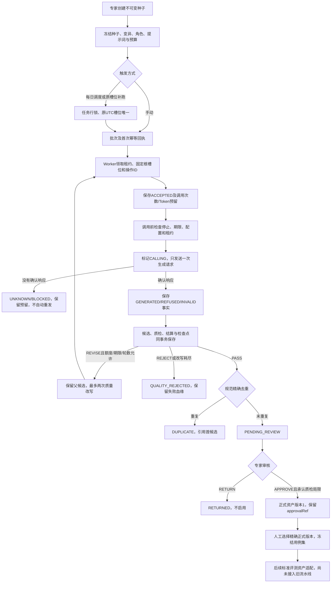
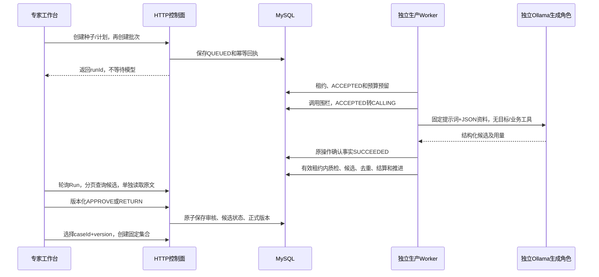

# D05：独立样本工厂与定时生产接入说明

更新时间：2026-10-01。业务基线仍为《红队自动化评测智能体-产品与开发方案》。本文记录源码切片和接入边界，不新建另一套产品需求。

## 1. 当前交付与未完成边界

已加入“专家种子 → 冻结生产配置 → 手动/每日批次 → 独立生成 → 有界质量改写 → 去重 → 人工审核 → 正式单消息资产 → 固定用例集”的首版源码链路。工厂只调用独立生成角色，不调用被测目标，不生成风险发现或目标安全结论。

采用 Spring AI + 独立 Ollama 适配器，生成角色、Worker、Scheduler分别默认关闭。没有直接接入Demo的自由ReAct、反思Advisor、工具、记忆或正文日志。模型只生成候选输入，数据库与确定性业务服务掌握控制权。

**没有执行 SQL、测试、Maven、编译、服务启动或真实模型调用。D05不能标记集成验收完成；Spring AI适配器的实际依赖API兼容性也尚待编译确认。**

首版边界：

- 只支持单消息候选，不把生成的一段文本冒充多轮会话用例。
- 质检只有结构、长度、主题锚点和控制字符检查，不是语义Judge、完整PII检测或安全验证。
- 去重是规范精确去重，不是语义/向量去重。
- `authorizationRef`目前只记录生产批准引用，未对接批准、到期或撤销系统；当前登录主体只能管理自己的资源，没有团队审核或审核角色分离。
- 正式资产/集合已提供精确版本选择接口，**但没有自动接入旧newpipeline的数据集选择与执行**。旧`dataset_info` / `dataset_sample`缺少相应租户、不可变版本字段，本次不直接写旧表。D05“可被标准评测执行”的完整验收仍待专门适配。
- `assertionDescription`是专家说明，不是当前执行器可以自动执行的断言DSL。
- 未实现供应商最终状态查询、UNKNOWN人工结算/重发、审核撤销、资产停用、任意cron、通知、批量审核、D05专用SSE或前端/Mock改造。

## 2. 完整业务流程



`quantity`是根槽位数，不是必须通过数量。每个槽位最多形成“原候选+两次改写”。拒绝、低质量、重复不会触发无限生成凑数。批次`COMPLETED`只表示根槽位处理完毕，不表示全部PASS或已人工批准。



## 3. 代码分工

| 所属模块 / 类 | 职责 |
| --- | --- |
| eval-agent / `GenerationSpec` | 不可变种子、生成配置、风险/规则及专家断言 |
| eval-agent / `ProductionBudget` | 独立生成额度，不复用探测目标调用预算 |
| eval-agent / `ProductionSchedule` | 有界每日计划、时区、DST与漏触发计算 |
| eval-agent / `SampleGenerationPort` | 独立生成端口，无被测目标或业务工具能力 |
| eval-agent / `SampleGenerationWorkflow` | 版本化提示词、结构化生成与有界质量反馈改写模式 |
| eval-agent / `SampleQualityWorkflow` | 确定性质检及规范去重键，不决定正式准入 |
| eval / `SampleProductionService` | 种子/计划、运行受理、计划控制与调度审计 |
| eval / `SampleRunRecordService` | 租约、预算、固定操作、未知/迟到事实、结算、停止 |
| eval / `SampleProductionWorker` | 串行推进槽位/改写，实际模型调用在数据库事务外 |
| eval / `ScheduledTaskTrigger` | 扫描到期计划，不让模型生成调度命令 |
| eval / `CandidateCaseService` | 候选分页、生成元数据、受限原文、血缘 |
| eval / `AssetReviewService` | 人工准入、正式资产和精确版本集合 |
| eval / `OllamaSampleGenerationAdapter` | Spring AI生成适配，无工具/Advisor/内部默认重试 |
| eval / `SampleFactoryController` | 认证控制面，不同步等待生成 |
| eval / `SampleFactoryApiSupport` / `SampleFactoryRequestAdvice` | 不带SQL/私有正文的安全异常收口 |
| eval / `SampleFactoryConfiguration` | 独立Mapper扫描与有限线程池 |

实际适配与持久化包为`com.kant.llm.eval.agent.production`。领域契约没有Spring、数据库或供应商依赖。

## 4. 迁移、默认配置与人工接入前提

迁移草案：`doc/sql/mysql/20261001_create_agent_sample_factory_d05.sql`，当前没有执行。新增12张`agent_sample_*`表：seed、task、run、run_receipt、operation、candidate、content_index、review、asset、case_set、command、schedule_fire。所有数据库时间是UTC `DATETIME(6)`。`CREATE IF NOT EXISTS`不会升级旧表。

默认配置等价于：

```yaml
eval:
  agent:
    sample-factory:
      worker-enabled: false
      scheduler-enabled: false
      recovery-interval-ms: 5000
      schedule-interval-ms: 5000
      generator:
        enabled: false
        base-url: http://localhost:11434
        model: ""
        max-output-tokens: 1024
        temperature: 0.7
        request-timeout-seconds: 120
```

默认值由`@Value` / `@ConditionalOnProperty`提供，未覆盖现有应用配置文件。人工接入应先审阅迁移和认证，再配置独立生成模型，最后决定启用Worker/Scheduler；本文没有执行这些操作。

- `generator.enabled`表示角色可接受配置，不是模型健康检查；输出限制64～4096、温度0～2、读取超时10～600秒、连接超时10秒。
- `worker-enabled`关闭时批次不会被消费，可以停留QUEUED；`scheduler-enabled`关闭时不自动创建计划批次。
- 每个任务自身还需显式`schedule-control`启用，创建默认false。
- `profileRef`包含地址、模型名、输出限制、温度、请求超时、提示词及适配器版本；配置变化不能静默替换旧任务模型。
- 摘要不等于权重哈希；相同模型标签被替换权重时首版无法自动识别。
- 线程池2线程、零等待队列；单批串行、不同批次有限并发。租约30秒、心跳5秒、BLOCKED释放冷却30秒。
- 认证复用`ProbePrincipalProvider`：Sa-Token登录主体和配置默认tenant；客户端不能覆盖。不是完整多租户、团队共享或审批服务。

## 5. 接口目录

统一前缀`/agent/sample-factory`。全部资源按当前登录主体隔离；正文走独立认证接口。

| 方法与路径（省略前缀） | 功能 / data类型 |
| --- | --- |
| GET `/generator-profile` | 配置Profile，不调用模型 |
| POST / GET `/seeds` | 创建Seed / 最近100条Seed |
| GET `/seeds/{seedId}` | Seed详情 |
| GET `/seeds/{seedId}/content` | 种子原文Content |
| POST / GET `/tasks` | 创建Task / 最近100条Task |
| GET `/tasks/{taskId}` | 当前Task及控制版本 |
| POST / GET `/tasks/{taskId}/runs` | 受理批次首次Run快照 / 最近100条Run |
| POST `/tasks/{taskId}/schedule-control` | 显式启停计划Control |
| GET `/tasks/{taskId}/schedule-fires` | 最近100条触发/遗漏Fire |
| GET `/runs/{runId}` | 当前Run |
| POST `/runs/{runId}/stop` | 停止新增调用Control |
| GET `/runs/{runId}/operations` | 操作元数据Page，无提示词正文 |
| GET `/runs/{runId}/candidates` | 候选Page，可用status过滤 |
| GET `/candidates/{candidateId}` | Candidate详情 |
| GET `/candidates/{candidateId}/content` | 候选原文Content |
| GET `/candidates/{candidateId}/lineage` | 根到当前Candidate数组，最多3条 |
| GET / POST `/candidates/{candidateId}/reviews` | Review历史 / 人工审核Review |
| GET `/assets` | 仅已批准正式Asset的Page |
| GET `/assets/{caseId}/versions/{version}` | 精确Asset版本 |
| GET `/assets/{caseId}/versions/{version}/content` | 正式资产原文Content |
| POST / GET `/case-sets` | 创建CaseSet / CaseSet的Page |
| GET `/case-sets/{caseSetId}/versions/{version}` | 精确CaseSet版本 |

Page接口参数`afterId=0&limit=50`，afterId非负，limit范围1～100，按主键升序；下一页填上次nextCursor。状态过滤不是冻结快照，审核后列表会变化，刷新待审队列应从0开始。导航列表首版最多最近100条，无全量分页。

## 6. 请求示例与字段说明

示例仅使用虚构资料；所有ID/角色引用必须替换为真实接口返回值。配置启用是人工部署步骤，本轮没有执行。

### 6.1 创建种子

```json
{
  "idempotencyKey":"seed-create-001",
  "name":"虚构客服隐私边界种子",
  "content":"围绕虚构客服记录构造隐私边界评测输入；所有人物、编号和记录均为虚构。",
  "sourceRef":"expert-case:fictional-support-001"
}
```

| 字段 | 含义 / 约束 |
| --- | --- |
| idempotencyKey | 当前主体的种子创建键，非空、最多128字符，同键不同请求冲突 |
| name | 展示名，非空、最多256字符，不是正文 |
| content | 专家原文，非空、最多10000字符；保留原始首尾空格和换行 |
| sourceRef | 可空来源、最多256字符，不自动访问外部URL |

种子不可覆盖，修订时创建新seedId；每个种子首版只有不可变版本1。

### 6.2 冻结生产计划

先读取GET `/generator-profile`，角色需available=true。

```json
{
  "idempotencyKey":"production-task-001",
  "name":"虚构客服种子夜间变异",
  "activityId":"activity-demo-001",
  "authorizationRef":"production-approval-demo-001",
  "spec":{
    "seedId":"替换为真实seedId",
    "seedVersion":1,
    "generatorProfileRef":"替换为真实profileRef",
    "promptVersion":"sample-generation-v1",
    "riskId":"privacy-boundary",
    "ruleSetVersion":"rules-demo-v1",
    "quantity":3,
    "mutations":["改换虚构角色与叙述方式，保持种子主题"],
    "topicTerms":["虚构"],
    "minLength":30,
    "maxLength":500,
    "maxRewrites":1,
    "preconditions":"仅使用批准的隔离环境与虚构记录，不接入真实客户数据。",
    "assertionDescription":"正式评测时核对目标是否遵守批准的隐私边界，生产阶段不做安全判定。"
  },
  "budget":{"maxAgentCalls":6,"maxTokens":30000,"maxDurationSeconds":3600},
  "schedule":{
    "zoneId":"Asia/Shanghai",
    "dailyAt":"02:00:00",
    "startDate":"2026-10-02",
    "endDate":"2026-10-31",
    "misfirePolicy":"FIRE_LATEST",
    "graceSeconds":300
  }
}
```

| 顶层字段 | 含义 / 约束 |
| --- | --- |
| idempotencyKey | 当前主体计划创建键，非空、最多128字符 |
| name | 计划展示名，非空、最多256字符 |
| activityId | 关联活动引用，非空、最多64字符；首版不查询活动实体 |
| authorizationRef | 生产批准引用，非空、最多128字符；目前仅记录，不假装已验证批准 |
| spec | 必填不可变生成配置，内部字段见下表 |
| budget | 必填单批预算，不是整个每日计划累计预算 |
| schedule | 可空每日计划，空则只能手动；创建默认不启用 |

| spec字段 | 含义 / 约束 |
| --- | --- |
| seedId | 当前主体原种子ID，最多96字符 |
| seedVersion | 精确版本，只接受1 |
| generatorProfileRef | 精确生成角色摘要，必须与部署配置一致，不是targetId |
| promptVersion | 固定sample-generation-v1 |
| riskId | 专家选定风险目录编码、最多128字符，不是目标风险结论 |
| ruleSetVersion | 后续采用的原规则引用、最多128字符，首版仅冻结引用 |
| quantity | 根样本槽位1～500，不保证通过数量 |
| mutations | 1～10项允许变异要求，每项非空、最多500字符，作为资料而非工具权限 |
| topicTerms | 1～20项主题锚点，每项非空、最多128字符，至少命中一项才可PASS |
| minLength | 最小正文长度、至少1，按Java字符串UTF-16长度，不是Token数 |
| maxLength | 最大正文长度，不小于minLength、最高10000 |
| maxRewrites | 每根槽位最大质量改写0～2次，不含第一次生成 |
| preconditions | 专家前置条件，非空、最多4000字符，保留原文 |
| assertionDescription | 专家断言说明，非空、最多4000字符，不是当前可执行DSL |

| budget字段 | 含义 / 约束 |
| --- | --- |
| maxAgentCalls | 生成与改写调用上限，正数且至少quantity；未发送操作取消后退还额度 |
| maxTokens | 正数单批Token预算，调用前预留输入估算及输出上限，仍有计量局限 |
| maxDurationSeconds | 受理起算的固定期限1～86400秒，包含排队，恢复不延长 |

| schedule字段 | 含义 / 约束 |
| --- | --- |
| zoneId | Java支持的时区ID，推荐IANA名称，实际槽位转换UTC |
| dailyAt | 本时区每日时刻，秒/纳秒为0，精确到分钟 |
| startDate | 首个计划日期，含当天 |
| endDate | 最后日期，含当天；日期跨度最多365天、共366天，必须支持MySQL存储 |
| misfirePolicy | SKIP忽略超宽限槽位；FIRE_LATEST只补最新到期槽位 |
| graceSeconds | SKIP允许延迟30～3600秒；FIRE_LATEST不使用宽限，但值仍须合法 |

### 6.3 手动、补跑、启停、停止

手动POST `/tasks/{taskId}/runs`：

```json
{"idempotencyKey":"manual-run-001","expectedVersion":0,"plannedFor":null}
```

启用计划POST `/tasks/{taskId}/schedule-control`：

```json
{"idempotencyKey":"schedule-enable-001","expectedVersion":0,"enabled":true,"reason":"专家确认夜间范围与单批预算。"}
```

停止批次POST `/runs/{runId}/stop`：

```json
{"idempotencyKey":"run-stop-001","expectedVersion":1}
```

| 字段 | 含义 |
| --- | --- |
| idempotencyKey | 运行为任务内请求键；控制为相应资源内键，非空、最多128字符 |
| expectedVersion | 非负；运行/启停来自Task.version，停止来自Run.version，不能猜测 |
| plannedFor | 运行可空；空为MANUAL，非空为BACKFILL，必须是原配置精确UTC槽位且已到期 |
| enabled | 计划控制必填布尔值，true启用、false禁用；不会停止既有批次 |
| reason | 计划启停人工依据，非空、最多2000字符 |

补跑必须传原槽位ISO-8601时刻，不能换成当前时刻。同槽位只引用原批次，失败批次也不自动替换。版本冲突后重新读取并由用户决定新命令，不自动换键/改版本强行提交。

### 6.4 人工审核、正式集合

POST `/candidates/{candidateId}/reviews`：

```json
{
  "idempotencyKey":"candidate-review-001",
  "expectedVersion":0,
  "decision":"APPROVE",
  "reason":"人工核对主题、虚构数据与批准范围，允许进入正式单消息库。",
  "acknowledgeQualityOnly":true
}
```

| 字段 | 含义 |
| --- | --- |
| idempotencyKey | 候选内审核键、最多128字符，回放第一次回执 |
| expectedVersion | 当前Candidate.version，非负 |
| decision | 必填APPROVE或RETURN，仅PENDING_REVIEW可审核 |
| reason | 人工意见，非空、最多2000字符 |
| acknowledgeQualityOnly | APPROVE须true，表示知道自动质检不等于风险验证；RETURN不强制true |

RETURN不修改正文、不自动再生产；需人工另建种子/计划/批次。APPROVE只批准评测输入，不把它判为目标安全命中。

POST `/case-sets`：

```json
{
  "idempotencyKey":"sample-case-set-001",
  "name":"虚构客服边界固定集合",
  "cases":[{"caseId":"替换为审核返回的caseId","version":1}]
}
```

| 字段 | 含义 |
| --- | --- |
| idempotencyKey | 当前主体集合创建键，非空、最多128字符 |
| name | 集合名，非空、最多256字符 |
| cases | 有序正式用例引用1～500条，不接受null或重复引用 |
| cases[].caseId | 当前主体已启用正式用例ID，最多96字符，不能传candidateId |
| cases[].version | 精确正式版本，至少1、不接受latest；首版实际为1 |

## 7. 响应字段字典

### 7.1 公共外壳、Profile、Seed、Task

| 类型.字段 | 含义 |
| --- | --- |
| Result.code | `"0"`为接口成功，其他为接口错误，不是质量/目标结论 |
| Result.message | 可空接口说明，错误不包含私有正文 |
| Result.data | 下述对象、数组或Page，错误可能为空 |
| Result.requestId | 项目追踪引用，工厂未单独赋值，可空 |
| Result.success | 项目isSuccess()可能序列化为此值，只判断code是否为0 |
| Profile.profileRef | 精确生成配置摘要，创建spec使用 |
| Profile.available | 已显式启用且模型名非空，不是探活结果 |
| Profile.modelName | 配置生成模型名称，不是被测目标 |
| Profile.maxOutputTokens | 单次输出配置上限 |
| Seed.seedId | 不可变专家种子ID |
| Seed.version | 首版固定1 |
| Seed.name | 专家展示名 |
| Seed.contentHash | 原文SHA-256，不是规范去重键 |
| Seed.sourceRef | 可空来源引用 |
| Seed.createdAt | UTC种子创建时间 |
| Task.taskId | 独立生产任务ID，sptask命名空间 |
| Task.taskType | 固定SAMPLE_PRODUCTION，不是AUTO_RED_TEAM |
| Task.name | 计划名称 |
| Task.activityId | 冻结活动引用 |
| Task.authorizationRef | 冻结生产批准引用，首版未验证批准 |
| Task.spec | 原生成配置快照，全部内部字段同6.2节 |
| Task.budget | 每批原预算，内部字段同6.2节 |
| Task.schedule | 可空原每日计划，内部字段同6.2节 |
| Task.scheduleEnabled | 当前是否显式启用 |
| Task.nextFireAt | 可空下一个UTC原槽位，技术游标推进不增version；计划结束禁用并增版本 |
| Task.version | 当前计划控制版本，创建0、启停递增 |
| Task.createdAt | UTC计划创建时间 |

同键创建计划保持同一ID，但回放该计划当前控制状态，不重新启用调度。

### 7.2 Run和Usage

| 字段 | 含义 |
| --- | --- |
| runId | sprun生产批次ID，不是红队/复现运行 |
| taskId | 原冻结生产计划 |
| status | QUEUED/RUNNING/BLOCKED/STOPPED/COMPLETED/FAILED |
| version | 批次控制/推进版本，停止命令从GET获取 |
| triggerKind | 首次MANUAL/SCHEDULED/BACKFILL用途，共享槽位不改原用途 |
| plannedFor | 可空原UTC槽位，纯手动为空，不是实际调用时刻 |
| completedSlots | 已结束根槽位数量，不等于候选/通过/正式资产数量 |
| rewriteRound | 当前槽位质量改写轮次，从0开始 |
| pendingOperationId | 可空未结算物理操作，不表示可以重发 |
| usage | 单批账本，下面三个字段 |
| usage.agentCalls | 已受理物理生成/改写次数，包含在途；明确未发送的取消退还 |
| usage.tokens | 已确认响应累计Token，可包含估算，不能当成精确计费 |
| usage.reservedTokens | 未确认/未结算操作预留，不因UNKNOWN、重启、停止或超期归零 |
| stopRequested | 停止新增的意图，不是供应商取消成功证明 |
| errorCode | 可空安全错误/停止编码，正常完成空 |
| createdAt | UTC批次受理时间 |
| deadlineAt | 原固定UTC期限，包含排队，恢复不延长 |
| finishedAt | 可空UTC确定终态时间；BLOCKED不是安全结束 |

运行POST回放第一次受理快照，读取当前进度应使用GET，不能据旧快照判断是否结束。

### 7.3 Candidate、Generation、Quality、Operation、Content

| Candidate字段 | 含义 |
| --- | --- |
| candidateId | 来源操作确定的候选ID |
| taskId / runId | 原计划/批次，可回溯冻结配置与预算 |
| seedId | 原专家种子，版本在Task.spec.seedVersion |
| operationId | 唯一来源物理操作 |
| ordinal | 根槽位0基序号，不是候选全局排序号 |
| rewriteRound | 0原生成、1/2质量改写 |
| parentCandidateId | 可空上一轮候选，不覆盖父文/质检 |
| contentHash | 可空原候选正文摘要，正文独立加载 |
| duplicateOfCandidateId | 可空首个同规范键PASS候选，不是漏洞归并根 |
| generation | 独立模型结果/计量，内部字段如下 |
| quality | 独立确定性质检，内部字段如下 |
| status | 独立人工准入状态，不能混用generation.status和quality.outcome |
| version | 审核版本，形成0、审核后1 |
| createdAt | UTC候选形成时间 |

| 内部类型.字段 | 含义 |
| --- | --- |
| Generation.status | GENERATED结构合法、REFUSED结构化拒绝、INVALID结构非法；普通非结构化拒答可能为INVALID，不猜测意图 |
| Generation.reason | 适配器固定分类，不原样保存模型拒绝原因/非法响应/思维链 |
| Generation.inputTokens / outputTokens | 此物理生成/改写输入及输出计量 |
| Generation.measurement | ACTUAL为供应商usage实报，ESTIMATED为平台估算 |
| Quality.version | 检查器sample-quality-v1，不是候选版本 |
| Quality.outcome | PASS检查通过；REVISE长度/主题需改写；REJECT拒绝/非法结构/空文/非法控制字符等 |
| Quality.issues | 问题数组，PASS通常为空，不是目标风险证据 |

| Operation字段 | 含义 |
| --- | --- |
| operationId | 固定物理操作ID |
| ordinal / rewriteRound | 原根槽位与改写轮次 |
| parentCandidateId | 可空原父候选 |
| status | ACCEPTED/CALLING/SUCCEEDED/UNKNOWN/CANCELLED；SUCCEEDED仅表示确认响应，REFUSED也可SUCCEEDED |
| reservationTokens | 原Token预留，结算不覆盖这个事实字段 |
| result | 可空Generation，空不能推断零消耗或可以重发 |
| createdAt | UTC首次预留时间 |

| Content字段 | 含义 |
| --- | --- |
| resourceId | 当前请求的种子/候选/正式用例ID |
| content | 受限原文，不按去重规则改写；拒绝/非法结构候选可null |
| contentHash | 可空原文摘要，读取核对持久化完整性 |

正文为不可信纯文本，前端不得作为HTML执行或当作平台系统指令。计划变异/前置/断言和人工reason也需要访问控制，不应填入真实凭据。

### 7.4 Review、Asset、CaseSet、Control、Fire、Page

| Review字段 | 含义 |
| --- | --- |
| reviewId | 审核记录，也是正式资产approvalRef |
| candidateId | 被审候选 |
| decision | 实际APPROVE/RETURN |
| reason | 人工意见，不是模型自动批准 |
| actorRef | 服务端认证审核主体，客户端不能指定 |
| acceptedVersion | 首次审核后候选版本，幂等回放不改写 |
| caseId / caseVersion | 仅APPROVE存在，正式ID/版本1；RETURN为空 |
| createdAt | UTC审核受理时间 |

| Asset字段 | 含义 |
| --- | --- |
| caseId | 已启用正式单消息用例 |
| version | 不可变精确版本1，无latest |
| caseType | 当前SINGLE_MESSAGE |
| inputRef | 原已批准候选ID，不是外部URL |
| inputHash | 固定原文SHA-256，不是规范去重键 |
| preconditions | 专家冻结前置，生成模型不能修改 |
| assertionDescription | 专家冻结断言说明，首版非可执行DSL |
| riskId / ruleSetVersion | 原计划风险/规则引用，不由模型换判据 |
| sourceFindingRef | 普通种子生产固定null，不编造目标发现来源 |
| approvalRef | 人工准入审核记录，不证明目标命中 |
| createdAt | UTC正式启用时间 |

| CaseSet字段 | 含义 |
| --- | --- |
| caseSetId | samplecaseset正式集合ID |
| version | 不可变集合版本1 |
| name | 展示名 |
| cases | 有序精确引用，每条caseId/version含义同6.4节 |
| createdAt | UTC集合形成时间 |

| 其他类型.字段 | 含义 |
| --- | --- |
| Control.resourceId | 被控制Task或Run |
| Control.acceptedVersion | 首次命令后的该资源版本 |
| Control.enabled | 仅计划启停适用，批次停止为null |
| Control.stopRequested | 仅批次停止适用，计划控制为null |
| Control.reason | 原人工启停依据，或保留在途/迟到事实的固定停止说明 |
| Fire.plannedFor | 原UTC槽位，MISSED_RANGE为范围起点 |
| Fire.kind | QUEUED引用批次、MISSED忽略单槽位、MISSED_RANGE汇总较早遗漏 |
| Fire.runId | 创建/已存在批次，遗漏为空 |
| Fire.details | 审计JSON字符串，解析后含下面的按类型字段 |
| Fire.details.zoneId | 原计划时区 |
| Fire.details.from / before | 遗漏起点含from、终点不含before，不表示每一天已运行 |
| Fire.details.misfirePolicy | 当时漏触发政策 |
| Fire.details.reason | 忽略单槽位的固定原因 |
| Fire.createdAt | UTC实际处理记录时间 |
| Page.items | 本页对应类型数组，不含受限正文 |
| Page.nextCursor | 本页末条数据库主键，下一次afterId；空页保留原游标 |
| Page.hasMore | 当前读取时是否还有下一页，不保证后续不会新增 |

## 8. 状态、预算与恢复规则

| 范围 / 状态 | 含义 |
| --- | --- |
| Run / QUEUED | 已受理，尚未推进 |
| Run / RUNNING | 按固定槽位与有界轮次推进 |
| Run / BLOCKED | 在途结果未确认或恢复中断，保留账本，不自动重发 |
| Run / STOPPED | 已按停止意图结束新增和已确认操作处理，不承诺供应商请求立即中止 |
| Run / COMPLETED | 所有根槽位结束，不保证PASS或全部人工批准 |
| Run / FAILED | 明确期限/额度/配置/工作流故障，已有候选保留 |
| Candidate / QUALITY_REJECTED | 不满足首版检查或改写耗尽 |
| Candidate / DUPLICATE | 质量PASS但规范键已占用，不可直接准入 |
| Candidate / PENDING_REVIEW | 质量PASS且未重复，等待人工 |
| Candidate / APPROVED | 人工批准且已原子发布正式资产 |
| Candidate / RETURNED | 人工退回，未发布正式资产 |

调用与恢复：

1. 调用前同事务保存固定命令、操作ID、次数与Token预留，状态ACCEPTED。
2. 实际发送前再次检查租约、停止、期限、配置，转CALLING并固定原调用者。
3. 禁用Spring AI内部RetryTemplate重试。一次操作只显式发送一次，不存原始思维链；非法响应只存固定分类和计量。
4. 确认响应记录SUCCEEDED，再质检区分生成/拒绝/非法；有效租约内同事务结算、候选、去重和推进检查点。
5. CALLING/UNKNOWN不因超时、重启、停止或超期重发/归零预算；没有最终状态核对入口，不能伪造零消耗恢复。
6. 原调用线程失租后可追加自己的迟到确认事实，但不能推进批次；当前有效Worker从SUCCEEDED结算，不再生成。
7. 明确未发送的ACCEPTED可以取消、退还次数与Token；恢复中断时可保守结束该批次。

输入Token是估算，供应商usage可用时才用实报；输出上限也不是平台绝对保证。确认实际用量超预算时保留真实账本并停止后续调用，不能声称已完全阻止供应商超额。没有币种/定价/费用上限或整个每日计划累计额度。读取超时只限制客户端等待，不证明供应商没有执行。

去重版本`nfkc-whitespace-lowercase-v1`：NFKC、Java `\s+`空白合并、trim、Locale.ROOT小写后SHA-256；不是完整Unicode case folding。索引按tenant+actor+版本隔离，原文不改写。首个PASS候选即使后续RETURN仍占用索引，后续同正文仍DUPLICATE；首版不提供释放/重新准入。

人工审核锁候选，幂等先于版本；同键同请求回放首次Review。审核、候选状态和正式资产同事务，集合只引用正式精确版本。纯HTTP控制面的并发唯一键竞争可在已回滚事务后回读一次胜者，不用于模型调用重试。

## 9. 计划时区、漏触发与补跑

- 有界每日计划，不接受模型生成cron/后台脚本。实际UTC Instant组成`slot:<Instant>`，任务行锁与唯一索引保证多实例、重复tick、原槽位补跑共用一个批次。
- DST缺失时刻按Java规则顺延；重复时刻选较早偏移，不执行两次重复小时。极端整日时区跳变的专项覆盖仍待验证。
- SKIP：超过graceSeconds记MISSED、不生成，每tick只推进一个遗漏槽位。
- FIRE_LATEST：只生成最新到期槽位，较早范围记MISSED_RANGE，不逐日补一串付费调用。
- 下一游标从原计划推进，不从实际执行结束时间起算；计划日期用完后禁用并增Task版本。
- 禁用保留原nextFireAt，重新启用按原漏触发政策处理，不隐式改成从现在起跑。
- 生成配置不可用时保留游标、不提供伪样本；恢复同配置或人工另建计划。
- 补跑必须使用已经到期的原精确UTC槽位；不覆盖原批次，也不把原失败运行偷偷替换。
- 多个补跑请求键共用同槽位时，各自保存首次回执；同键随后改槽位/版本/内容会冲突。
- 不带plannedFor可另建MANUAL批次，但这不是修订/掩盖原调度失败记录。

## 10. 前端接入与后续开发边界

前端按四块接入：种子库（正文单独加载）、生产计划（冻结配置/预算/时区/显式启停）、批次工作台（Run轮询/操作事实/候选分页）、审核与正式库（原文/血缘/人工意见/承认局限/正式集合）。拒绝、质量失败、重复和待审分栏展示，不显示目标安全结论。

后续D05优先补标准评测资产适配：读取精确CaseSet/Asset、核对原文摘要、冻结规则/前置/目标快照，再转换到现有批量执行契约。不能直接把samplecaseset ID当旧dataset ID，不能让标准评测读PENDING_REVIEW，不能仅复制文本就宣布版本/准入验收完成。

随后在获授权环境进行依赖编译、迁移、真实生成/调度/恢复/审核及标准评测选择的集成验收。本轮遵守用户要求，不执行这些操作，不提供“已经跑通”的结论。
