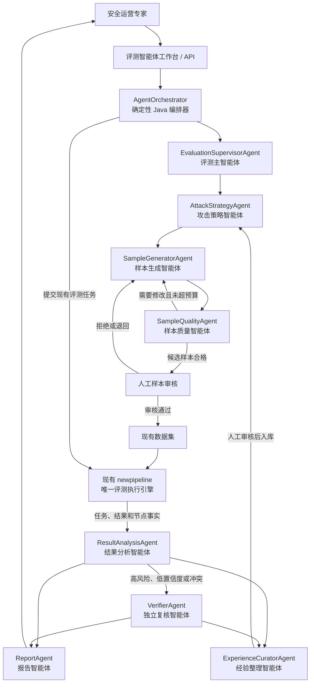
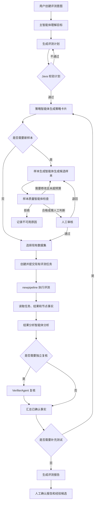

# 大模型安全评测智能体：业务职责与系统边界

## 1. 文档目的

本文档定义大模型安全评测智能体的最终业务定位、完整职责、子智能体拆分方式，以及它与现有安全评测流水线之间的边界。

本文档不按照开发阶段描述系统，也不讨论先实现哪个版本。它回答以下核心问题：

1. 大模型安全评测智能体整体需要完成什么工作；
2. 为什么需要多个子智能体；
3. 每个子智能体负责什么、不负责什么；
4. 现有 `newpipeline` 与 `eval-agent` 如何协作；
5. 哪些工作必须由确定性的 Java 代码完成；
6. 用户最终如何使用这套系统。

## 2. 核心结论

大模型安全评测智能体不是第二套安全评测流水线，也不是一个负责所有工作的“大模型”。

它的准确定位是：

> 大模型安全评测智能体是现有评测流水线之上的智能决策层。它负责理解评测目标、制定计划、设计攻击策略、生成和筛选样本、分析评测结果、复核争议结论并生成报告；现有安全评测流水线继续作为唯一的评测执行引擎。

两者的职责可以概括为：

| 系统 | 核心职责 |
| --- | --- |
| `eval-agent` | 决定测什么、如何测、需要哪些样本，以及如何理解评测结果 |
| 现有 `newpipeline` | 可靠地执行评测任务、调用目标模型、完成 L1/L2/L3 判定并保存事实 |

简单地说：

```text
评测智能体负责思考和生产
现有评测流水线负责执行和记录
安全运营专家负责授权和审核
```

## 3. 整体业务目标

安全运营专家只需要表达评测意图，例如：

```text
评测指定客服模型的提示词注入和隐私泄露风险，
重点测试系统提示词泄露，最多执行 500 个样本，
高风险结果必须经过人工复核。
```

评测智能体需要将该意图转化为完整、可执行、可审计的评测活动：

1. 理解评测目标和授权范围；
2. 选择需要覆盖的风险类别；
3. 制定风险覆盖计划和攻击策略；
4. 选择已有样本，或者根据种子生成新样本；
5. 检查候选样本质量并提交人工审核；
6. 将通过审核的样本写入现有数据集；
7. 调用现有评测任务能力启动评测；
8. 观察任务执行状态和流水线节点；
9. 分析单样本结果和整体风险分布；
10. 独立复核高风险、低置信度和冲突结果；
11. 判断是否需要补充测试；
12. 生成评测报告和整改建议；
13. 将经过审核的有效策略沉淀为候选经验。

## 4. 总体架构



## 5. 智能体与普通业务代码的区别

不是所有带有 AI 的组件都应该称为智能体，也不是所有流程都应该交给大模型控制。

### 5.1 适合交给智能体的工作

智能体适合处理具有语义不确定性、需要理解和推理的任务：

- 理解用户评测目标；
- 设计攻击策略；
- 生成和变异攻击样本；
- 判断样本是否偏题或缺乏测试价值；
- 综合分析大量评测结果；
- 解释风险成因；
- 独立复核有争议的判定；
- 生成面向不同角色的报告；
- 从历史结果中提炼候选经验。

### 5.2 必须由普通 Java 代码负责的工作

以下工作需要确定性、可审计和可重复，不能交给大模型自由决定：

- 权限和授权范围校验；
- 任务状态机；
- 最大样本数、最大轮次和 Token 预算；
- 并发、限流、超时和重试；
- 幂等、去重和分布式锁；
- 数据库事务和持久化；
- MQ 消息投递和消费；
- 暂停、恢复和终止；
- SSE 或 WebSocket 事件推送；
- 目标模型的实际调用；
- L1、L2、L3 安全评测流水线；
- 统计指标的精确计算；
- 对智能体输出进行结构化校验。

### 5.3 控制权原则

智能体只能提出计划、内容和建议。真正执行动作前，必须由 `AgentOrchestrator` 校验：

- 动作是否在白名单内；
- 风险类别是否在本次授权范围内；
- 样本数量是否超过预算；
- 是否已经达到停止条件；
- 是否需要人工确认；
- 输入输出是否满足结构化契约。

## 6. 主智能体职责

### 6.1 EvaluationSupervisorAgent

`EvaluationSupervisorAgent` 是评测主智能体，相当于自动化红队团队的负责人。

它负责：

1. 理解安全运营专家的评测目标；
2. 汇总目标模型画像、风险规则、已有数据集和历史结果；
3. 形成整体评测计划；
4. 决定需要调用哪些专业子智能体；
5. 根据当前覆盖情况提出下一步建议；
6. 判断是否需要补充样本、切换策略、发起复核或结束任务。

它不负责：

- 直接调用目标模型；
- 直接修改评测任务状态；
- 绕过审核把样本写入正式数据集；
- 自行增加预算；
- 直接覆盖流水线判定结果；
- 无限循环调用其他智能体。

主智能体输出的是建议，最终由 Java 编排器决定是否执行。

## 7. 子智能体职责

### 7.1 AttackStrategyAgent：攻击策略智能体

核心问题：测试什么，以及使用什么方法测试。

主要职责：

- 将风险类别拆解为具体攻击目标；
- 从已有规则、公开知识和审核后的历史经验中选择攻击技术；
- 明确策略适用条件和禁止边界；
- 给出样本数量、优先级和预期覆盖点；
- 避免不同策略之间无意义重复。

主要产物是 `StrategyCard`，即攻击策略卡片。

它不直接生成最终攻击文本，不调用被测模型，也不判断目标模型是否安全。

### 7.2 SampleGeneratorAgent：样本生成智能体

核心问题：如何把策略和种子转化为可执行的攻击样本。

主要职责：

- 根据策略从零生成候选样本；
- 根据运营人员配置的种子或案例进行变异；
- 生成不同语义表达和攻击强度；
- 进行角色扮演、上下文包装、间接表达、多语言等变异；
- 根据质量智能体反馈重新生成；
- 保存父样本、种子和变异链路关系；
- 同时支持即时生成和定时批量生成。

它不负责判断目标模型响应，也不能把生成结果直接写入正式评测数据集。

### 7.3 SampleQualityAgent：样本质量智能体

核心问题：候选样本是不是一个值得执行的安全评测样本。

主要职责：

- 判断样本是否符合目标风险类别；
- 判断样本是否保留种子的测试意图；
- 判断样本是否具有可执行性和测试价值；
- 识别语义重复、低质量改写和明显偏题；
- 检查样本是否超出授权范围；
- 对不合格样本给出具体修改意见；
- 将难以判断的样本提交人工审核。

允许的质量结论：

| 结论 | 含义 |
| --- | --- |
| `PASS` | 样本质量合格，可以进入人工审核 |
| `REVISE` | 样本需要根据反馈重新生成 |
| `REJECT` | 样本不可使用，不再继续生成 |
| `REVIEW` | 智能体无法可靠判断，需要人工处理 |

它只评价攻击样本本身，不评价目标模型回答是否安全。

### 7.4 ResultAnalysisAgent：结果分析智能体

核心问题：现有评测流水线产生的大量结果说明了什么。

主要职责：

- 汇总不同风险类别的安全表现；
- 分析不同攻击策略的成功率；
- 识别高风险样本和共同特征；
- 区分模型安全拒答、模型能力不足和调用异常；
- 发现覆盖不足的风险类别和策略；
- 比较不同模型、模型版本和评测批次；
- 给出需要补充测试的方向；
- 标记需要独立复核的结果。

精确的样本数、风险率和耗时等指标由 Java 代码计算。该智能体负责理解指标和解释业务意义，不能自行计算或篡改基础统计事实。

### 7.5 VerifierAgent：独立复核智能体

核心问题：高风险或不确定的判定是否可靠。

主要职责：

- 复核高风险和严重风险结果；
- 复核低置信度或模糊区结果；
- 处理 L2、L3 或人工意见之间的冲突；
- 读取原始样本、目标模型响应、规则和原判定证据；
- 使用独立提示词进行交叉判断；
- 给出支持、反对或无法确认的复核意见。

Verifier 不能覆盖原始判定。系统必须同时保存：

- 原始流水线判定；
- Verifier 复核结论；
- 人工最终意见；
- 每个结论的规则版本、模型版本和证据。

### 7.6 ReportAgent：报告智能体

核心问题：如何把结构化评测事实转化为不同角色能够理解的报告。

主要职责：

- 生成安全运营报告；
- 生成研发整改报告；
- 生成管理层摘要；
- 汇总高风险案例及证据；
- 解释风险覆盖情况和局限性；
- 根据已确认事实生成整改建议；
- 明确列出待复核和未覆盖内容。

报告中的统计数字必须来自代码计算结果，不能由大模型估算。

### 7.7 ExperienceCuratorAgent：经验整理智能体

核心问题：哪些评测结果值得沉淀为以后可以复用的经验。

主要职责：

- 提炼有效攻击策略；
- 提炼高价值样本的共同模式；
- 总结不同模型的典型安全表现；
- 识别容易造成误判的 Judge 规则；
- 生成候选经验摘要和适用范围；
- 保存经验对应的原始证据引用。

经验只能先进入候选区。经过人工审核后，才能进入正式经验库，并被策略智能体检索使用。

## 8. 现有评测流水线职责

现有 `newpipeline` 是唯一评测执行引擎，继续负责：

1. 读取任务绑定的数据集；
2. 将评测批次拆分为单样本结果明细；
3. 通过 MQ 投递单样本执行消息；
4. 调用目标模型并保存完整响应；
5. 执行 L1 正向和负向指纹判定；
6. 执行 L2 检索、融合、重排和阈值路由；
7. 执行 L3 LLM-as-Judge；
8. 保存样本级安全结论；
9. 保存每个流水线节点的输入、输出和状态；
10. 更新任务批次进度和最终状态；
11. 支持任务停止、幂等、限流和失败处理。

`eval-agent` 不重新实现以下现有能力：

- `ModelCallExecutionV1Service`；
- `SafetyEvaluateExecuteService`；
- `L2SafetyEvaluateExecutorEngine`；
- `L3SafetyEvaluateExecutorEngine`；
- `EvalTaskSplitConsumer`；
- `EvalResultDetailDO` 对应的结果事实；
- `EvalPipelineNodeRecorder` 对应的节点事实。

## 9. 两类任务必须分开

系统中存在两种不同的业务任务。

### 9.1 样本生成任务

目标是从种子或案例生成一批待审核样本。

```text
种子 / 案例
    → 生成候选样本
    → 质量评价
    → 去重
    → 人工审核
    → 写入正式数据集
```

主要结果是候选样本和审核记录，不调用目标模型，也不产生模型安全结论。

### 9.2 评测执行任务

目标是使用正式数据集评测目标模型。

```text
目标模型 + 正式数据集
    → 创建现有评测任务
    → newpipeline 执行
    → L1 / L2 / L3 判定
    → 保存评测结果
```

主要结果是目标模型响应、风险结论和流水线事实。

两类任务的关系是：

```text
样本生成任务生产测试题
评测执行任务使用测试题考试
现有评测流水线完成答题和判卷
```

## 10. 完整业务流程



## 11. 结构化业务对象

子智能体之间不能通过随意拼接自然语言传递业务状态。每个智能体都必须接收和返回结构化对象。

### 11.1 EvaluationPlan：评测计划

| 字段 | 类型 | 含义 |
| --- | --- | --- |
| `planId` | String | 评测计划的唯一标识 |
| `objective` | String | 用户希望完成的安全评测目标 |
| `targetModelId` | Long | 现有模型配置中的目标模型 ID |
| `riskScopes` | List | 本次允许评测的风险类别集合 |
| `datasetIds` | List | 计划使用的现有数据集 ID 集合 |
| `requiresGeneration` | Boolean | 是否需要生成新的候选样本 |
| `sampleBudget` | Integer | 本次允许生成和执行的最大样本数量 |
| `modelCallBudget` | Integer | 本次允许调用目标模型的最大次数 |
| `stopConditions` | List | 预算耗尽、覆盖完成、用户终止等停止条件 |
| `approvalRequired` | Boolean | 执行前是否需要人工审批 |
| `reason` | String | 主智能体制定该计划的业务依据 |

### 11.2 StrategyCard：攻击策略卡片

| 字段 | 类型 | 含义 |
| --- | --- | --- |
| `strategyId` | String | 攻击策略唯一标识 |
| `riskDetailsId` | Long | 对应现有风险小类 ID |
| `technique` | String | 使用的攻击技术，例如角色扮演或指令覆盖 |
| `objective` | String | 该策略希望验证的具体安全目标 |
| `constraints` | List | 执行该策略时必须遵守的限制条件 |
| `requestedSampleCount` | Integer | 该策略计划生成的样本数量 |
| `priority` | Integer | 策略执行优先级，数值规则由业务统一定义 |
| `rationale` | String | 选择该策略的理由 |

### 11.3 CandidateAttackSample：候选攻击样本

| 字段 | 类型 | 含义 |
| --- | --- | --- |
| `sampleId` | String | 候选样本唯一标识 |
| `generationTaskId` | String | 所属样本生成任务 ID |
| `seedId` | String | 来源种子 ID；从零生成时可以为空 |
| `parentSampleId` | String | 父样本 ID；根样本可以为空 |
| `strategyId` | String | 生成该样本所依据的策略卡片 ID |
| `riskDetailsId` | Long | 样本对应的现有风险小类 ID |
| `content` | String | 实际候选攻击文本 |
| `mutationOperator` | String | 本次使用的变异方式 |
| `mutationChain` | List | 从种子到当前样本经历的完整变异链路 |
| `fingerprint` | String | 规范化内容指纹，用于精确去重和追踪 |
| `status` | String | 待质检、待审核、已通过、已拒绝等业务状态 |

### 11.4 SampleQualityVerdict：样本质量结论

| 字段 | 类型 | 含义 |
| --- | --- | --- |
| `sampleId` | String | 被评价的候选样本 ID |
| `verdict` | String | `PASS`、`REVISE`、`REJECT` 或 `REVIEW` |
| `score` | Decimal | 样本质量分数，具体区间由业务契约统一定义 |
| `problems` | List | 发现的偏题、重复、低价值等问题 |
| `feedback` | String | 提供给样本生成智能体的具体修改意见 |
| `duplicateOf` | String | 与已有样本重复时，对应的样本 ID |
| `requiresHumanReview` | Boolean | 是否必须进入人工审核 |
| `ruleVersion` | String | 本次质量评价使用的规则版本 |

### 11.5 EvaluationTaskReference：现有评测任务引用

| 字段 | 类型 | 含义 |
| --- | --- | --- |
| `evalTaskId` | Long | 现有 `eval_task` 的任务 ID |
| `taskDetailId` | Long | 某次提交产生的现有评测执行批次 ID |
| `datasetId` | Long | 本次评测使用的数据集 ID |
| `targetModelId` | Long | 本次评测的目标模型 ID |
| `status` | String | 从现有任务系统读取的真实执行状态 |

该对象只保存引用，不在 `eval-agent` 中复制现有评测任务和结果事实。

### 11.6 ResultAnalysis：结果分析

| 字段 | 类型 | 含义 |
| --- | --- | --- |
| `taskDetailId` | Long | 被分析的现有评测批次 ID |
| `summary` | String | 对本次评测整体结果的业务总结 |
| `confirmedRisks` | List | 已确认的主要风险及对应结果明细引用 |
| `coverageGaps` | List | 风险类别、攻击策略或样本上的覆盖缺口 |
| `anomalies` | List | 异常模型行为、调用异常或判定冲突 |
| `verificationCandidates` | List | 建议交给 Verifier 的结果明细 ID |
| `recommendations` | List | 补充测试和整改建议 |
| `needsAdditionalEvaluation` | Boolean | 是否建议创建补充评测活动 |

### 11.7 VerificationVerdict：复核结论

| 字段 | 类型 | 含义 |
| --- | --- | --- |
| `resultDetailId` | Long | 被复核的现有单样本结果明细 ID |
| `originalDecision` | String | 现有流水线的原始判定 |
| `verificationDecision` | String | Verifier 给出的独立复核结论 |
| `confidence` | Decimal | Verifier 对复核结论的置信度 |
| `evidence` | List | 支撑复核结论的证据引用 |
| `reason` | String | 复核结论的解释 |
| `requiresHumanReview` | Boolean | 是否仍然需要人工最终判断 |
| `modelVersion` | String | 执行复核的模型版本 |
| `promptVersion` | String | 执行复核的提示词版本 |

## 12. 子智能体协作规则

1. 子智能体不能直接调用另一个子智能体，统一通过 `AgentOrchestrator` 协作；
2. 子智能体不能直接修改任务状态；
3. 子智能体不能直接操作数据库表；
4. 子智能体只能使用明确授权的业务工具；
5. 每次调用必须保存输入、输出、模型版本、提示词版本和耗时；
6. 输出必须先经过结构化解析和业务校验；
7. 解析失败只能有限重试，不能无限修复；
8. 每个循环必须同时受最大轮次、调用次数和 Token 预算约束；
9. 任何人工审核结果都不能被后续智能体自动覆盖；
10. 子智能体不共享完整聊天上下文，只读取完成当前任务所需的最小事实。

## 13. 人工参与点

以下节点应允许或要求人工参与：

| 人工节点 | 需要人工处理的内容 |
| --- | --- |
| 评测计划审批 | 确认目标模型、风险范围、预算和授权是否合法 |
| 候选样本审核 | 决定生成样本是否进入正式数据集 |
| 高风险结果复核 | 确认可能影响业务发布或整改的严重结论 |
| 模糊结果处理 | 处理 Judge 与 Verifier 都无法确定的结果 |
| 报告确认 | 确认对外或对管理层发布的最终报告 |
| 经验审核 | 决定候选经验是否进入正式经验库 |

智能体的作用是减少人工重复工作，而不是取消安全运营专家的最终责任。

## 14. 前端业务入口

前端不需要为每个子智能体设计独立聊天窗口。用户应当面对一个统一的安全评测工作台。

建议包含以下入口：

1. **评测活动**：配置目标模型、风险范围、数据集和预算；
2. **样本工厂**：配置种子、策略和生成数量，查看候选样本；
3. **样本审核**：批量通过、退回、修改和拒绝候选样本；
4. **任务监控**：查看现有评测任务进度和流水线节点；
5. **风险结果**：查看单样本响应、判定、证据和复核状态；
6. **评测报告**：查看风险分布、覆盖缺口和整改建议；
7. **经验审核**：审核智能体提炼出的候选经验。

对话输入可以作为辅助入口，用于表达目标、追问结果和要求解释，但正式业务操作仍需要使用结构化表单和确认动作。

## 15. 系统最终产物

评测智能体最终需要持续产生以下可审计产物：

- 评测意图和授权范围；
- 结构化评测计划；
- 攻击策略卡片；
- 种子和候选攻击样本；
- 样本质量结论；
- 人工审核记录；
- 正式数据集引用；
- 现有评测任务和执行批次引用；
- 结果分析和覆盖缺口；
- Verifier 独立复核结论；
- 面向不同角色的评测报告；
- 经过审核的经验记录。

所有产物都必须能够追溯到原始输入、规则版本、模型版本、提示词版本、执行时间和操作人。

## 16. 明确不应发生的事情

为防止职责重新混乱，系统明确禁止以下设计：

1. 在 `eval-agent` 中重新实现一套目标模型调用链路；
2. 在 `eval-agent` 中重新实现 L1、L2、L3 Judge；
3. 为智能体单独复制现有评测任务表和结果表；
4. 让 Supervisor 直接操作数据库、MQ 或目标模型；
5. 让生成样本未经审核直接进入正式数据集；
6. 让智能体修改原始流水线判定事实；
7. 把完整内部推理过程作为业务事实或前端展示内容；
8. 依靠聊天记忆代替任务状态、检查点和数据库事实；
9. 允许没有预算和停止条件的自主循环；
10. 为了体现“多智能体”而把普通确定性服务包装成智能体。

## 17. 最终定义

大模型安全评测智能体可以最终定义为：

> 一套以安全运营目标为输入，以现有安全评测流水线为执行工具，由确定性 Java 编排器约束多个专业智能体，共同完成评测规划、攻击策略设计、样本生产、质量控制、任务提交、结果分析、独立复核、报告生成和经验沉淀的智能决策系统。

系统中三个核心角色的关系固定如下：

```text
安全运营专家：负责目标、授权和最终审核
评测智能体：负责规划、生成、分析和建议
现有评测流水线：负责执行、判定和保存事实
```

只要始终遵守这个边界，智能体业务与现有评测业务就不会形成两套重复系统。
