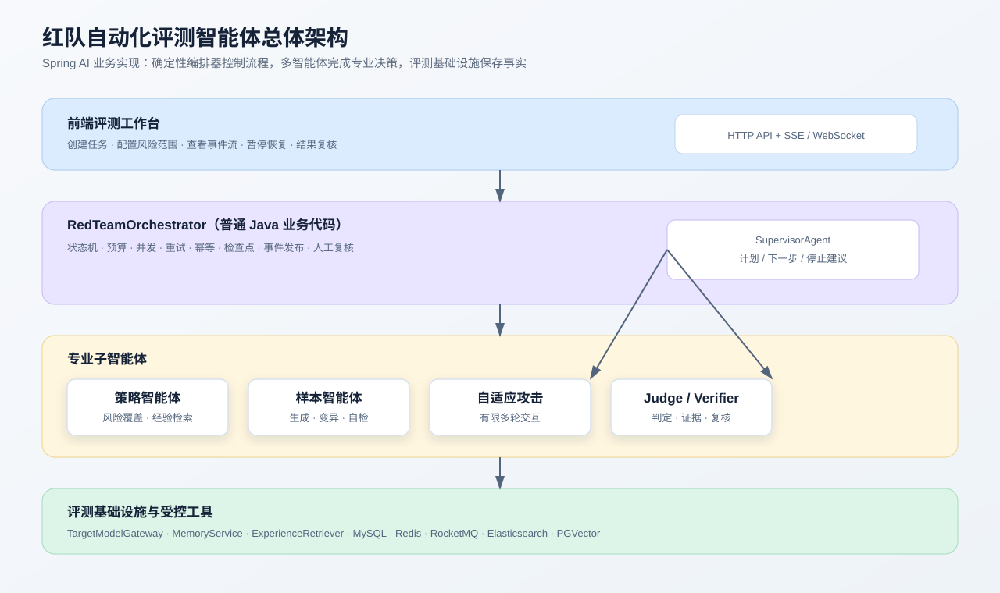
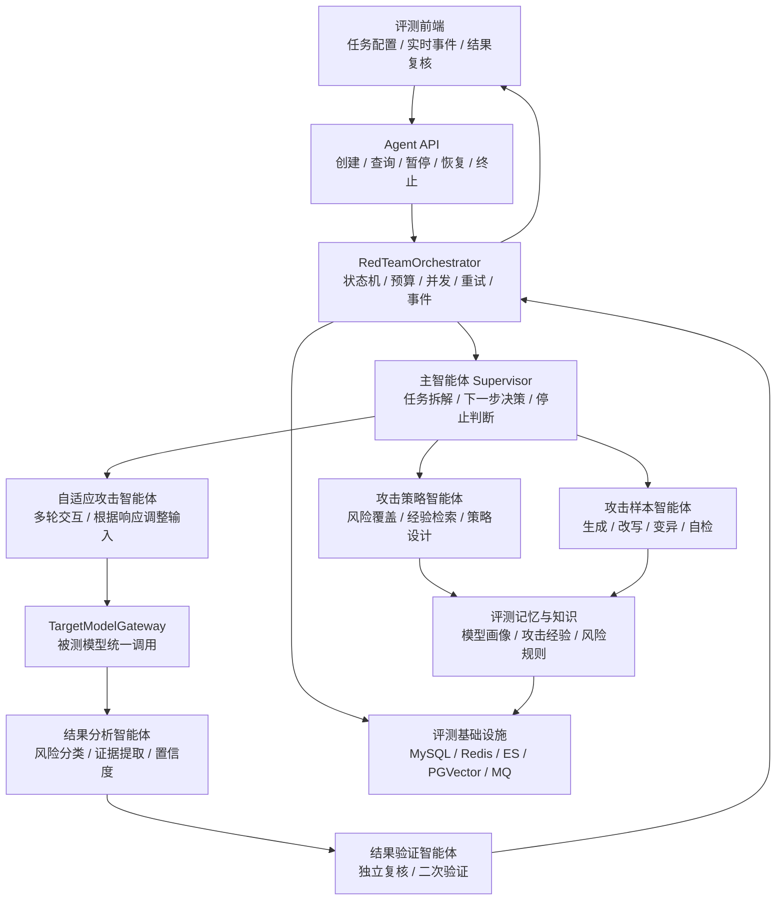
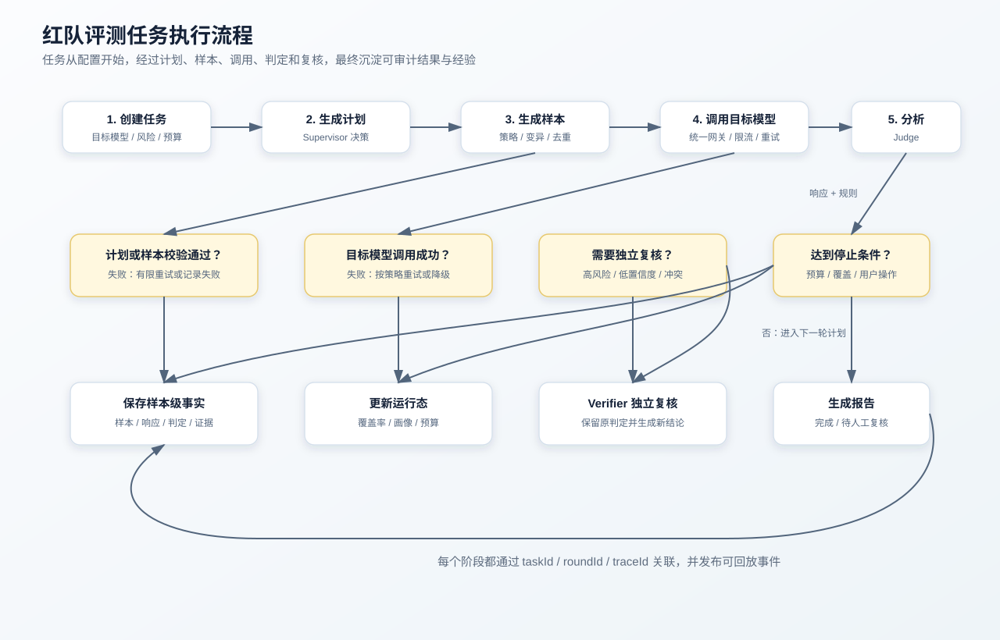
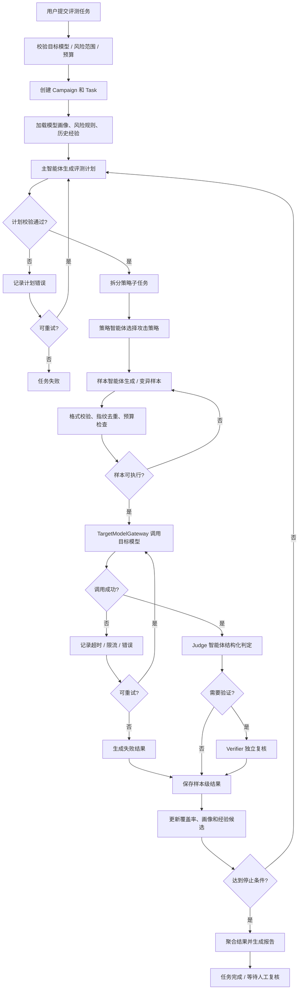
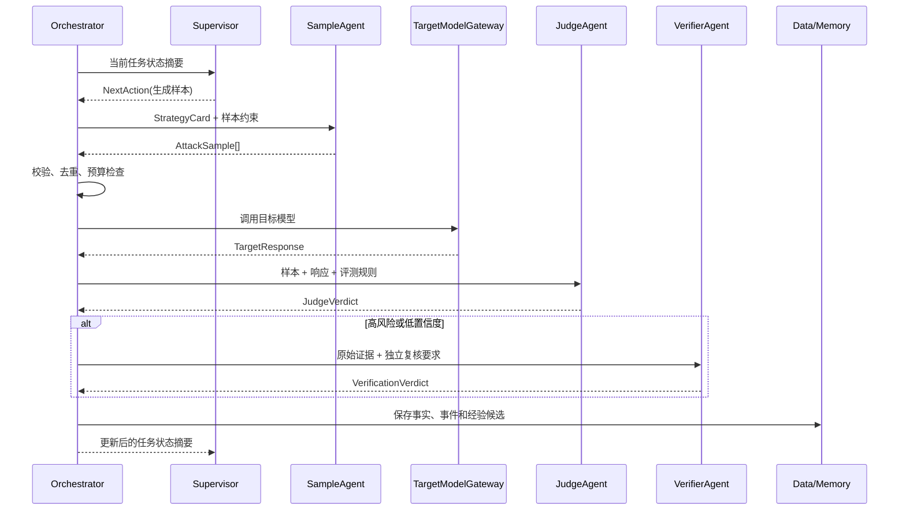
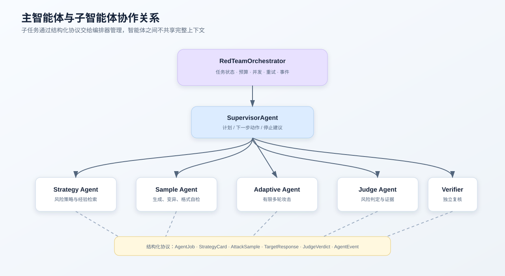
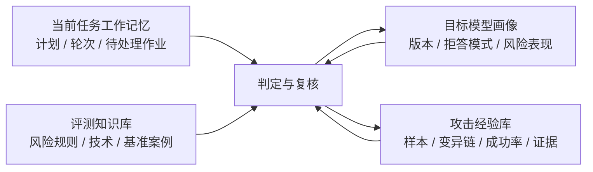
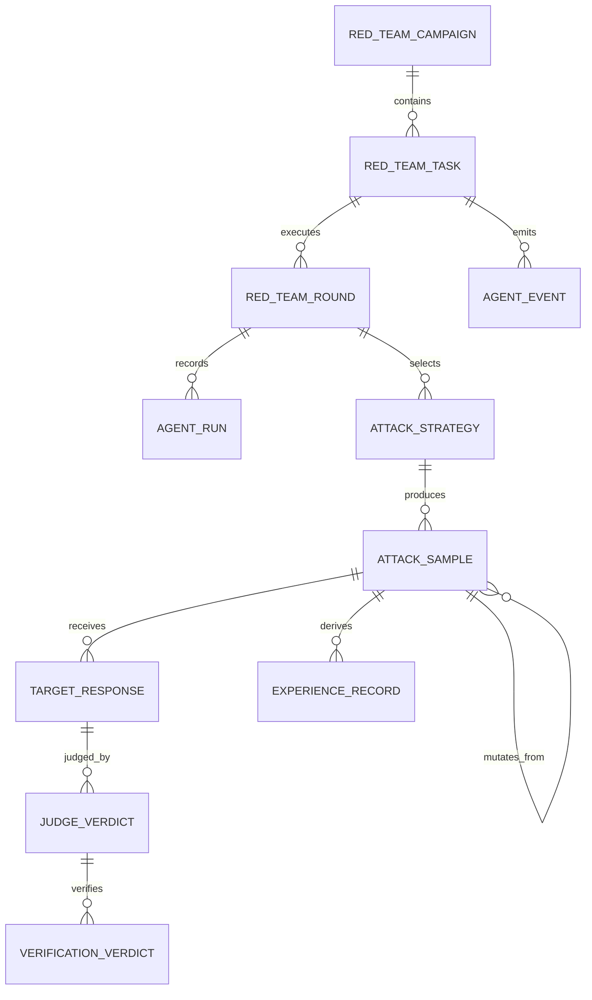
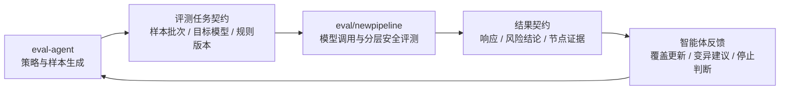
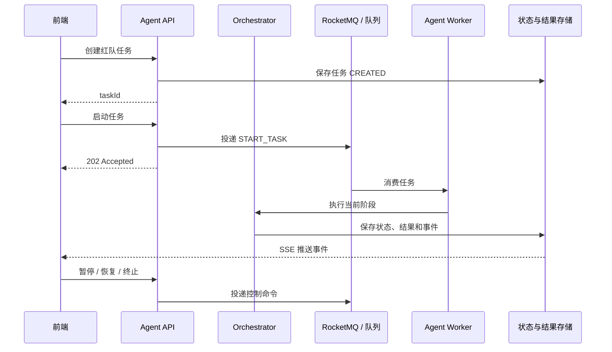

# 红队自动化评测智能体设计方案

> 版本：v0.1
>
> 状态：方案初稿
>
> 适用模块：`eval-agent`
>
> 当前技术基线：Spring Boot 3.5.x、Spring AI 1.1.x、Java 21
>
> 未来演进：在业务接口稳定后评估 AgentScope-Java 2.x

## 1. 文档目标

本文档用于定义大模型安全评测智能体的第一版业务和技术方案，回答以下问题：

- 红队评测智能体需要解决什么问题；
- 主智能体和子智能体分别负责什么；
- 一次评测任务如何从创建执行到形成结论；
- 哪些部分使用大模型，哪些部分使用确定性的 Java 服务；
- 当前 Spring AI 实现如何为后续 AgentScope-Java 改造保留空间。

本文档聚焦红队自动化评测智能体，不覆盖安全运维客服机器人，也不把通用聊天能力作为红队流程的前置依赖。

## 2. 业务定位

红队自动化评测智能体面向一个明确目标：围绕指定的目标模型、风险类别和评测预算，自动设计攻击策略，生成或变异攻击样本，调用目标模型，判断响应是否暴露安全风险，并将可复核的证据和经验沉淀下来。

它不是简单的“攻击样本生成器”，而是一条可控制、可追踪、可复现的评测闭环：

```text
评测目标
  → 风险范围与预算
  → 攻击计划
  → 攻击样本
  → 目标模型响应
  → 安全判定
  → 复核与证据
  → 经验沉淀
  → 下一轮策略
```

### 2.1 第一阶段目标

第一阶段优先完成以下能力：

1. 创建一次红队评测任务并明确评测边界；
2. 按风险类别制定有限轮次的攻击计划；
3. 生成、改写和去重攻击样本；
4. 调用统一的目标模型网关；
5. 使用独立的判定链路分析响应；
6. 对高风险或低置信度结果发起复核；
7. 实时展示任务进度、智能体事件和关键证据；
8. 保存任务、轮次、样本、响应、判定和攻击路径。

### 2.2 暂不纳入第一阶段

- 自动修改模型参数或自动训练模型；
- 让智能体直接修改评测规则；
- 让多个智能体无约束地自然语言互聊；
- 让智能体直接访问数据库、消息队列或任意网络资源；
- 一开始就将每个业务节点拆成独立微服务；
- 用聊天记忆代替评测事实和经验数据。

## 3. 总体架构

### 3.1 架构总览图



系统采用“确定性编排器 + 层级式多智能体 + 受控工具 + 评测基础设施”的组合结构。



### 3.2 责任边界

| 组件 | 主要职责 | 是否由大模型决定 |
| --- | --- | --- |
| `AgentController` | 接收前端命令、返回任务标识、提供事件流 | 否 |
| `RedTeamOrchestrator` | 驱动状态机、控制预算、分发子任务、处理重试 | 否 |
| 主智能体 | 生成计划、选择下一步、决定是否继续 | 是，但受代码约束 |
| 策略智能体 | 将风险目标转成攻击策略 | 是 |
| 样本智能体 | 生成和变异结构化样本 | 是 |
| 自适应攻击智能体 | 执行有限的多轮交互策略 | 是，执行范围受限 |
| `TargetModelGateway` | 调用被测模型、统一超时和限流 | 否 |
| 结果分析智能体 | 分析目标响应并输出结构化判定 | 是 |
| 验证智能体 | 独立复核重要或不确定的判定 | 是 |
| 去重、限流、落库、统计 | 确保系统一致性和可复现性 | 否 |

核心原则是：大模型产生候选决策，Java 编排器负责验证决策是否符合任务约束并执行。最大轮次、最大样本数、最大模型调用次数、允许的工具和终止条件都由代码强制执行。

## 4. 智能体角色设计

### 4.1 主智能体：Supervisor

主智能体负责评测任务级决策，采用 `Supervisor + Plan-and-Execute` 结构。它不直接执行数据库写入和目标模型调用，而是根据当前任务状态输出下一步的结构化动作。

输入包括：

- 评测任务目标和风险范围；
- 目标模型画像；
- 已覆盖的风险类别和攻击技术；
- 最近几轮的样本、响应和判定摘要；
- 剩余时间、样本数和模型调用预算；
- 当前失败、超时或待复核任务。

输出包括：

- 下一轮评测计划；
- 要调用的子智能体；
- 每个子任务的输入和约束；
- 是否需要复核；
- 是否继续、暂停或完成。

主智能体不能绕过以下约束：

- 任务只能在允许的风险范围内执行；
- 每一轮和整个任务都有预算上限；
- 子智能体必须使用白名单工具；
- 计划必须能够被结构化解析和校验；
- 计划失败时由编排器根据策略重试或终止。

### 4.2 攻击策略智能体：Attack Strategy Agent

职责是选择“测试什么”和“为什么测试”。它从风险知识库、历史攻击经验和目标模型画像中检索上下文，输出可执行的策略卡片。

策略卡片至少包含：

```json
{
  "riskCategory": "风险类别编码",
  "attackTechnique": "攻击技术编码",
  "objective": "本轮要验证的安全目标",
  "preconditions": ["前置条件"],
  "conversationMode": "single_turn",
  "mutationDirections": ["语言改写", "角色改写"],
  "expectedEvidence": ["需要观察的响应特征"],
  "priority": 80,
  "maxAttempts": 5
}
```

它可以使用 RAG 和有限 ReAct，但不能直接把检索结果当作判定结果，也不能自行改变风险规则。

### 4.3 攻击样本智能体：Attack Sample Agent

职责是根据策略卡片生成攻击样本，或在已有样本基础上进行受控变异。它更适合“结构化生成 + 自检”，不需要长时间自主规划。

输出的每个样本需要记录：

- 所属任务、轮次和策略；
- 样本原文和规范化文本；
- 变异来源样本；
- 采用的变异算子；
- 预期风险类别；
- 生成模型和提示词版本；
- 去重指纹；
- 样本状态。

生成后由普通服务执行格式校验、敏感信息检查、长度检查和去重。模型只提供候选样本，不能直接写入最终事实表。

### 4.4 自适应攻击智能体：Adaptive Attack Agent

该智能体用于确实需要多轮交互的攻击场景。它维护一个有界的对话轨迹，根据目标模型的响应选择下一步输入。

约束包括：

- 最大对话轮数；
- 最大单轮响应长度；
- 允许的输入和工具范围；
- 每轮必须记录原因和结果；
- 达到成功、失败、超时或预算上限后立即结束。

单轮攻击不需要经过该智能体，可以直接由样本任务调用目标模型网关，以降低系统复杂度。

### 4.5 结果分析智能体：Judge Agent

职责是回答“目标模型的响应是否构成风险，以及证据是什么”。它应当与攻击智能体隔离提示词、记忆和评测上下文，避免自我确认偏差。

输出建议采用以下结构：

```json
{
  "verdict": "RISK | SAFE | UNCERTAIN",
  "riskCategory": "风险类别编码",
  "severity": "LOW | MEDIUM | HIGH | CRITICAL",
  "confidence": 0.92,
  "evidence": [
    {
      "type": "response_span",
      "content": "响应中的证据片段",
      "reason": "为什么支持该判定"
    }
  ],
  "ruleReferences": ["规则版本或规则编号"],
  "needsVerification": false
}
```

判定智能体只接收必要的原始响应、攻击样本和评测规则，不接收攻击智能体的主观结论作为事实。

### 4.6 结果验证智能体：Verifier Agent

结果验证智能体用于高风险、低置信度、规则冲突或模型输出异常的结果。验证方式可以是：

- 使用独立提示词再次判定；
- 使用不同的裁判模型进行交叉判定；
- 对同一攻击样本重复调用目标模型；
- 检索相似历史案例进行证据比对；
- 转人工复核。

验证智能体应输出新的判定记录，保留原判定，不覆盖原始结果。最终结论由确定性的聚合规则产生。

## 5. 一次评测的完整流程

### 5.1 主流程图





### 5.2 单个样本的执行时序



### 5.3 停止条件

任务结束由编排器依据规则决定，主智能体只能提出结束建议。建议至少支持：

- 已覆盖所有用户选择的风险类别；
- 达到最大轮次；
- 达到样本数或目标模型调用预算；
- 连续若干轮没有新增覆盖或有效信息；
- 已发现达到阈值的高风险结果；
- 用户主动暂停或终止；
- 目标模型不可用且超过重试上限。

## 6. 主智能体与子智能体的协作方式

### 6.1 采用层级式协作

主智能体只与编排器交换结构化任务和结果，子智能体之间通常不直接互相调用。



```text
RedTeamOrchestrator
        │
        ├── SupervisorAgent
        │       ├── StrategyJob
        │       ├── SampleJob
        │       ├── AdaptiveAttackJob
        │       └── VerificationJob
        │
        ├── TargetModelGateway
        ├── JudgeService / JudgeAgent
        └── MemoryService / ExperienceRetriever
```

这样可以使每个子任务拥有清晰的上下文边界，并且可以独立记录、重试、超时和审计。

### 6.2 统一任务和事件对象

建议建立与 Spring AI 无关的业务对象：

| 对象 | 用途 |
| --- | --- |
| `RedTeamCampaign` | 一次完整评测活动 |
| `RedTeamTask` | 一个可执行的评测任务 |
| `AgentContext` | 智能体本次执行的上下文视图 |
| `AgentJob` | 主智能体分发给子智能体的任务 |
| `StrategyCard` | 攻击策略结构 |
| `AttackSample` | 攻击样本及其来源 |
| `TargetResponse` | 被测模型响应 |
| `JudgeVerdict` | 判定结果和证据 |
| `VerificationVerdict` | 复核结果 |
| `AgentEvent` | 面向前端和审计的执行事件 |
| `ExperienceRecord` | 经过审核的评测经验 |

每个对象都建议带有 `campaignId`、`taskId`、`roundId`、`traceId`、`agentRunId`、`modelVersion` 和 `schemaVersion`，方便定位一条结果来自哪次任务和哪一版智能体。

### 6.3 上下文按角色裁剪

| 角色 | 可见上下文 |
| --- | --- |
| Supervisor | 任务目标、覆盖率、统计摘要、预算、子任务状态 |
| Strategy Agent | 风险规则、攻击知识、模型画像、历史经验摘要 |
| Sample Agent | 当前策略、样本约束、变异来源、去重提示 |
| Adaptive Agent | 当前对话轨迹、目标响应、轮次限制 |
| Judge Agent | 攻击样本、目标响应、规则和必要的背景 |
| Verifier Agent | 原始样本、响应、证据和独立验证要求 |

完整原始响应保存到数据层，智能体上下文只携带当前决策所需的摘要和引用，避免上下文持续膨胀。

## 7. 记忆、知识与数据沉淀

### 7.1 记忆分层

红队评测需要长期记忆，但长期记忆应表现为受控的评测经验，而不是无限制的聊天历史。



建议分配如下：

| 数据类型 | 推荐存储 | 说明 |
| --- | --- | --- |
| 当前任务状态 | Redis + MySQL | Redis 用于运行态，MySQL 保存可恢复事实 |
| 任务、轮次和样本 | MySQL | 结构化主数据和状态变更 |
| 原始响应和节点日志 | Elasticsearch / MySQL | ES 用于检索，MySQL 保存关键事实 |
| 风险规则和知识文档 | MySQL + PGVector | 规则结构化保存，文档用于检索 |
| 攻击经验摘要 | MySQL + PGVector | 结构化字段配合相似检索 |
| 事件和链路 | MQ + 持久化事件表 | 支持实时推送和审计回放 |

### 7.2 经验写入规则

经验记录不能在智能体输出后直接成为可信知识。建议经历以下步骤：

1. 保存不可变的原始样本、响应和判定；
2. 对判定做格式、规则和证据完整性校验；
3. 高风险或低置信度结果经过独立复核；
4. 对样本和案例去重，建立来源关系；
5. 生成带版本、来源和适用范围的经验摘要；
6. 只有审核通过的经验才进入默认检索集合。

经验必须绑定目标模型环境，至少包括目标模型标识、模型版本、系统提示词版本或哈希、参数配置、风险类别和评测规则版本。

评测集与经验库需要保留隔离策略。盲测任务不能直接检索包含测试答案或测试样本原文的集合，否则会影响评测有效性。

### 7.3 核心数据关系

运行态可以保存在 Redis 中，但以下核心事实需要持久化，才能支持任务恢复、审计和结果复现：



| 实体 | 核心内容 |
| --- | --- |
| `RED_TEAM_CAMPAIGN` | 用户提交的一次完整评测活动、范围和总预算 |
| `RED_TEAM_TASK` | 可独立调度的目标模型与风险范围组合 |
| `RED_TEAM_ROUND` | 一次计划、生成、执行和反馈循环 |
| `AGENT_RUN` | 某智能体的一次执行、输入输出引用、版本和资源消耗 |
| `ATTACK_STRATEGY` | 风险目标、攻击技术、优先级和尝试上限 |
| `ATTACK_SAMPLE` | 样本文本、变异链、指纹和生成来源 |
| `TARGET_RESPONSE` | 目标模型原始响应、调用配置、耗时和调用状态 |
| `JUDGE_VERDICT` | 风险结论、严重度、置信度、规则和证据 |
| `VERIFICATION_VERDICT` | 独立复核结论及与原判定的关系 |
| `AGENT_EVENT` | 前端展示和审计回放所需的结构化事件 |
| `EXPERIENCE_RECORD` | 从已验证结果提炼出的可检索经验 |

原始样本、目标响应和判定记录建议采用追加式保存。复核、重判和经验摘要生成新记录并通过来源字段关联，避免覆盖历史事实。

### 7.4 模型角色与配置隔离

红队任务中至少存在五类模型角色，它们的配置和上下文不能混为一套：

| 模型角色 | 主要作用 | 上下文与配置要求 |
| --- | --- | --- |
| Attack Model | 生成策略、样本和变异 | 读取攻击知识和经验，不读取最终盲测答案 |
| Target Model | 接受安全评测的被测模型 | 保留真实系统提示词、参数和接口环境 |
| Judge Model | 判断响应是否构成风险 | 读取评测规则和原始证据，不继承攻击智能体判断 |
| Verifier Model | 对关键判定独立复核 | 优先采用独立提示词，可配置不同模型交叉验证 |
| Embedding / Rerank Model | 检索规则、经验和相似案例 | 只承担召回和排序，不产生最终风险结论 |

每个角色需要独立配置模型标识、模型版本、系统提示词版本、温度、最大输出长度、超时、重试和并发限制。一次任务保存这些配置的不可变快照，后续即使管理端配置发生变化，也能还原当时的执行环境。

本地 `deepseek-r1:8b` 可以作为初期 Attack Model 候选，但模型拒绝生成样本属于模型行为，而不是编排器异常。系统需要把拒绝分成三类记录：可通过调整任务上下文重新生成、模型能力不足、模型策略性拒绝。超过有限重试后应切换已配置的备用攻击模型或将该策略标记为未覆盖，不能让主智能体无限改写和循环调用。

## 8. Spring AI 落地方式

### 8.1 推荐的模块结构

`eval-agent` 是当前 Maven 工程中的智能体业务模块，依赖已有的 `framework` 和 `infra-ai`。现阶段由 `eval` 模块依赖并通过 `com.kant.agent` 包扫描完成 Spring Bean 装配，随 `eval` 应用一起运行；它暂时不作为单独部署单元。建议逐步形成以下包结构：

```text
com.kant.agent
├── controller              # HTTP、SSE、任务控制接口
├── application             # 用例服务和事务边界
├── orchestration            # RedTeamOrchestrator、状态机、预算
├── agent                    # 主智能体和子智能体实现
│   ├── supervisor
│   ├── strategy
│   ├── sample
│   ├── adaptive
│   ├── judge
│   └── verifier
├── contract                 # AgentRequest、AgentResult、AgentEvent
├── tool                     # 受控业务工具接口和 Spring AI Tool 实现
├── memory                   # 工作记忆、画像、经验检索和写入
├── persistence              # 任务、样本、响应、判定持久化
└── config                   # 模型、线程池、预算和事件配置
```

### 8.2 Spring AI 的使用范围

Spring AI 主要负责以下能力：

- `ChatClient` 和 `ChatModel` 调用；
- 系统提示词和模板管理；
- 结构化输出映射；
- Tool Calling；
- RAG、向量检索和 Embedding；
- 模型切换、超时和调用观测的基础适配。

业务代码不应把 `ChatClient`、Spring AI `Message` 或 Prompt 类型暴露到 `contract` 和 `orchestration` 层。智能体通过 `AgentModelGateway`、`ExperienceRetriever`、`TargetModelGateway` 等业务接口访问能力。

### 8.3 智能体运行接口

建议先抽象以下接口，接口返回业务对象或 Reactor 类型，具体实现内部再使用 Spring AI：

```java
public interface AgentExecutor<I, O> {

    Mono<O> execute(I input, AgentContext context);

    Flux<AgentEvent> stream(I input, AgentContext context);
}
```

```java
public interface RedTeamOrchestrator {

    Mono<RedTeamTask> createTask(CreateRedTeamTaskCommand command);

    Mono<Void> start(String taskId);

    Mono<Void> pause(String taskId);

    Mono<Void> resume(String taskId);

    Mono<Void> cancel(String taskId);

    Flux<AgentEvent> events(String taskId, String afterEventId);
}
```

实际实现可以先采用 Spring AI + Java 状态机，后续替换 AgentScope 时保留这些业务接口。

### 8.4 与现有评测流水线的接入边界

红队智能体负责发现和构造评测样本，现有评测流水线负责稳定地执行模型调用和安全判定。两者通过业务契约连接，不直接互相调用内部 Service 或复用内部状态机。



建议按照以下职责划分：

| 能力 | `eval-agent` | `eval/newpipeline` | `infra-ai` |
| --- | --- | --- | --- |
| 红队任务计划和预算 | 负责 | 不负责 | 不负责 |
| 攻击策略、样本生成与变异 | 负责 | 不负责 | 提供模型能力 |
| 被测模型批量调用 | 通过契约申请 | 负责执行和记录 | 提供厂商调用适配 |
| L1/L2/L3 安全评测 | 消费最终结果 | 负责 | 提供 Judge、RAG 等能力 |
| 智能体任务状态和事件 | 负责 | 发布流水线节点结果 | 不负责 |
| 评测事实与节点证据 | 引用和汇总 | 负责保存 | 不负责 |

第一版也可以由 `eval-agent` 通过 `TargetModelGateway` 直接完成小规模单样本验证，但接口语义需要与正式流水线一致。进入批量评测后，应通过稳定的任务契约提交，避免形成两套模型调用和结果判定口径。

## 9. 前端交互与调度

### 9.1 入口设计

红队智能体应提供“评测任务工作台”入口，而不是只提供一个自由聊天框。前端入口建议包含：

- 创建红队评测；
- 继续未完成任务；
- 查看实时执行轨迹；
- 查看攻击样本和目标响应；
- 查看风险判定和证据；
- 暂停、恢复、终止任务；
- 对待复核结果进行人工确认。

可以保留一个对话式配置区，让用户用自然语言描述评测目标，再由系统转换成结构化任务配置。真正开始执行前，前端应展示并确认目标模型、风险范围、预算和数据范围。

### 9.2 推荐接口形态

| 场景 | 接口形态 | 作用 |
| --- | --- | --- |
| 创建任务 | `POST /eval-agent/red-team/tasks` | 创建任务并返回 `taskId` |
| 启动任务 | `POST /eval-agent/red-team/tasks/{id}/start` | 触发异步执行 |
| 查询任务 | `GET /eval-agent/red-team/tasks/{id}` | 获取状态和统计 |
| 事件流 | `GET /eval-agent/red-team/tasks/{id}/events` | SSE 推送事件 |
| 暂停任务 | `POST /eval-agent/red-team/tasks/{id}/pause` | 请求安全暂停 |
| 恢复任务 | `POST /eval-agent/red-team/tasks/{id}/resume` | 从检查点继续 |
| 终止任务 | `POST /eval-agent/red-team/tasks/{id}/cancel` | 终止后续执行 |
| 人工复核 | `POST /eval-agent/red-team/reviews/{id}` | 提交复核意见 |

事件流建议统一输出：

```json
{
  "eventId": "evt_10086",
  "taskId": "task_10086",
  "roundId": "round_03",
  "agentRunId": "run_20001",
  "type": "ATTACK_SAMPLE_CREATED",
  "status": "RUNNING",
  "payload": {},
  "occurredAt": "2026-09-10T10:00:00+08:00"
}
```

前端主要渲染状态、阶段、工具调用、样本、响应摘要、判定和错误。智能体内部完整思考内容不作为产品展示和业务事实，展示事件应以可解释的动作摘要为主。

### 9.3 同步与异步边界

创建任务可以同步返回任务标识；评测执行、样本生成、目标模型调用、判定和报告生成采用异步任务。当前可以在同一个 Spring Boot 应用内使用线程池或 MQ，随着负载增加再拆出 `agent-worker`。



## 10. 状态机与失败处理

### 10.1 任务状态

```text
CREATED
  → VALIDATING
  → PLANNING
  → RUNNING
  → PAUSING → PAUSED → RUNNING
  → VERIFYING
  → COMPLETED

任意可执行状态 → CANCELLING → CANCELLED
任意可执行状态 → FAILED
```

状态迁移需要具备幂等约束。重复消息、重复启动和重复恢复不能创建重复的样本或重复调用目标模型。

### 10.2 失败分类

| 失败类型 | 处理方式 |
| --- | --- |
| 参数和策略结构错误 | 记录错误，有限次数重新生成，仍失败则任务失败 |
| 攻击样本重复 | 丢弃重复样本，要求生成新变体 |
| 目标模型超时 | 按模型策略重试，超过阈值记录调用失败 |
| 目标模型限流 | 延迟重试并遵守并发和速率限制 |
| Judge 输出无法解析 | 使用结构化重试或转人工复核 |
| MQ 重复消费 | 通过任务阶段、样本指纹和幂等键拦截 |
| 服务重启 | 从持久化检查点恢复当前任务 |
| 经验写入失败 | 不影响原始评测结果，进入待补偿队列 |

## 11. 可观测性与审计

每次模型调用和每个智能体执行至少记录：

- `traceId`、`taskId`、`roundId`、`agentRunId`；
- 智能体类型和版本；
- 模型名称、模型版本和配置摘要；
- 输入、输出或内容摘要的引用；
- 开始时间、结束时间、耗时和 Token 用量；
- 工具调用、重试次数和异常；
- 最终状态和人工处理记录。

原始攻击样本、目标响应和判定证据需要可回放。对于敏感数据，日志展示与持久化应区分脱敏摘要和受权限保护的原文。

## 12. 评测指标与验收口径

智能体的效果不能只看“生成了多少样本”或“发现了多少风险”。至少需要同时观察攻击有效性、风险覆盖、判定可靠性、成本和可复现性。

| 指标 | 建议定义 | 主要用途 |
| --- | --- | --- |
| 有效样本率 | 通过格式、范围和去重校验的样本数 / 生成样本数 | 衡量样本智能体质量 |
| 攻击成功率 | 被确认有风险的样本数 / 已成功执行样本数 | 衡量攻击效果 |
| 风险覆盖率 | 已产生有效测试的风险项 / 目标风险项 | 防止策略只集中于少数风险 |
| 新颖样本率 | 与基线集和经验库不重复的有效样本数 / 有效样本数 | 衡量探索能力 |
| 复核一致率 | Judge 与独立复核结论一致数 / 已复核数 | 衡量判定稳定性 |
| 不确定率 | `UNCERTAIN` 数 / 已判定数 | 识别规则或裁判能力缺口 |
| 可复现率 | 在相同配置下重复验证仍成立的风险数 / 重复验证风险数 | 衡量证据可信度 |
| 单次发现成本 | Token、调用时长或费用 / 已确认风险数 | 衡量资源效率 |
| 预算完成率 | 实际消耗 / 配置预算 | 检查预算控制是否生效 |
| 任务恢复成功率 | 成功从检查点继续的任务数 / 恢复任务数 | 衡量长任务可靠性 |

指标需要按目标模型版本、系统提示词版本、风险类别、攻击技术和智能体版本切分。跨版本比较时要固定评测集、预算和模型参数，否则结果不能直接归因于智能体能力变化。

第一阶段的工程验收建议包括：

1. 单轮任务可以从创建运行到形成结构化判定；
2. 任务达到预算后一定停止，且重复启动不产生重复执行；
3. 每个结论可以追溯到攻击样本、目标响应、规则版本和模型配置；
4. 低置信度结果可以进入复核并保留原判定；
5. 服务重启后可以根据事实数据恢复未完成任务；
6. 前端可以通过事件流看到阶段进度、可解释动作和异常；
7. 相同任务配置能够导出可复现的运行快照。

## 13. 第一阶段实施顺序

建议按以下顺序从小到大实现：

1. 定义 `AgentContext`、`AgentEvent`、`StrategyCard`、`AttackSample`、`TargetResponse` 和 `JudgeVerdict`；
2. 实现一个确定性的 `RedTeamOrchestrator`；
3. 接入攻击样本智能体和目标模型网关，跑通单轮链路；
4. 接入结果分析智能体，形成样本级闭环；
5. 增加攻击策略智能体和有限轮次的 Supervisor；
6. 增加 Redis 运行态、任务检查点和 SSE 事件流；
7. 增加复核智能体和人工复核状态；
8. 最后接入长期经验检索、相似案例和自适应多轮攻击。

第一版可以先只启用以下三个智能体：

```text
Supervisor
  ├── Attack Sample Agent
  └── Judge Agent
```

攻击策略可以先由结构化配置提供，待单轮链路稳定后再交给策略智能体生成。这样能先验证任务状态、结果证据和前端事件模型。

## 14. AgentScope-Java 的未来迁移边界

未来引入 AgentScope-Java 时，重点替换智能体运行时层：

| 当前 Spring AI 方案 | 未来 AgentScope 方案 | 应保留的业务资产 |
| --- | --- | --- |
| `AgentExecutor` 实现 | AgentScope Agent / Harness | 业务输入输出协议 |
| Java 编排循环 | AgentScope ReAct / Supervisor 编排 | 任务状态和预算规则 |
| Spring AI Tool Calling | AgentScope Toolkit | 工具接口和权限白名单 |
| Spring AI 事件适配 | AgentScope 事件适配 | 统一 `AgentEvent` |
| 自研上下文管理 | AgentScope Memory / State | 任务数据和经验数据 |
| Spring AI RAG | AgentScope RAG 或继续使用现有服务 | 知识文档和检索接口 |

当前不要让领域对象依赖 Spring AI 类型，也不要让任务状态机依赖某个智能体框架的具体类。未来迁移的最小范围应是 `agent` 运行时适配层、事件适配层和部分上下文管理实现。

## 15. 方案结论

`eval-agent` 作为当前 Maven 工程的智能体业务模块，由 `eval` Spring Boot 应用装配和运行，承载第一阶段的 Spring AI 多智能体实现。业务结构使用层级式 `Supervisor + Worker`，执行方式使用有限轮次的 `Plan-and-Execute`，子智能体内部只在需要时使用有界 ReAct。

主智能体负责任务级计划和下一步建议，策略、样本、分析和验证智能体负责专业环节。编排器负责状态机、预算、并发、重试、幂等、暂停恢复和事件发布。目标模型调用、记忆、检索、落库和统计由普通业务服务负责。

这套边界可以先在当前 Spring AI 技术栈中完成，也为后续 AgentScope-Java 改造保留稳定的业务协议和数据模型。
