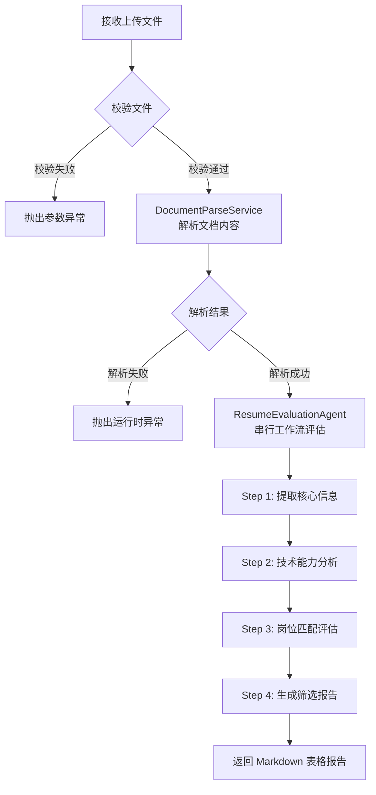

# 简历智能评估接口文档

## 概述

该接口用于解析上传的简历文件（PDF/Word 格式），并通过 AI Agent 工作流自动生成 HR 筛选报告。

---

## 接口信息

| 项目 | 说明 |
|:--|:--|
| Controller | `com.kant.springai.agent.controller.ResumeEvaluationController` |
| 请求方式 | `POST` |
| 请求路径 | `/agent/resumeEvaluation` |
| Content-Type | `multipart/form-data` |
| 所属模块 | spring-ai-agent |

---

## 请求参数

| 参数名 | 类型 | 必填 | 说明 |
|:--|:--|:--|:--|
| file | MultipartFile | 是 | 简历附件，支持 **PDF**、**DOC**、**DOCX** 格式 |

---

## 响应说明

### 成功响应

- **类型**: `String`
- **格式**: Markdown 表格
- **内容**: HR 筛选报告

#### 响应示例

```markdown
| 项目 | 结果 |
|:--|:--|
| 候选人 | 张三 |
| 年龄 | 28 |
| 学历 | 本科 |
| 工作年限 | 5年 |
| 在职情况 | 离职中（已离职 2 个月） |
| 技术能力 | Java 基础扎实，熟悉 Spring Cloud、MySQL、Redis，具备高并发经验 |
| 项目质量 | 参与过日均百万级用户的电商系统，有分布式架构设计经验 |
| 匹配等级 | 高 |
| 风险点 | AI 相关经验较少 |
| 是否推荐面试 | 是 |
| 筛选结论 | 候选人技术栈匹配度高，项目经验丰富，建议进入下一轮面试 |
```

### 失败响应

| 场景 | HTTP 状态码 | 错误信息 |
|:--|:--|:--|
| 未上传文件 | 400 | `请上传文档` |
| 文件为空 | 400 | `请上传文档` |
| 文件名为空 | 400 | `文件名不能为空` |
| 不支持的文件格式 | 400 | `仅支持 PDF、Word 文档` |
| 文档无有效内容 | 400 | `文档没有识别到有效文字内容` |
| 读取文档失败 | 500 | `读取文档失败` |

---

## 处理流程



---

## AI Agent 工作流说明

### 工作流模式

`Prompt Chaining`（串行工作流）—— 当前步骤的输出作为下一步的输入，依次执行四个步骤。

### 工作流步骤

| 步骤 | 任务 | 输入 | 输出 |
|:--|:--|:--|:--|
| Step 1 | 提取核心信息 | 简历原文 | 年龄、学历、工作年限、技术栈、项目经验、当前岗位、目标岗位 |
| Step 2 | 技术能力分析 | Step 1 结果 | 技术深度、技术广度、项目复杂度、高并发/分布式经验、AI 落地能力、简历包装分析 |
| Step 3 | 岗位匹配评估 | Step 2 结果 | 匹配等级（高/中/低）、匹配分析、是否推荐面试、推荐原因 |
| Step 4 | 生成筛选报告 | 前三步综合结果 | Markdown 格式的 HR 筛选报告表格 |

### 默认目标岗位

当简历中未指定目标岗位时，默认按 **Java 后端开发工程师** 进行匹配评估。

---

## cURL 调用示例

```bash
curl -X POST "http://localhost:8080/agent/resumeEvaluation" \
  -F "file=@/path/to/resume.pdf"
```

---

## 依赖组件

| 组件 | 说明 |
|:--|:--|
| `ResumeEvaluationAgent` | AI Agent，封装串行工作流评估逻辑 |
| `DocumentParseService` | 文档解析服务，支持 PDF / DOC / DOCX 格式 |
| `SparkChatClient` | 大模型客户端（讯飞星火），用于执行 AI 推理 |